# 《revenge-memories》完整游戏流程

四份主文档：[完整游戏设定](完整游戏设定.md) · [完整故事剧情](完整故事剧情.md) · [完整游戏流程](完整游戏流程.md) · [完整台词汇总](完整台词汇总.md)。

版本：新流程设计稿 1.2；日期：2026-10-16。配套[《完整故事剧情》](完整故事剧情.md)与[《泉水与濒死救治设定》](泉水与濒死救治设定.md)。本次统一濒死留队、禁出阵、全程四次救治与保留经验，更新相关剧情、结局和文档用索引；原有少年年龄、命名、神话线索与章节数量保留。大地图仍为56×64格地理重绘审阅稿。

本文把已确认的新故事落实为可制作的节点、道路、地图、据点与对白事件。包含39个世界节点、31场主线战斗、9场支线战斗和40张逐格布局蓝图。本稿是完整新战役设计；actual已实现序章与前两章，后续章节及本次濒死救治规则尚未接入。本次仅更新文档与文档用索引，未改代码、场景、运行数据、应用或原素材。

## 一、沿用设定与需要新做的部分

| 内容 | 本方案处理 | 接入状态 |
|---|---|---|
| 回合、移动、地形费用、射程、反击追击、法术HP支付 | 沿用docs/完整游戏设定和现行规则 | 现有底层可复用；新地图仍需验证 |
| 职业、个人成长、装备携带、恢复与召唤 | 使用现有职业和技能；剧情名与角色身份重建 | 不新增MP，不因台词获得额外攻击 |
| 正式成员伤情与泉水救治 | HP归零按濒死留队、不可出阵；全程四次，每人最多一次，保留经验与原队归属 | 文档已确认；当前运行版本尚未接入 |
| 大地图节点与道路 | 全新39节点、章节门槛、两队位置和来向 | 待重新配置 |
| 战术地图 | 40张重新拼接的地图，部署、目标、敌军与触发另做 | 静态蓝图已交付，未导入Godot |
| 据点、招募、对白、章节转换 | 新房间交互与事件；全部原剧情旗标隔离 | 待实现 |
| 护送、占领、守井、设备交互 | 明确新目标和失败条件 | 需要新目标判定；不是当前游戏已有功能声明 |
| 太阳神终战 | 普通物理和法术可伤害，不依赖旧专属终结手段 | 原多玛终结限制须在新战役中移除 |
| 存档 | 独立战役标识、命名空间和存档文件 | 不将现有外传存档自动迁入新故事 |

不把80张原地图按旧顺序改名。源地图编号仅说明可借用的图块和构图参考，不继承道路、敌人、原部署或剧情。主线初步时长目标12—16小时，属于设计目标，尚未自然实玩校准。

## 二、时间、章节与队伍

| 阶段 | 可操作路线 | 切换／收束规则 |
|---|---|---|
| 序章P00 | 第三章广场片段，无战斗收益 | 自动进入第一章；序章不写未来队伍成长 |
| 第一章 | 西队，M11—M15；S11/S12可选 | M15结算、救劳工、举行日返、确认章节结束后保存西队 |
| 第二章 | 东队，F21—F26；S21/S22可选 | 新建东队；西队保持第一章真实成长、濒死状态与救治经历 |
| 第三章 | M31—M33、F31—F33 | 开场D31接回P00；脱围后自由切队；两边完成后D33会谈 |
| 第四章 | M41—M44、F41—F44 | M43可先夺塔再切东队；F42传步骤；两边安全节点齐备后收束 |
| 第五章 | M51/M52、F51/F52，然后J53/J54 | 两入口齐备，玩家完成双方整备，按完整在队名册合军，部署只选择非濒死成员 |

同一时段的第一、二章分别完整讲一路；第二章回到半年前有明确字幕与地图起点，不将男主经验回滚或复制给女主。序章与第三章的庆典是同一个事件，庆典骚乱不重复结算。

**战斗数量口径：**序章不计战斗；第一章5主线＋2支线，第二章6＋2，第三章两队各3场主线＋2支线，第四章两队各4场主线＋2支线，第五章两队各2场、合军2场主线＋1支线。合计31场必经主线、9场可选支线，共40张独立战术地图。重试、增援、据点谈话与返程均不另算一场。

故事文档的4.1包含M11，4.2包含M12/M13，4.3包含M14/M15。三个叙事分节合计五场主线，每场独立部署与结算，另有S11、S12两场可选战斗。

主角年龄按周岁与同一时间轴保存：第一、二章起行时胡纳普17岁、艾琳16岁；序章／第三章仍为17岁、16岁；第五章18岁、17岁。十年前失散时为7岁、6岁。第一、二章共用约半年，第三至五章约四个月，两人的生日落在后四个月；不累计为两个半年，也不按玩家刷图或停留时间增长。成人职业与长期建设采用明确标注“数年后”的后日谈，不改变终战时年龄。

### 2.1 新阵容与出战容量

西队九人：胡纳普、达恩、奥托、芙拉、蕾娜、兰斯、贝克、赫维、格曼。东队九人：艾琳、米蕾、莉莎、卡洛、洛德、罗恩、希雅、诺娅、赛琳。按实际招募进入正式名册；濒死成员仍在原队，可查看状态但不可出阵。未招募者不自动补入。

起始西队胡纳普、达恩、奥托；起始东队艾琳、米蕾、莉莎、卡洛。M12可得芙拉，M13可得蕾娜，M14兰斯正式加入；F22可得洛德，F23可得罗恩，F24可得希雅。支线与投降角色仍需战后交谈，不自动补入。除两位主角濒死立即导致本场失败外，已入队同伴HP归零进入濒死并继续在队，主线见证有伤情与缺席分支；招募前死亡的NPC另按真实生死处理。

每张单队图提供8—10个部署槽，按实际在队且非濒死成员填入；濒死者不占部署槽，但计入队伍总人数。J53/J54按两队完整名册合军，各最多10人、合计不超过20个正式出战者，仅非濒死者可选；本稿全招募合计18人。友军、幻影与召唤占各自阵营容量，不能以本稿“组锚点”突破引擎20槽上限。

## 三、新剧情大地图

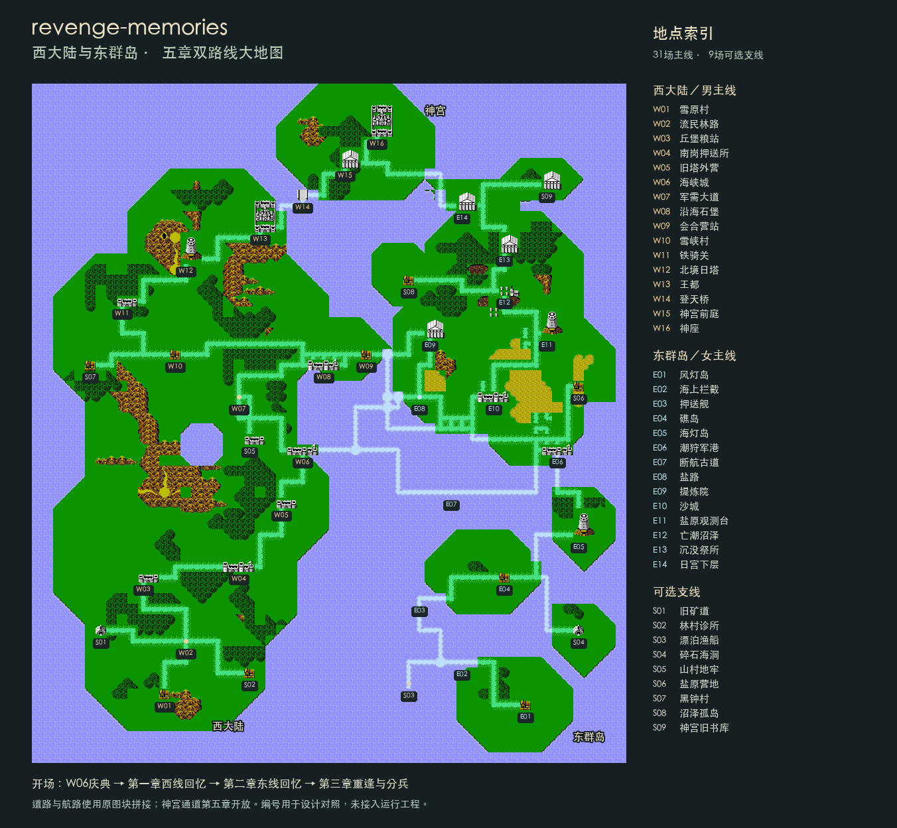

交付同时含可编辑的[SVG大地图](新剧情大地图.svg)、无标注的[图块底图](大地图地形底图.png)与[布局索引](规划索引.json)。神宫为第五章专用展开区，连接线表达通道关系，不表示普通海上距离。

**当前美术状态：地理重绘审阅稿，尚未接入游戏。**本轮收紧为56×64格，重排海岸、山系、内陆湖、港湾与岛链，复用33组原图地形组合与32处建筑组合，使用转折道路与航路，地点全名移至侧边索引。世界坐标已同步本文与布局索引；每关战术格坐标保持原方案。雪地、神宫背景与最终敌人专用形象仍待制作。原有静态路径、资源尺寸、标签间距检查不能代替运行与成品美术验收。

成品大地图以工程内《外传》原地图为直接对照，达到同等级的地块完整度、信息密度与地点辨识度。制作顺序为地理构图、地块拼接、道路与地点、剧情通行检查、标注排布；不要求沿用当前112×76格的大画布。验收至少覆盖以下五项：

1. 山系、林地与海岸使用完整的邻接组合；没有孤立碎块、断开的山体与机械铺满的矩形树林。
2. 西大陆的山谷、关口、粮站与城堡控制实际通路；东群岛有海峡、避风港、礁区与分散岛链，航路顺应这些地理条件。
3. 沙漠、盐原、沼泽具有不规则边界与地区过渡，地形能解释水井、聚落和绕行的必要性。
4. 村庄、港口、军堡、神殿、日塔有可区分的完整建筑模块；雪原和神宫缺失的专用美术另行制作，交付图明确状态。
5. 隐去名称与编号后仍能辨认主要地区、道路和重要地点；按原生像素及实际展示尺寸对照检查。完成地理重绘后再同步关卡布局与对白中的方位关系。

道路衔接使用[派生图块条](大地图道路衔接图块.png)，由原worldtiles第49号道路图块旋转、组合而成，共15格、每格16×16像素；原始山体、树林与建筑保持原朝向。规划索引中256—270是文档派生编号，接入时须扩展图集并映射，不能作为现有运行图集编号直接读取。海路沿用原176—182号图块。此资源只保存在docs2，未改游戏素材或代码。

### 3.1 世界节点：编号与坐标

底图56×64个16像素图块。坐标从左上角(0,0)起，x向右、y向下；图像外加标题与图例，不计入世界坐标。W表示西线/公共/神宫节点，E表示东线节点，S表示支线节点。战场编号和世界节点编号独立，同一王都或祭所可有不同战场。

| 世界ID | 地点 | 图块坐标 | 类型 | 开放章／所含战场 |
|---|---|---|---|---|
| W01 | 雪原村 | (12,57) | 据点 | 1；据点／事件 |
| W02 | 流民林路 | (14,52) | 战场 | 1；M11 |
| W03 | 丘堡粮站 | (10,46) | 战场／据点 | 1；M12 |
| W04 | 南岗押送所 | (19,45) | 战场／据点 | 1；M13 |
| W05 | 旧塔外营 | (23,39) | 战场 | 1；M14 |
| W06 | 海峡城 | (25,34) | 战场／港口／庆典 | 1—3；M15、M31、F31 |
| W07 | 军需大道 | (19,29) | 战场 | 3；M32 |
| W08 | 沿海石堡 | (27,26) | 战场 | 3；M33 |
| W09 | 会合营站 | (31,25) | 据点／通信 | 3—4；据点／事件 |
| W10 | 雪峡村 | (13,25) | 战场／据点 | 4；M41 |
| W11 | 铁骑关 | (8,20) | 战场 | 4；M42 |
| W12 | 北境日塔 | (14,16) | 战场／控制室 | 4；M43 |
| W13 | 王都 | (21,13) | 城门／内廷 | 4—5；M44、M51 |
| W14 | 登天桥 | (25,10) | 专用通道 | 5；M52 |
| W15 | 神宫前庭 | (29,7) | 合军战场 | 5；J53 |
| W16 | 神座 | (32,4) | 最终战场 | 5；J54 |
| E01 | 风灯岛 | (46,58) | 据点 | 2；据点／事件 |
| E02 | 海上拦截 | (40,54) | 海战 | 2；F21 |
| E03 | 押送舰 | (36,48) | 船战 | 2；F22 |
| E04 | 礁岛 | (44,46) | 战场／据点 | 2；F23 |
| E05 | 海灯岛 | (51,42) | 战场／据点 | 2；F24 |
| E06 | 潮狩军港 | (49,34) | 战场／牢房 | 2；F25 |
| E07 | 断航古道 | (39,38) | 海战通道 | 2；F26 |
| E08 | 盐路 | (36,29) | 战场 | 3；F32 |
| E09 | 提炼院 | (37,23) | 战场 | 3；F33 |
| E10 | 沙城 | (43,29) | 战场／据点 | 4；F41 |
| E11 | 盐原观测台 | (48,23) | 战场／观测室 | 4；F42 |
| E12 | 亡潮沼泽 | (44,19) | 战场 | 4；F43 |
| E13 | 沉没祭所 | (44,15) | 战场／地脉室 | 4—5；F44、F51 |
| E14 | 日宫下层 | (40,11) | 专用通道 | 5；F52 |
| S01 | 旧矿道 | (6,51) | 支线迷宫 | 1；S11 |
| S02 | 林村诊所 | (20,55) | 支线据点 | 1；S12 |
| S03 | 漂泊渔船 | (35,56) | 支线船战 | 2；S21 |
| S04 | 碎石海洞 | (51,51) | 支线迷宫 | 2；S22 |
| S05 | 山村地牢 | (20,33) | 支线救援 | 3；S31 |
| S06 | 盐原营地 | (51,28) | 支线救援 | 3；S32 |
| S07 | 黑钟村 | (5,26) | 支线战场 | 4；S41 |
| S08 | 沼泽孤岛 | (35,18) | 支线救援 | 4；S42 |
| S09 | 神宫旧书库 | (48,9) | 支线迷宫 | 5；S51 |

### 3.2 道路与门槛

| 起点—终点 | 道路 | 开放条件 |
|---|---|---|
| W01—W02 | 陆路 | 第一章前关结算与据点确认 |
| W02—W03 | 陆路 | 第一章前关结算与据点确认 |
| W03—W04 | 陆路 | 第一章前关结算与据点确认 |
| W04—W05 | 陆路 | 第一章前关结算与据点确认 |
| W05—W06 | 陆路 | 第一章前关结算与据点确认 |
| E01—E02 | 海路 | 第二章前关结算与船团确认 |
| E02—E03 | 海路 | 第二章前关结算与船团确认 |
| E03—E04 | 海路 | 第二章前关结算与船团确认 |
| E04—E05 | 海路 | 第二章前关结算与船团确认 |
| E05—E06 | 海路 | 第二章前关结算与船团确认 |
| E06—E07 | 海路 | 第二章前关结算与船团确认 |
| E07—W06 | 古航路 | F26完成；不可提前交换两队物品 |
| W06—W07 | 陆路 | 第三章西线前关完成 |
| W07—W08 | 陆路 | 第三章西线前关完成 |
| W06—E08 | 海路／盐路 | 第三章东线前关完成 |
| E08—E09 | 海路／盐路 | 第三章东线前关完成 |
| W08—W09 | 短渡 | M33与F33均完成；共同会谈只触发一次 |
| E09—W09 | 短渡 | M33与F33均完成；共同会谈只触发一次 |
| W09—W10 | 短渡／陆路 | 第四章西线前关完成；W12安全停用另需F42 |
| W10—W11 | 陆路 | 第四章西线前关完成；W12安全停用另需F42 |
| W11—W12 | 陆路 | 第四章西线前关完成；W12安全停用另需F42 |
| W12—W13 | 陆路 | 第四章西线前关完成；W12安全停用另需F42 |
| W09—E10 | 海路／古道 | 第四章东线前关完成；祭所难度受M42影响 |
| E10—E11 | 海路／古道 | 第四章东线前关完成；祭所难度受M42影响 |
| E11—E12 | 海路／古道 | 第四章东线前关完成；祭所难度受M42影响 |
| E12—E13 | 海路／古道 | 第四章东线前关完成；祭所难度受M42影响 |
| W13—W14 | 登天通道 | M51完成；第四章双方收束完成 |
| W14—W15 | 神宫通道 | M52与F52均完成，双方整备确认 |
| E13—E14 | 祭所神术通道 | F51完成；第四章双方收束完成 |
| E14—W15 | 神宫通道 | M52与F52均完成，双方整备确认 |
| W15—W16 | 神宫通道 | J53完成；在前庭可返回整备 |
| W02—S01 | 支路 | 收到据点邀请后开放；出发前说明收束时机 |
| W02—S02 | 支路 | 收到据点邀请后开放；出发前说明收束时机 |
| E02—S03 | 支路 | 收到据点邀请后开放；出发前说明收束时机 |
| E04—S04 | 支路 | 收到据点邀请后开放；出发前说明收束时机 |
| W07—S05 | 支路 | 收到据点邀请后开放；出发前说明收束时机 |
| E08—S06 | 支路 | 收到据点邀请后开放；出发前说明收束时机 |
| W10—S07 | 支路 | 收到据点邀请后开放；出发前说明收束时机 |
| E12—S08 | 支路 | 收到据点邀请后开放；出发前说明收束时机 |
| E14—S09 | 支路 | 收到据点邀请后开放；出发前说明收束时机 |

道路双向开放后允许返程，当前战斗、据点来向和所属队伍分别保存。已完成战场不因返程重复发经验与战利品；需要世界敌軍重访时创建独立军队身份，不把主线首领复制出来。第一、二章不额外生成随机封路军，避免回忆推进被随机事件拖长。

### 3.3 主线道路总表

第1章西线：M11 流民林路 → M12 丘堡粮站 → M13 南岗押送所 → M14 旧塔外营 → M15 海峡旧塔堡。

第2章东线：F21 海上拦截 → F22 押送舰救援 → F23 礁岛登岸 → F24 海灯岛防卫 → F25 潮狩军港 → F26 断航古道。

第3章西线：M31 西街撤离 → M32 军需大道截运 → M33 沿海石堡。

第3章东线：F31 码头脱围 → F32 盐路解围 → F33 提炼院后庭。

第4章西线：M41 雪峡撤离战 → M42 铁骑封锁线 → M43 北境日塔 → M44 王都城门。

第4章东线：F41 沙城守井战 → F42 盐原观测台 → F43 亡潮沼泽 → F44 沉没祭所。

第5章西线：M51 王都内廷 → M52 登天桥。

第5章东线：F51 祭所底层 → F52 日宫下层。

第5章合线：J53 神宫前庭 → J54 太阳神乌库布·卡基。

第三章M33/F33先后顺序自由，只有双方完成才开放W09会谈。第四章M43先打不会卡档：夺塔结算后可返回控制室、切东队取得F42步骤，再完成停用，不重打守军。F44不硬等M42：战前提示援军差异，提前挑战者可照常取胜；M42后来完成保护后续船队，不使已完成F44重新开战。

## 四、素材复用与小地图重构规范

| 图集／材料 | 当前实测规格 | 本稿用途 | 限制与重构方式 |
|---|---|---|---|
| assets/original/graphics/maps/worldtiles.png | 256×256；16×16图块 | 新大地图陆地、海、岸、山、林与地点标记 | 重绘地理排布，保留图块比例；不拉伸整张旧地图 |
| assets/original/graphics/maps/tileset.png | 256×256；16×16图块 | 40张战场地形与室内边墙 | 地形按整数tile ID查现行类别；不拿角色图块当地形 |
| assets/original/graphics/maps/buildings.png | 256×256；16×16图块 | 十二类新据点房间 | 门、台阶、分割线与角块整组拼接 |
| assets/original/graphics/panel.png | 24×24；固定8像素九宫格边 | 日后对话与操作面板 | 原生内容至少10像素内边距，检查中文实际字形 |
| map_units、village_sprites、portraits与战斗动画 | 现有角色与职业图集 | 制作占位与动作复用 | 映射只作制作索引，不沿用原人物身份；新角色最终辨识美术另做 |

布局蓝图实际使用的战场tile ID：48平地、172森林、94不可步行岩壁、242沙地、96海面、196墙、208石地板、191木甲板、66毒沼、218恢复格。类别分别为0、1、5、2、7、12、8、6、16、15。石地板沿用类别8的20物理回避，不把它误当无回避平地；恢复格以现行tile218规则处理，毒沼以类别16规则处理。目标标记T本身不额外赋予恢复效果。布局校验按现有士兵移动表验证至少一条地面路线，不把海面或墙默认为平地。

雪峡为地理／季节名称，现有图集没有完整雪地；本稿用山地图块表达通路并明确列后续雪地需求。神宫用现有石阶、地板、柱与神殿图块拼专用固定比例场景；云上背景、乌库布·卡基独立形象与神骑标识是后续美术制作需求。本轮未伪装成已完成美术接入。

所有图块按原比例、最近邻整数放大。边墙先成闭合结构，再开明确门洞；相邻通路应有完整连续地板。布局图里的E/A/R等标记是评审标注，不是运行时文字；以后运行界面使用完整面板、柔和选中反馈，避免黄色矩形选中。

### 4.1 布局图读法

每格16原生像素，图中放大2倍。P为部署区，E1—E4为敌群锚点，B为首领，A1/A2为友军或事件锚点，T为操作目标，G为撤离/出口，R为预告增援口。敌群锚点不等于每个敌人都叠在同一格；接入时围绕锚点安排不同空格，不占部署、目标和出口。图像坐标刻度在地形外；文档坐标均为实际格坐标。

战场图围绕局部作战视角绘制，门名采用地区地理称呼，位置以本图格坐标及T/G/R标记为准；不能把大地图航程直接当成战术格距离。E/B使用现成队组符号表示位置，实际职业、魔物与太阳神形象按制作卡配置。

原图标24×24会覆盖相邻格的少量空域，其地面锚点仍在指定16×16格。文本不贴地图边框。小地图图块矩阵、部署区与锚点同时写入规划索引，供以后重建；不直接用原stage JSON覆盖本稿矩阵。

## 五、据点、对白与触发顺序

据点使用新H编号，不沿用原房间脚本。以下是可制作的原生24×16房间布局要求，所有交互以“相邻一格、面对对象、确认”为准。出口在(22,14)，入口(2,14)；回房按已记录来向进入，不生成在锁门外。

| 据点 | 名称 | 所属地点 | 交互位置 | 事件 | 主线出口 |
|---|---|---|---|---|---|
| H01 | 雪原村 | W01 | 墓碑(7,5)、奥托(13,7)、达恩(5,10) | D11，村民邀请S11/S12 | 进入回忆后可出门 |
| H02 | 粮站前庭 | W03 | 芙拉(8,6)、粮车(16,5) | M12战后分粮、芙拉招募 | 分粮确认后开放W04 |
| H03 | 押送所院落 | W04 | 劳工(6,5)、蕾娜(16,6) | 军令、营救与招募 | 至少一组劳工救出 |
| H04 | 旧塔教堂 | W05 | 赫兰(12,4)、兰斯(17,8)、救治泉(5,11) | D12合作后开放西队1份救治；旧塔堡情报 | 对话完成开W06；救治可保留 |
| H05 | 海峡城／城外避难处 | W06 | 第一章赫兰(12,4)；第三章两主角(8,6)/(15,6) | 序章/日返/D31/D32；房间版本按时间阶段分开 | 按当前章节开放不同出口 |
| H06 | 风灯岛船坞 | E01 | 卡洛(15,6)、米蕾(7,8)、航图(11,4) | D21、确认出航 | 卡洛雇佣与船团整备完成 |
| H07 | 礁岛渔村 | E04 | 罗恩(8,6)、村民(15,7) | 罗恩招募、S22邀请 | 主线海灯岛始终可走 |
| H08 | 海灯岛灯屋 | E05 | 希雅(13,5)、岛民(7,8)、救治泉(8,11) | F24胜利并安置岛民后开放东队1份救治；希雅招募另记 | 安置完成开E06；救治不依赖希雅或米蕾 |
| H09 | 军港牢房／箱室 | E06 | 获救者(7,6)、神教箱(16,4) | D22、取得航图 | 箱确认后开E07 |
| H10 | 沿海会合营站 | W09 | 两主角(8,6)/(15,6)、信使(12,11)、救治处(18,11) | D33开放共享1份并合并早期剩余份额；D42确认后接收第四份补给；第四章分兵 | M33/F33都完成后开W10/E10；返程不刷新救治 |
| H11 | 日塔控制室 | W12 | 工匠(7,6)、控制台(15,4) | F42信件、安全停用 | m43_seized与obs_steps_ready齐备 |
| H12 | 祭所调节室／神宫整备室 | E13/W15 | 三个调节点(6,5)/(12,5)/(18,5)、后备(12,10)、神宫救治处(18,11) | D42；第五章随队带入尚存救治资源，双方整备与濒死照护 | 按岛屿循环或双入口旗标分版本；不新增救治份额 |

### 5.1 每场战斗的对白时机

1. 世界确认进入：先检查前置，展示目标、失败条件、来向与增援预告，再部署。战前对白一旦完成写独立事件键。
2. 战中：表中指定回合开始、首次交锋、到达区域或首次打开目标触发；同一事件每次战斗最多一次。首领对白发生在该次伤害结算前或后须固定，不能吞掉反击。
3. 胜利：先停止新行动并锁结算，再处理经验、升级、掉落、正式成员濒死与NPC真实生死；随后战后对白。掉落选择结束前不切章。
4. 据点：需要取得军令、航图、停塔等内容时，明确面对对象确认。战斗胜利本身不伪装成已经完成这些操作。
5. 失败与重试：回滚本战事件、奖励与世界变化，保留此前濒死、已完成救治、已消耗份额与成长；重试后战中对白可按快照重新发生，收益不会复制。

对白编号：D00/D11—D52见故事文档；本流程各关另用“关卡ID-BEGIN／MID／END”存储独立内容。人物未招募、濒死而无法参加现场、或招募前已死亡时，保留事实与结果并使用相应缺席分支；濒死者仍在队，可有照护谈话，不能被写成死者或承担战场工作。两主角的个人讨论保留两人，不把配角台词全部转给主角。

### 5.2 神话线索的场景与对白触发

名字与出处以故事文档2.4为准。乌库布·卡基对应Vucub Caquix，胡纳普对应Hunahpu；“太阳神”保留为游戏教团尊称。男女主关系、神幕救灾与地脉循环属于本作改编。七羽日冠与旧像是后续需制作的装饰素材，不把当前通用城堡图标视作已实现的神像。

| 事件键 | 触发时机／位置 | 内容与缺席处理 | 对流程的影响 |
|---|---|---|---|
| M12-MYTH | M12胜利、分粮确认后；H02救济牌旁 | 固定管理员指认七羽日冠。胡纳普：这块牌也送到村里去。管理员：粮还得点清，再给你们装车。 | 以实物建立图案，无额外战斗或属性奖励；任意招募状态可见 |
| F25-MYTH | F25胜利；H09打开神教箱、取得航图时 | 展示同样的冠印和母亲两处照明记录。艾琳：这两页写的是同一天。获救引航者：她在两座岛上都问过。 | 随主线取得证据，补充疑点；不在此处提前给出完整停塔方法 |
| F42-MYTH | F42记录受保护且战后观测确认 | 固定观测员：把这面镜转开，井边仍然有光。艾琳：先记下位置，再把步骤送到西岸。 | 与既有obs_steps_ready同时确认，不另增锁；由固定人员提供事实，诺娅等人的私人交代另行播放 |
| S51-MYTH | 可选S51后检查救灾记录箱 | 看见鸟冠、金银与蓝绿宝石饰面的早期救灾像，以及后来改动的题记；退役祭司：这块是后来补刻的，旧字还在下面。 | 补充形象与自我神化过程；未做不影响讨神或主线真相 |
| J54-MYTH | 终战完成、经验掉落结算后 | 神像饰面暗下，切回已修复岛屿的清晨与井边人群；不因此自动救治濒死成员或复活真实死者 | 复用结局场景，普通物理与法术仍能完成终战；不追加拆眼、拔牙或断臂机制 |

以上均依附既有关卡／据点事件，不增加战斗数，不新增收集门槛。生日、少年时期的训练经历与成年后的职业须依时间阶段编写，不让十年前的儿童说出成年后才会知道的事实。

## 六、四十张战场制作卡

以下矩阵与图像是新布局，不是原地图截图。初始敌人数与增援是首轮制作目标，正式数值、等级和AI仍需自然实玩调整。所有公开预告的增援口在图上以R标明；每关所用的实际口见“增援”与地图语义。没有增援的关不启用图中的备用R点。

### 第1章

#### M11 流民林路（主线／西队）

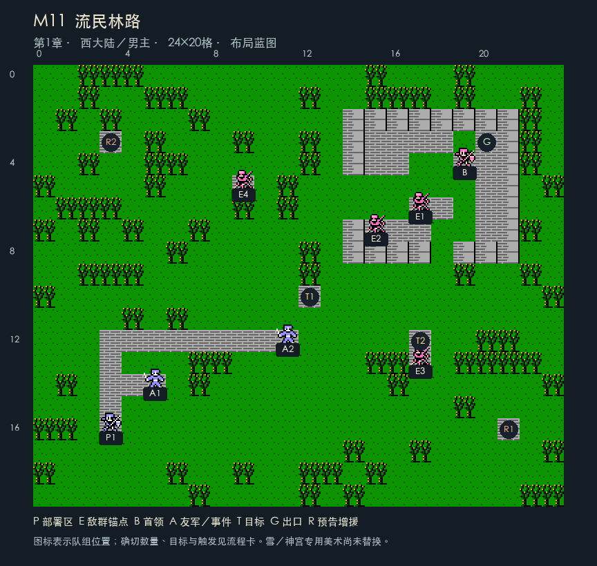

**剧情推动：**科兰押送兵把凯尔放走的居民重新赶回雪原；胡纳普先完成兄长没完成的护送。

**地点与重构：**W02 流民林路；24×20格；采用`forest_escort`构图。图块参考原B01／B02，仅借图块、建筑模块和地形配合，部署与通路按本图重新安排。

**部署与空间：**P1 (2,15)—(5,17)。首领B (19,4)；T目标 (12,10)、(17,12)；出口G (20,3)。友军/事件A (5,14)、(11,12)；增援口R (21,16)、(3,3)。

**敌军与增援：**士兵4、弓手2、追击队长1；第4敌回合从后方增援士兵2，仅一波。 E锚点分别为 (17,6)、(15,7)、(17,13)、(9,5)，四组按实际类型分布。首领必须留独立槽，不与增援重复身份。

**目标格语义：**T1林路路障；T2转移停靠点；A1/A2各一组流民；G安全村口。

**AI与时机：**流民每己方结束沿已清通路移动2格，遇敌停止；队长追最近流民，弓手守转弯。第3回合先显示R1，第4敌回合出现一次。

**交互契约：**两组流民抵达后一次写入救援；劳工被护送不会占正式名册。

**目标／失败：**护送两组流民抵达出口；击败追击队长。流民任一组全灭则失败。 两主角只在自己在场时参与主角败北判定；任一在场主角濒死立即失败，不消耗救治份额。保护、占领类失败另见目标。歼灭与撤离不偷偷切换。

**BEGIN：**达恩：他们又被赶回来了。／胡纳普：奥托，你带他们沿林边走，我挡住后面。

**MID：**第3己方回合，流民到中段：奥托：前面那条小路能走。别让他们绕回营地。

**END／下一步：**居民：凯尔也是从这里带我们走的。／胡纳普：到了村里，先把受伤的人安置好。 林路开放，村民提供粮站情报；S11与S12出现邀请。

**招募：**无自动新增正式角色；本关的友军和事件人物不因清场复制进队伍。

**人物缺席分支：**达恩濒死：胡纳普直接要求护送居民；奥托濒死：固定村民指出林边小路与凯尔军令。删除同伴私人回忆，不给替代者虚构旧关系。

**奖励与返回：**过关经验与明确掉落按现有规则；道具数量与归属另列数值稿。首次完成写`clear_M11`，返程不重复。先返回对应据点/世界节点，完成本卡指定确认后再开放下一节点。

**地形与安全：**P/T/G/A/B均有士兵可通行的地面通路；海面、墙与岩壁阻止步兵。图中的恢复格是有限站位，不能被理解为无限物品或濒死救治点。

#### M12 丘堡粮站（主线／西队）

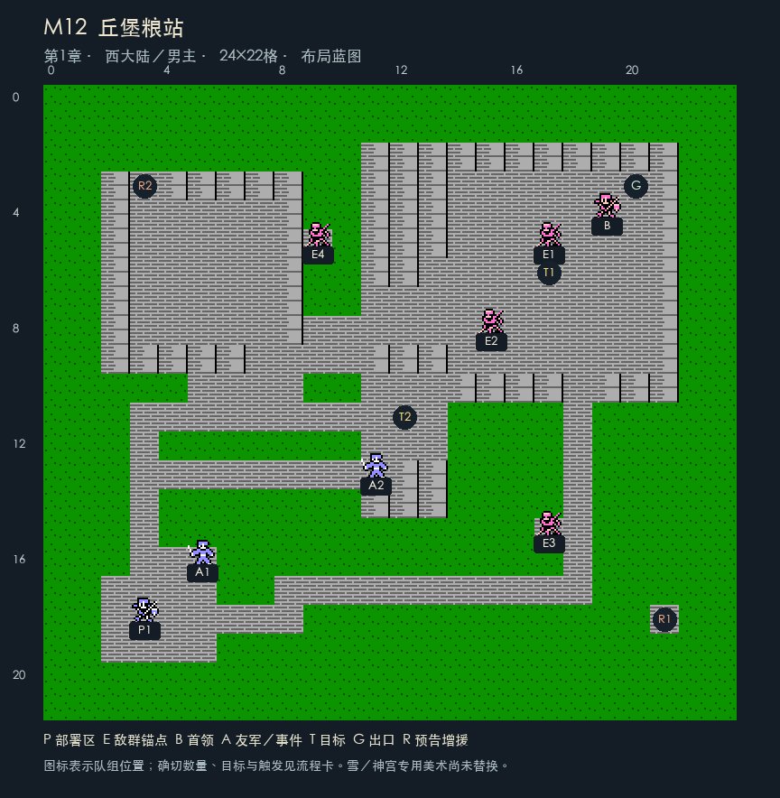

**剧情推动：**赈灾粮被科兰扣留，修女芙拉与领粮居民也被拘押。

**地点与重构：**W03 丘堡粮站；24×22格；采用`grain_fort`构图。图块参考原B04／B05，仅借图块、建筑模块和地形配合，部署与通路按本图重新安排。

**部署与空间：**P1 (2,17)—(5,19)。首领B (19,4)；T目标 (17,6)、(12,11)；出口G (20,3)。友军/事件A (5,16)、(11,13)；增援口R (21,18)、(3,3)。

**敌军与增援：**士兵5、弓手2、佣兵1、守将1；无无限增援。 E锚点分别为 (17,5)、(15,8)、(17,15)、(9,5)，四组按实际类型分布。首领必须留独立槽，不与增援重复身份。

**目标格语义：**T1粮仓门；T2焚毁队集合点；A1芙拉；A2领粮居民。

**AI与时机：**敌人先守仓门；第4回合预告，第5回合焚毁兵才可行动。只有连续两次在仓门确认焚毁才失败；击败焚毁兵取消。

**交互契约：**战后必须面对粮车确认分粮，再与芙拉交谈；完成分粮即开放出口。

**目标／失败：**占领粮仓前庭并击败守将；粮仓被焚毁则失败。占领需一名正式成员在目标格确认。 两主角只在自己在场时参与主角败北判定；任一在场主角濒死立即失败，不消耗救治份额。保护、占领类失败另见目标。歼灭与撤离不偷偷切换。

**BEGIN：**芙拉：粮在北边那间仓里。他们说谁敢靠近就烧掉。／胡纳普：先挡住拿火把的人。

**MID：**首次到达仓院：芙拉：别把粮全留给军队。村里已经等了几天。

**END／下一步：**胡纳普：粮车按原名单送回去。／芙拉：我与你去押送所，那里也有人等药。 M12-MYTH场景线索按5.2节播放，不追加战斗。 运粮车返回雪原村，教团合作事件开放；救芙拉后可招募。

**招募：**芙拉；战后与她面对面交谈，答应先送粮。

**人物缺席分支：**芙拉在获救前死亡：居民要求粮按原名单发放，教团仍可凭粮车与军令合作；不招募芙拉。

**奖励与返回：**过关经验与明确掉落按现有规则；道具数量与归属另列数值稿。首次完成写`clear_M12`，返程不重复。先返回对应据点/世界节点，完成本卡指定确认后再开放下一节点。

**地形与安全：**P/T/G/A/B均有士兵可通行的地面通路；海面、墙与岩壁阻止步兵。图中的恢复格是有限站位，不能被理解为无限物品或濒死救治点。

#### M13 南岗押送所（主线／西队）

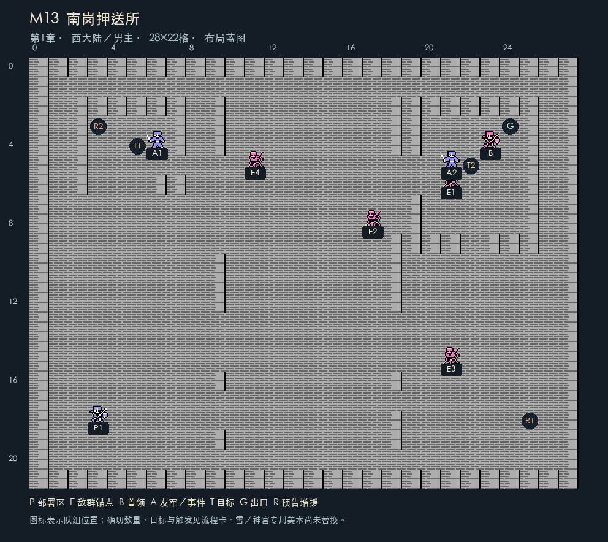

**剧情推动：**牢中有违抗强迁命令的骑士蕾娜，以及准备运往旧塔堡的劳工。

**地点与重构：**W04 南岗押送所；28×22格；采用`prison`构图。图块参考原B29／B11，仅借图块、建筑模块和地形配合，部署与通路按本图重新安排。

**部署与空间：**P1 (2,17)—(5,19)。首领B (23,4)；T目标 (5,4)、(22,5)；出口G (24,3)。友军/事件A (6,4)、(21,5)；增援口R (25,18)、(3,3)。

**敌军与增援：**士兵5、重装2、弓手2、押送长1；第5回合侧门增援佣兵2。 E锚点分别为 (21,6)、(17,8)、(21,15)、(11,5)，四组按实际类型分布。首领必须留独立槽，不与增援重复身份。

**目标格语义：**T1/T2分别为左右牢门；A1蕾娜、A2一组劳工。

**AI与时机：**首领守中庭；第5回合援军从R1进。牢门靠邻接确认打开，开门后友军可以移动，不能透墙对话。

**交互契约：**劳工救援为主线；蕾娜招募前死亡则记录真实死亡，不生成替身或卡住军令取得；入队后的HP归零按濒死处理。

**目标／失败：**击败押送长并打开两间牢房。蕾娜招募前可死亡而主线继续；必须至少救出一组劳工。 两主角只在自己在场时参与主角败北判定；任一在场主角濒死立即失败，不消耗救治份额。保护、占领类失败另见目标。歼灭与撤离不偷偷切换。

**BEGIN：**奥托：牢门在两边，先把院子清出来。／胡纳普：有人开门，其他人挡住押送兵。

**MID：**打开蕾娜牢房：蕾娜：我能走。先去另一间，他们没有力气再等了。

**END／下一步：**蕾娜：这些人本来由我护送，是我让他们被带到了这里。／胡纳普：把他们送回去，再决定要不要同行。 取得科兰押送军令，旧塔外营道路开放；蕾娜存活时可招募。

**招募：**蕾娜；救出且存活，战后护送确认与交谈。

**人物缺席分支：**奥托濒死：劳工指出左右牢房；蕾娜招募前死亡：保留真实死亡、由押送军令交代旧塔劳工，不出现她的招募谈话。

**奖励与返回：**过关经验与明确掉落按现有规则；道具数量与归属另列数值稿。首次完成写`clear_M13`，返程不重复。先返回对应据点/世界节点，完成本卡指定确认后再开放下一节点。

**地形与安全：**P/T/G/A/B均有士兵可通行的地面通路；海面、墙与岩壁阻止步兵。图中的恢复格是有限站位，不能被理解为无限物品或濒死救治点。

#### M14 旧塔外营（主线／西队）

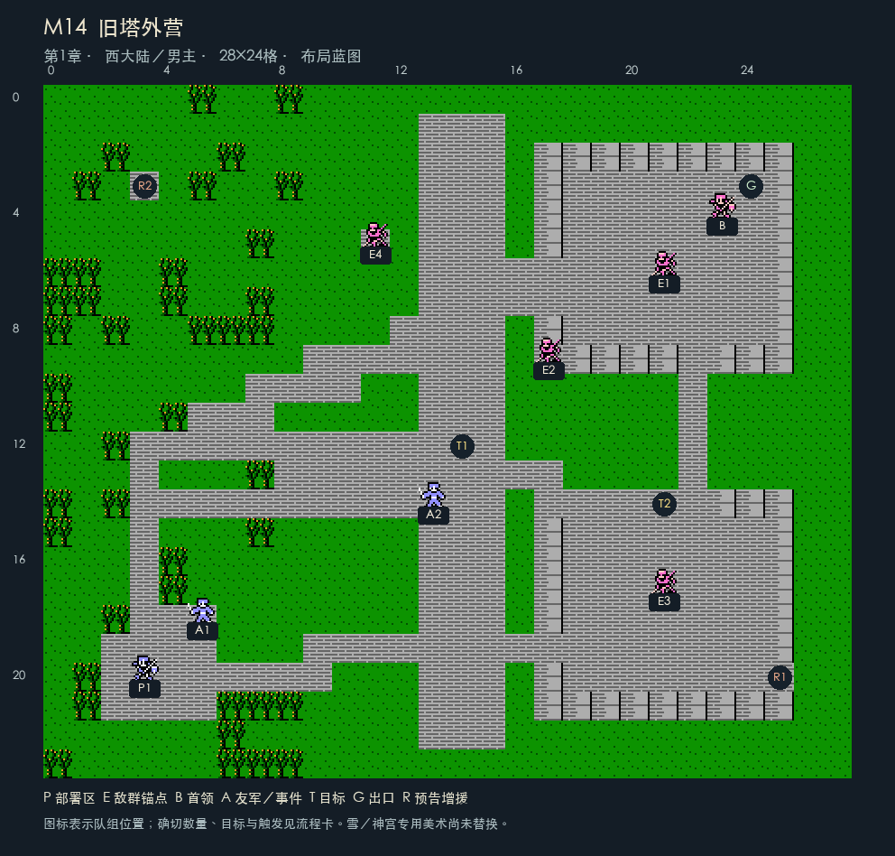

**剧情推动：**赫兰正式提供援军；外营阻断夺城与释放塔工的路线。

**地点与重构：**W05 旧塔外营；28×24格；采用`camp`构图。图块参考原B06／B17，仅借图块、建筑模块和地形配合，部署与通路按本图重新安排。

**部署与空间：**P1 (2,19)—(5,21)。首领B (23,4)；T目标 (14,12)、(21,14)；出口G (24,3)。友军/事件A (5,18)、(13,14)；增援口R (25,20)、(3,3)。

**敌军与增援：**骑兵3、士兵5、弓手2、魔道士1、指挥官1；无回合刷兵。 E锚点分别为 (21,6)、(17,9)、(21,17)、(11,5)，四组按实际类型分布。首领必须留独立槽，不与增援重复身份。

**目标格语义：**T1骑兵营路口；T2步兵营路口；A1营内劳工、A2可投降兵。

**AI与时机：**骑兵从右路压部署，弓手守粮道，指挥官守北门；半血后明确投降动作。

**交互契约：**两路确认控制后才进入旧塔堡；未归降者正常结算伤亡。

**目标／失败：**击败外营指挥官，控制两条通往旧塔堡的道路；无需消灭已投降者。 两主角只在自己在场时参与主角败北判定；任一在场主角濒死立即失败，不消耗救治份额。保护、占领类失败另见目标。歼灭与撤离不偷偷切换。

**BEGIN：**兰斯：赫兰大人让我带你们进城。右边是骑兵营，别都挤在那条路上。

**MID：**指挥官半血：兰斯：愿意放下武器的去西门。不要再往内院退。

**END／下一步：**胡纳普：塔工还在里面？／投降兵：将军要带粮走，没给他们留车。 兰斯加入；进入旧塔堡，不能绕过科兰直接举行仪式。

**招募：**兰斯；作为本关正式成员加入，可能濒死但继续在队。

**人物缺席分支：**兰斯在本关濒死：指挥官投降时由普通教团兵传令；濒死期间不播放需他亲自行动的旧同袍交涉，救治后仅参与仍开放的后续事件。

**奖励与返回：**过关经验与明确掉落按现有规则；道具数量与归属另列数值稿。首次完成写`clear_M14`，返程不重复。先返回对应据点/世界节点，完成本卡指定确认后再开放下一节点。

**地形与安全：**P/T/G/A/B均有士兵可通行的地面通路；海面、墙与岩壁阻止步兵。图中的恢复格是有限站位，不能被理解为无限物品或濒死救治点。

#### M15 海峡旧塔堡（主线／西队）

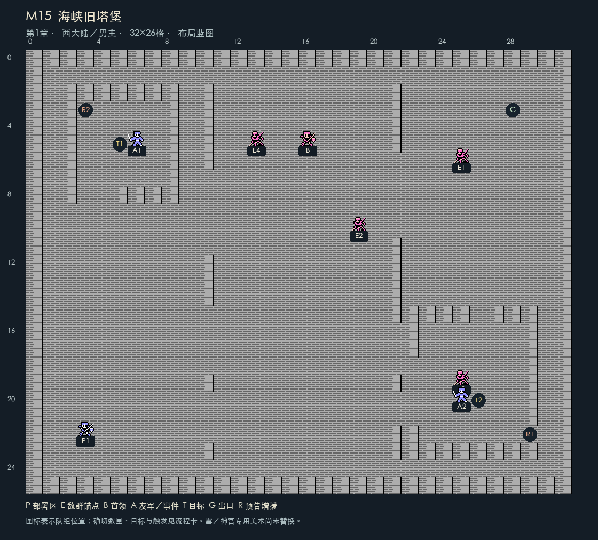

**剧情推动：**科兰带亲兵与粮食准备逃离，把劳工留在内院。胡纳普进入复仇终点。

**地点与重构：**W06 海峡城；32×26格；采用`citadel`构图。图块参考原B07／B42，仅借图块、建筑模块和地形配合，部署与通路按本图重新安排。

**部署与空间：**P1 (2,21)—(5,23)。首领B (16,5)；T目标 (5,5)、(26,20)；出口G (28,3)。友军/事件A (6,5)、(25,20)；增援口R (29,22)、(3,3)。

**敌军与增援：**士兵5、重装3、弓手3、骑兵2、魔道士1、科兰1；撤离护卫2在第4回合进入。 E锚点分别为 (25,6)、(19,10)、(25,19)、(13,5)，四组按实际类型分布。首领必须留独立槽，不与增援重复身份。

**目标格语义：**T1劳工内院门；T2第二组劳工；A1/A2两组劳工；B科兰；G北侧撤离点。

**AI与时机：**科兰前5回合守要塞；第6回合且HP低于半血才开始撤离，未达半血则第8回合开始。第4回合R1护卫2；玩家可提前封退路。

**交互契约：**击败科兰、至少一组劳工获救才结算；没有独立速度竞赛隐藏失败条件。

**目标／失败：**击败科兰并救出内院劳工。科兰到达撤离格则失败；退路预先标示。 两主角只在自己在场时参与主角败北判定；任一在场主角濒死立即失败，不消耗救治份额。保护、占领类失败另见目标。歼灭与撤离不偷偷切换。

**BEGIN：**科兰：守住粮车，内院的人留在那里。／胡纳普：先去内院，别让他们把门堵上。D13的私人交锋留到MID。

**MID：**胡纳普首次与科兰交锋：胡纳普：凯尔回营的时候，你答应过放人。／科兰：他已经把整支军队的命令都坏掉了。

**END／下一步：**D13败北段；内院劳工呼救后转去救人。赫兰：军令已经交给记录官，我会公布凯尔的事。／胡纳普：塔里的人先带出来。随后乌库布·卡基显灵与庆典前夜；不重复播放D12合作。 完成科兰讨伐，海峡城解放；处理伤者后触发日返与乌库布·卡基显灵，保存西队并切第二章。

**招募：**无自动新增正式角色；本关的友军和事件人物不因清场复制进队伍。

**人物缺席分支：**劳工两组分别记录；科兰罪责来自军令与既有处刑见证，不因奥托濒死被改写。

**奖励与返回：**过关经验与明确掉落按现有规则；道具数量与归属另列数值稿。首次完成写`clear_M15`，返程不重复。先返回对应据点/世界节点，完成本卡指定确认后再开放下一节点。

**地形与安全：**P/T/G/A/B均有士兵可通行的地面通路；海面、墙与岩壁阻止步兵。图中的恢复格是有限站位，不能被理解为无限物品或濒死救治点。

#### S11 旧矿道救援（支线／西队）

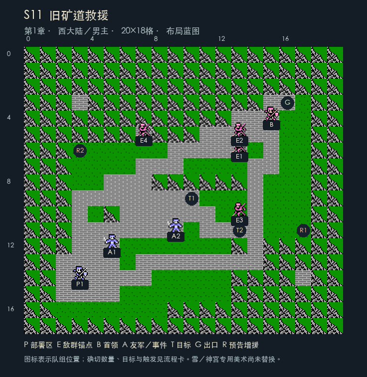

**剧情推动：**村民请求带出塌道后的矿工与工具。

**地点与重构：**S01 旧矿道；20×18格；采用`mine`构图。图块参考原B49／B55，仅借图块、建筑模块和地形配合，部署与通路按本图重新安排。

**部署与空间：**P1 (2,13)—(5,15)。首领B (15,4)；T目标 (10,9)、(13,11)；出口G (16,3)。友军/事件A (5,12)、(9,11)；增援口R (17,11)、(3,6)。

**敌军与增援：**盗匪5、弓手1、首领1；无随机重复遭遇收益。 E锚点分别为 (13,6)、(13,5)、(13,10)、(7,5)，四组按实际类型分布。首领必须留独立槽，不与增援重复身份。

**目标格语义：**T1工具箱；T2塌道出口；A1贝克与矿工、A2另一名矿工。

**AI与时机：**盗匪守箱、弓手守窄口，矿工沿地面出口撤离。

**交互契约：**取工具是普通物资，未取不影响主线；贝克需存活并战后交谈。

**目标／失败：**至少两名矿工撤到出口，击败盗掠首领；贝克可死亡，主线不受阻。 两主角只在自己在场时参与主角败北判定；任一在场主角濒死立即失败，不消耗救治份额。保护、占领类失败另见目标。歼灭与撤离不偷偷切换。

**BEGIN：**贝克：工具还在里面。先带他们走，我去拿。／胡纳普：你跟他们一起出去，我去看。

**MID：**打开侧室：奥托或矿工辨认征调遗物。

**END／下一步：**贝克：我把他们送回去。你们还缺人吗？ 可招贝克、有限装备；回W02，不更改主线祭礼进度。

**招募：**贝克；保护存活、战后交谈。

**人物缺席分支：**贝克死则失去招募；奥托亡由矿工辨认遗物。主线罪证另有固定来源。

**奖励与返回：**过关经验与明确掉落按现有规则；道具数量与归属另列数值稿。首次完成写`clear_S11`，返程不重复。支线返回入口节点，保留来向；主线照常可继续。

**地形与安全：**P/T/G/A/B均有士兵可通行的地面通路；海面、墙与岩壁阻止步兵。图中的恢复格是有限站位，不能被理解为无限物品或濒死救治点。

#### S12 林村诊所道路（支线／西队）

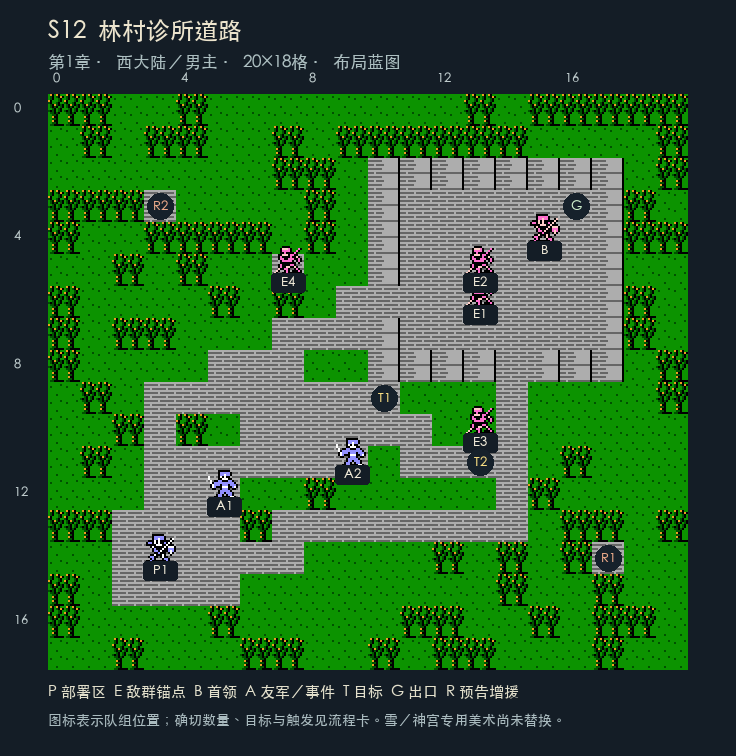

**剧情推动：**赫维不愿放下病人，诊所缺药而军队征用道路。

**地点与重构：**S02 林村诊所；20×18格；采用`forest_clinic`构图。图块参考原B28／B53，仅借图块、建筑模块和地形配合，部署与通路按本图重新安排。

**部署与空间：**P1 (2,13)—(5,15)。首领B (15,4)；T目标 (10,9)、(13,11)；出口G (16,3)。友军/事件A (5,12)、(9,11)；增援口R (17,14)、(3,3)。

**敌军与增援：**士兵4、弓手2、队长1。 E锚点分别为 (13,6)、(13,5)、(13,10)、(7,5)，四组按实际类型分布。首领必须留独立槽，不与增援重复身份。

**目标格语义：**T1诊所门；T2药箱停靠点；A1赫维、A2药车。

**AI与时机：**封路兵追药箱，术士在林边不隐藏全图伤害。

**交互契约：**药车抵达后管理员接手医疗，赫维才可离开。

**目标／失败：**击败封路队，护送药箱抵诊所；药箱为事件对象，不占唯一神器槽。 两主角只在自己在场时参与主角败北判定；任一在场主角濒死立即失败，不消耗救治份额。保护、占领类失败另见目标。歼灭与撤离不偷偷切换。

**BEGIN：**赫维：药没到，我不能走。／芙拉或管理员：先把路打开，我们再谈。

**MID：**药箱到中点：提醒小路是森林，骑兵可绕主路。

**END／下一步：**赫维：管理员留下来。我想去看看塔里到底出了什么事。 可招赫维，诊所留下替代医者；回W02。

**招募：**赫维；送药完成、面对交谈。

**人物缺席分支：**芙拉亡由诊所管理员提出药箱需求；赫维死则只完成送药。

**奖励与返回：**过关经验与明确掉落按现有规则；道具数量与归属另列数值稿。首次完成写`clear_S12`，返程不重复。支线返回入口节点，保留来向；主线照常可继续。

**地形与安全：**P/T/G/A/B均有士兵可通行的地面通路；海面、墙与岩壁阻止步兵。图中的恢复格是有限站位，不能被理解为无限物品或濒死救治点。

### 第2章

#### F21 海上拦截（主线／东队）

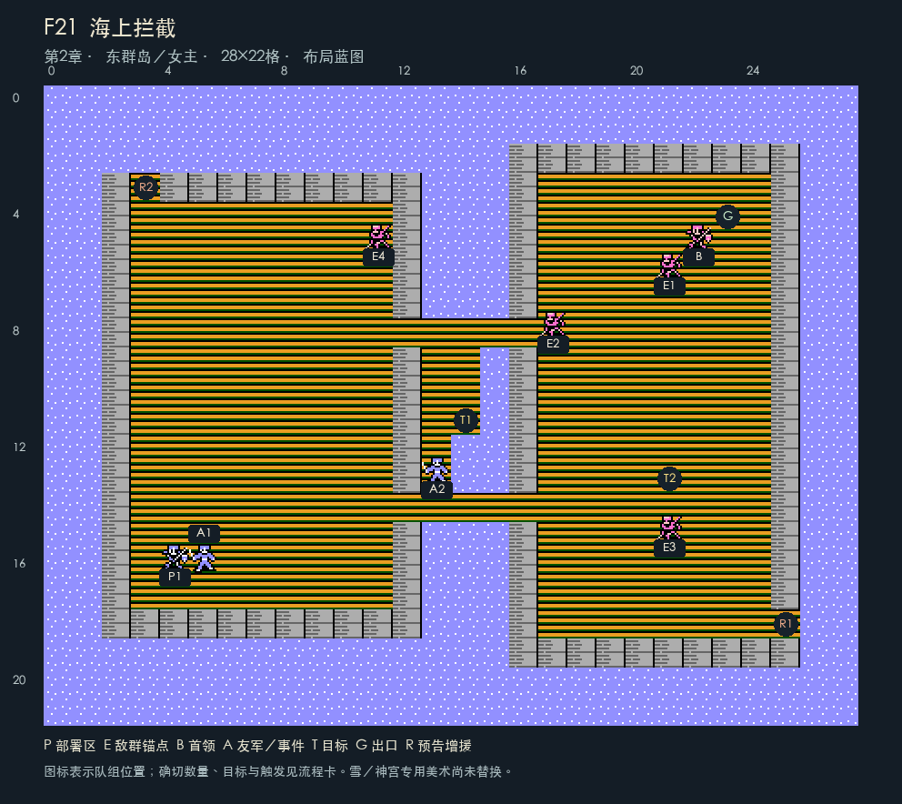

**剧情推动：**卡洛指出押送舰的航线，搜捕船封锁船团。

**地点与重构：**E02 海上拦截；28×22格；采用`naval`构图。图块参考原B09／B10，仅借图块、建筑模块和地形配合，部署与通路按本图重新安排。

**部署与空间：**P1 (3,15)—(6,17)。首领B (22,5)；T目标 (14,11)、(21,13)；出口G (23,4)。友军/事件A (5,16)、(13,13)；增援口R (25,18)、(3,3)。

**敌军与增援：**海兵5、弓手2、术士1、指挥官1；不使用海面步行敌人。 E锚点分别为 (21,6)、(17,8)、(21,15)、(11,5)，四组按实际类型分布。首领必须留独立槽，不与增援重复身份。

**目标格语义：**T1第一跳板；T2第二跳板；A1商船船员、A2受伤乘客；G敌舰后甲板。

**AI与时机：**海兵经两块跳板登船，弓手留船头，术士守中央；无水面行走。

**交互契约：**己方船完整度用事件状态显示；不要把船血量等同单个正式成员。

**目标／失败：**击败搜捕船指挥官，保住己方船。甲板两端是地面通路，水面不能作为步兵落点。 两主角只在自己在场时参与主角败北判定；任一在场主角濒死立即失败，不消耗救治份额。保护、占领类失败另见目标。歼灭与撤离不偷偷切换。

**BEGIN：**卡洛：他们要登船。你们守内侧，别站在两块跳板中间。

**MID：**敌第3回合开始前：莉莎：另一条船的弓手换到右边了。

**END／下一步：**艾琳：押送舰在哪里？／俘虏：前面的灯线，所有船都得从那里过。 取得押送舰位置；漂泊渔船支线开放。

**招募：**无自动新增正式角色；本关的友军和事件人物不因清场复制进队伍。

**人物缺席分支：**莉莎濒死：甲板护卫报告右侧弓手；卡洛濒死：固定舵手执行已获得的航线，不延续卡洛私人承诺。

**奖励与返回：**过关经验与明确掉落按现有规则；道具数量与归属另列数值稿。首次完成写`clear_F21`，返程不重复。先返回对应据点/世界节点，完成本卡指定确认后再开放下一节点。

**地形与安全：**P/T/G/A/B均有士兵可通行的地面通路；海面、墙与岩壁阻止步兵。图中的恢复格是有限站位，不能被理解为无限物品或濒死救治点。

#### F22 押送舰救援（主线／东队）

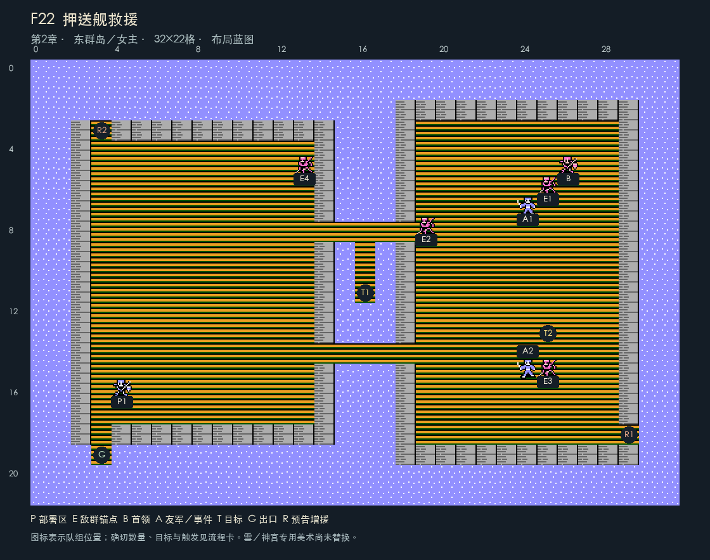

**剧情推动：**押送舰运送引航者与被征调术士，母亲旧船的人在其中。

**地点与重构：**E03 押送舰；32×22格；采用`boarding`构图。图块参考原B11／B12，仅借图块、建筑模块和地形配合，部署与通路按本图重新安排。

**部署与空间：**P1 (3,15)—(6,17)。首领B (26,5)；T目标 (16,11)、(25,13)；出口G (3,19)。友军/事件A (24,7)、(24,15)；增援口R (29,18)、(3,3)。

**敌军与增援：**海兵5、重装2、弓手2、舰长1；第4回合后舱出士兵2。 E锚点分别为 (25,6)、(19,8)、(25,15)、(13,5)，四组按实际类型分布。首领必须留独立槽，不与增援重复身份。

**目标格语义：**T1囚舱门；T2备用跳板闸；A1/A2合计4名俘虏，其中洛德单独记录；G己方船撤离口。

**AI与时机：**救出者走甲板2格/己方结束，遇敌停止；第4回合R1后舱出兵2。普通俘虏合计至少3人撤出，洛德可另死。

**交互契约：**洛德不能在战中被重复加入；战后见面才正式招募。

**目标／失败：**打开囚舱、击败舰长，至少三名俘虏撤至己方船。洛德死亡不阻断主线。 两主角只在自己在场时参与主角败北判定；任一在场主角濒死立即失败，不消耗救治份额。保护、占领类失败另见目标。歼灭与撤离不偷偷切换。

**BEGIN：**米蕾：先打开舱门，有人已经站不起来了。／艾琳：卡洛，你挡住舰长那边。

**MID：**囚舱打开：洛德：我能把右边的跳板放下。后面的人跟我走。

**END／下一步：**艾琳：你见过这块船牌吗？／引航者：裴萨留下了那只箱子，他说要送到军港。 获知裴萨军港与薇娅船牌去向；洛德存活可招募。

**招募：**洛德；存活、逃离押送舰后交谈。

**人物缺席分支：**米蕾濒死：艾琳先指出囚舱伤者；卡洛濒死：护卫留跳板；洛德招募前死亡则普通引航者打开备用闸，失去招募。

**奖励与返回：**过关经验与明确掉落按现有规则；道具数量与归属另列数值稿。首次完成写`clear_F22`，返程不重复。先返回对应据点/世界节点，完成本卡指定确认后再开放下一节点。

**地形与安全：**P/T/G/A/B均有士兵可通行的地面通路；海面、墙与岩壁阻止步兵。图中的恢复格是有限站位，不能被理解为无限物品或濒死救治点。

#### F23 礁岛登岸（主线／东队）

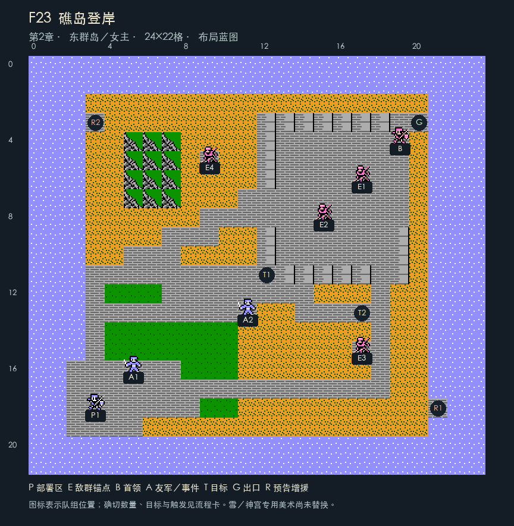

**剧情推动：**获救者需要安全岸边，黑昼引来的魔物占据礁岛。

**地点与重构：**E04 礁岛；24×22格；采用`reef`构图。图块参考原B13／B19，仅借图块、建筑模块和地形配合，部署与通路按本图重新安排。

**部署与空间：**P1 (2,17)—(5,19)。首领B (19,4)；T目标 (12,11)、(17,13)；出口G (20,3)。友军/事件A (5,16)、(11,13)；增援口R (21,18)、(3,3)。

**敌军与增援：**僵尸型魔物5、飞行魔物3、硬甲魔物2、首领1；无召唤。 E锚点分别为 (17,6)、(15,8)、(17,15)、(9,5)，四组按实际类型分布。首领必须留独立槽，不与增援重复身份。

**目标格语义：**T1居民营地；T2登陆坡；A1罗恩、A2渔民；G通往村子的口。

**AI与时机：**飞行敌优先攻击暴露后排，硬甲守登陆坡，普通魔物守营地；全清后才安全。

**交互契约：**罗恩招募前死亡只失去该招募；渔村长者保有主线航路情报。

**目标／失败：**清除岸上魔物，保护渔民营地；击败飞行首领后仍需处理未撤离的自然魔物。 两主角只在自己在场时参与主角败北判定；任一在场主角濒死立即失败，不消耗救治份额。保护、占领类失败另见目标。歼灭与撤离不偷偷切换。

**BEGIN：**罗恩：岸边还有人，别把船开走。／艾琳：我们先上岸，你守住他们身后。

**MID：**首次进入中央沙滩：莉莎：那几只硬甲的，我来试。你们看住天上的。

**END／下一步：**罗恩：军港拿走了我们的货船。我知道那里的岸线，让我带路。 罗恩存活可加入；海洞邀请与海灯岛通路开放。

**招募：**罗恩；保护他存活、战后村内交谈。

**人物缺席分支：**莉莎濒死：艾琳要求先处理硬甲；罗恩招募前死亡或未招募：渔村长者提供军港岸线，不出现他的在队货船旧约。

**奖励与返回：**过关经验与明确掉落按现有规则；道具数量与归属另列数值稿。首次完成写`clear_F23`，返程不重复。先返回对应据点/世界节点，完成本卡指定确认后再开放下一节点。

**地形与安全：**P/T/G/A/B均有士兵可通行的地面通路；海面、墙与岩壁阻止步兵。图中的恢复格是有限站位，不能被理解为无限物品或濒死救治点。

#### F24 海灯岛防卫（主线／东队）

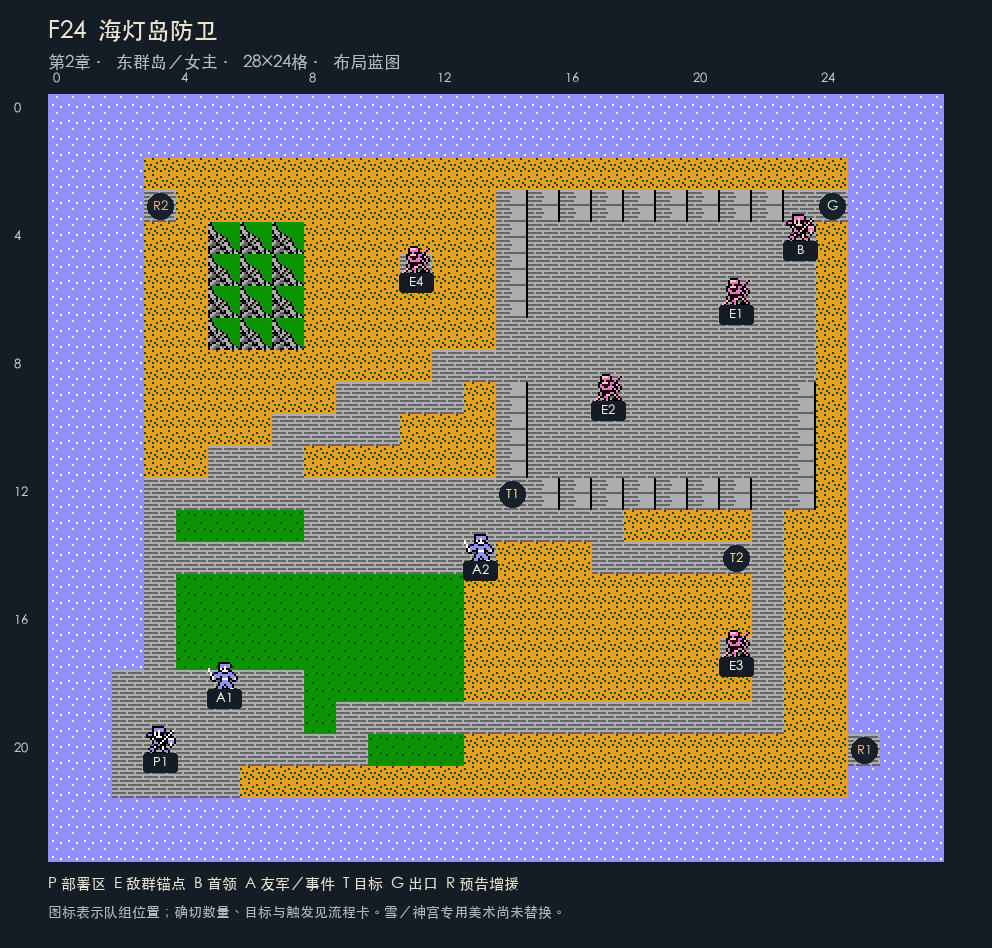

**剧情推动：**希雅拒绝弃岛追敌；航灯熄灭会让撤离船失去方向。

**地点与重构：**E05 海灯岛；28×24格；采用`lighthouse`构图。图块参考原B15／B25，仅借图块、建筑模块和地形配合，部署与通路按本图重新安排。

**部署与空间：**P1 (2,19)—(5,21)。首领B (23,4)；T目标 (14,12)、(21,14)；出口G (24,3)。友军/事件A (5,18)、(13,14)；增援口R (25,20)、(3,3)。

**敌军与增援：**飞行魔物3、海兵4、弓手2、术士1、首领1；第3回合北侧士兵2。 E锚点分别为 (21,6)、(17,9)、(21,17)、(11,5)，四组按实际类型分布。首领必须留独立槽，不与增援重复身份。

**目标格语义：**T1航灯；T2居民避难屋；A1希雅、A2岛民。

**AI与时机：**飞行敌从外海迫近，弓手压飞骑落点；只有敌军连续占T1一整回合才算失守。第3回合R1增援预告后入场。

**交互契约：**守至第6回合且首领败北才能胜；希雅生死与岛民安置分别记录。

**目标／失败：**守住航灯至第6己方回合并击败搜捕首领；航灯失守则失败。 两主角只在自己在场时参与主角败北判定；任一在场主角濒死立即失败，不消耗救治份额。保护、占领类失败另见目标。歼灭与撤离不偷偷切换。

**BEGIN：**希雅：我不能现在离开。灯一灭，后面的船就进不来了。／艾琳：那我们先守住它。

**MID：**第4己方回合：米蕾：伤者都进屋了。希雅，东边那条船在靠岸。

**END／下一步：**希雅：留守的人够了。我与你去军港，但岛上的船不能全带走。 岛民有安全去处，希雅可正式加入，军港航路被确认。

**招募：**希雅；存活、岛民安置完成后交谈。

**人物缺席分支：**米蕾濒死：岛上医者报告伤者；希雅招募前死亡时留守骑士完成安置，主线军港航路仍在，失去飞骑招募。

**奖励与返回：**过关经验与明确掉落按现有规则；道具数量与归属另列数值稿。首次完成写`clear_F24`，返程不重复。先返回对应据点/世界节点，完成本卡指定确认后再开放下一节点。

**地形与安全：**P/T/G/A/B均有士兵可通行的地面通路；海面、墙与岩壁阻止步兵。图中的恢复格是有限站位，不能被理解为无限物品或濒死救治点。

#### F25 潮狩军港（主线／东队）

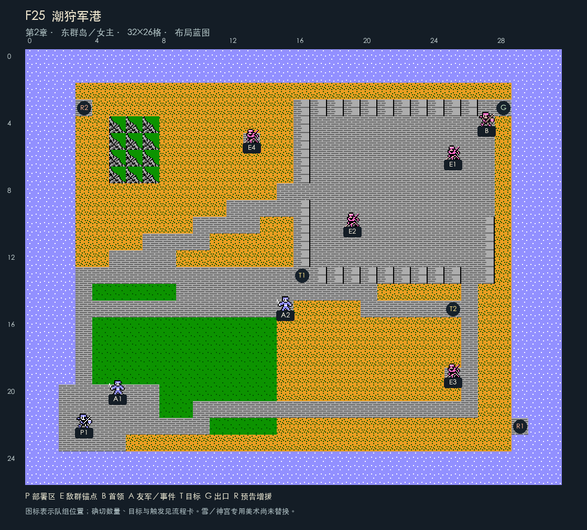

**剧情推动：**母亲的航图与被截船队的幸存者都在军港，女主进入复仇终点。

**地点与重构：**E06 潮狩军港；32×26格；采用`harbor`构图。图块参考原B24／B11，仅借图块、建筑模块和地形配合，部署与通路按本图重新安排。

**部署与空间：**P1 (2,21)—(5,23)。首领B (27,4)；T目标 (16,13)、(25,15)；出口G (28,3)。友军/事件A (5,20)、(15,15)；增援口R (29,22)、(3,3)。

**敌军与增援：**海兵4、重装3、弓手3、术士2、飞行2、裴萨1；最多同时17名敌人。 E锚点分别为 (25,6)、(19,10)、(25,19)、(13,5)，四组按实际类型分布。首领必须留独立槽，不与增援重复身份。

**目标格语义：**T1神教箱；T2引航者牢门；A1/A2幸存船员；B裴萨。

**AI与时机：**首领守主楼，重装守囚门，术士占远射程点；击败首领后剩兵可投降或退走。

**交互契约：**取得航图为战后固定交互信息，满手道具不阻断；D22只一次。

**目标／失败：**击败裴萨，打开引航者牢房并取回神教箱；逃离的普通军人不追杀。 两主角只在自己在场时参与主角败北判定；任一在场主角濒死立即失败，不消耗救治份额。保护、占领类失败另见目标。歼灭与撤离不偷偷切换。

**BEGIN：**艾琳：囚舱在左边，箱子在主楼。先把人救出来。

**MID：**与裴萨首次交锋：D22前段；右侧神教箱不会因击杀首领自动加入物品。

**END／下一步：**D22败北段；面对神教箱确认取得航图，米蕾处理撤离者。 F25-MYTH场景线索按5.2节播放，不追加战斗。 完成裴萨讨伐，取得D22与航图；古道出发事件开放。

**招募：**无自动新增正式角色；本关的友军和事件人物不因清场复制进队伍。

**奖励与返回：**过关经验与明确掉落按现有规则；道具数量与归属另列数值稿。首次完成写`clear_F25`，返程不重复。先返回对应据点/世界节点，完成本卡指定确认后再开放下一节点。

**地形与安全：**P/T/G/A/B均有士兵可通行的地面通路；海面、墙与岩壁阻止步兵。图中的恢复格是有限站位，不能被理解为无限物品或濒死救治点。

#### F26 断航古道（主线／东队）

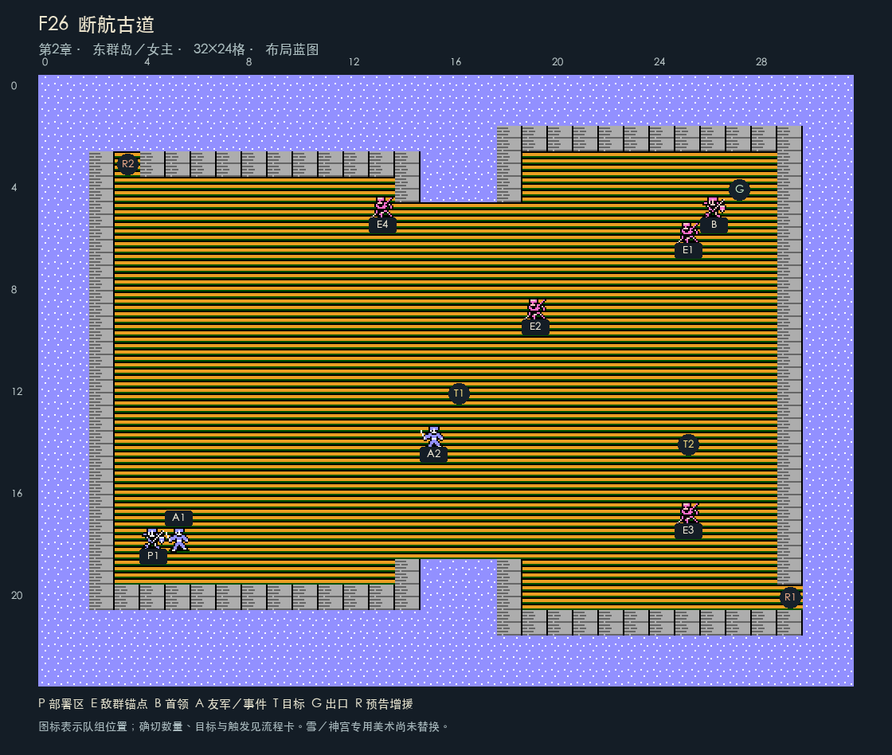

**剧情推动：**薇娅的航图指出局部神幕薄处，神军阻止继续西渡。

**地点与重构：**E07 断航古道；32×24格；采用`sea_pass`构图。图块参考原B14／B18，仅借图块、建筑模块和地形配合，部署与通路按本图重新安排。

**部署与空间：**P1 (3,17)—(6,19)。首领B (26,5)；T目标 (16,12)、(25,14)；出口G (27,4)。友军/事件A (5,18)、(15,14)；增援口R (29,20)、(3,3)。

**敌军与增援：**飞行魔物3、海兵4、弓手2、术士2、封航首领1；无无限潮汐生成。 E锚点分别为 (25,6)、(19,9)、(25,17)、(13,5)，四组按实际类型分布。首领必须留独立槽，不与增援重复身份。

**目标格语义：**T1古石门；T2航灯旧座；A1/A2居民船队；G西岸登陆点。

**AI与时机：**居民船是事件组，沿指定水路行进，不把步兵放到海面；玩家在遗迹铺板上护送。

**交互契约：**至少一艘到达、西岸首领败北后归乡；序章拘押不清空已得物品。

**目标／失败：**护送船队穿过遗迹通道，击败封航守军。出口至少有一艘居民船抵达。 两主角只在自己在场时参与主角败北判定；任一在场主角濒死立即失败，不消耗救治份额。保护、占领类失败另见目标。歼灭与撤离不偷偷切换。

**BEGIN：**艾琳：母亲标的是左边那座石门。不要跟着外面的灯走。

**MID：**居民船过中点：卡洛：已经能看见西岸了。后面的船跟紧。

**END／下一步：**船团抵海峡城，卫兵宣布拘押破坏设施者；序章同一场景由女主视角进入，不结算第二次复仇。 到达海峡城，东队实际成长、濒死状态与救治经历存档；被拘押事件衔接序章。

**招募：**无自动新增正式角色；本关的友军和事件人物不因清场复制进队伍。

**人物缺席分支：**卡洛濒死：舵手报告西岸；船团由至少一艘存活居民船抵达，不复活押送舰已死人员。

**奖励与返回：**过关经验与明确掉落按现有规则；道具数量与归属另列数值稿。首次完成写`clear_F26`，返程不重复。先返回对应据点/世界节点，完成本卡指定确认后再开放下一节点。

**地形与安全：**P/T/G/A/B均有士兵可通行的地面通路；海面、墙与岩壁阻止步兵。图中的恢复格是有限站位，不能被理解为无限物品或濒死救治点。

#### S21 漂泊渔船（支线／东队）

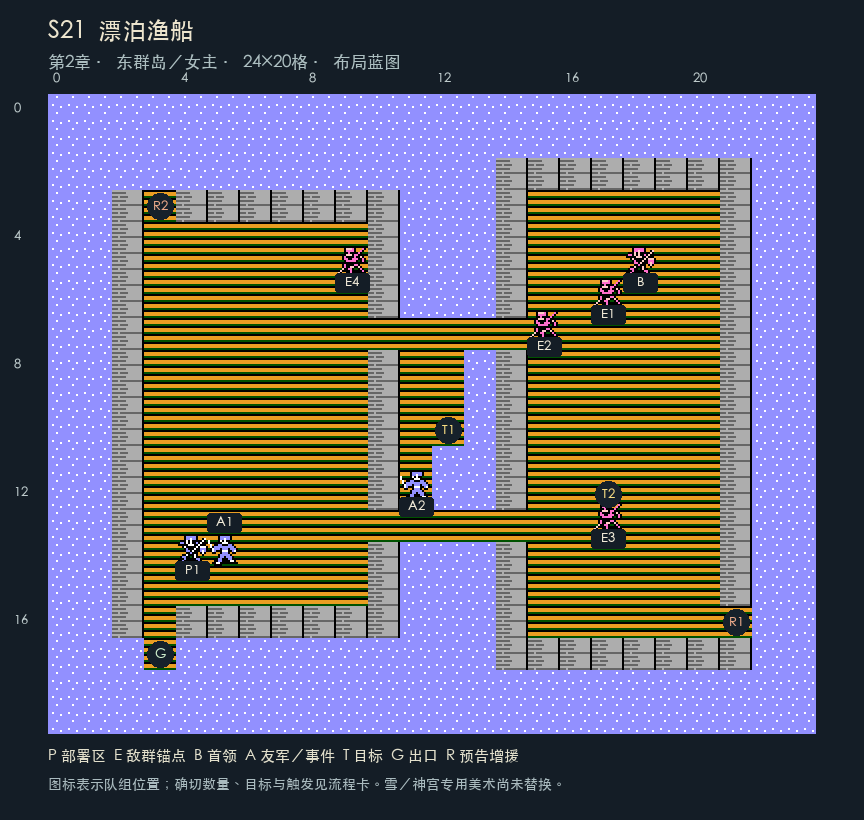

**剧情推动：**漂泊渔民被拒靠岸，米蕾要求先救伤者。

**地点与重构：**S03 漂泊渔船；24×20格；采用`rescue_ship`构图。图块参考原B09／B12，仅借图块、建筑模块和地形配合，部署与通路按本图重新安排。

**部署与空间：**P1 (3,13)—(6,15)。首领B (18,5)；T目标 (12,10)、(17,12)；出口G (3,17)。友军/事件A (5,14)、(11,12)；增援口R (21,16)、(3,3)。

**敌军与增援：**飞行魔物3、僵尸型3、首领1；无海面步行友军。 E锚点分别为 (17,6)、(15,7)、(17,13)、(9,5)，四组按实际类型分布。首领必须留独立槽，不与增援重复身份。

**目标格语义：**T1船边防守点；T2靠岸跳板；A1/A2病人组；G安全停泊口。

**AI与时机：**飞行怪攻击暴露病人，地面魔物只在船与跳板上。

**交互契约：**治疗用正常生命支付；不要求米蕾必须能行动；她濒死时由船团医者照护伤者，有相应缺席对白。

**目标／失败：**击败海上魔物，保住载病人船至靠岸；至少一组居民存活。 两主角只在自己在场时参与主角败北判定；任一在场主角濒死立即失败，不消耗救治份额。保护、占领类失败另见目标。歼灭与撤离不偷偷切换。

**BEGIN：**米蕾或艾琳：他们船上还有病人，不能就这样走。

**MID：**居民船受伤一次提示前排保护位置，不强制全队治疗。

**END／下一步：**渔民告知一条备用停泊点；物资与旗标只结算一次。 有限物资、后日谈救助旗标；回E02。

**招募：**无自动新增正式角色；本关的友军和事件人物不因清场复制进队伍。

**人物缺席分支：**米蕾亡由艾琳提出救援，保留地方医者；关系后日谈写她的遗留工作。

**奖励与返回：**过关经验与明确掉落按现有规则；道具数量与归属另列数值稿。首次完成写`clear_S21`，返程不重复。支线返回入口节点，保留来向；主线照常可继续。

**地形与安全：**P/T/G/A/B均有士兵可通行的地面通路；海面、墙与岩壁阻止步兵。图中的恢复格是有限站位，不能被理解为无限物品或濒死救治点。

#### S22 碎石海洞（支线／东队）

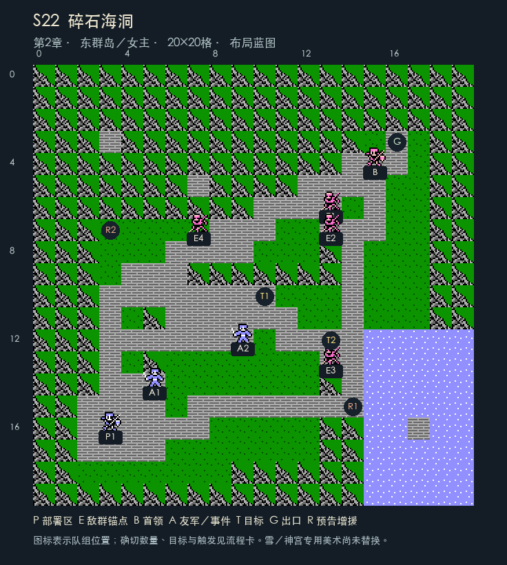

**剧情推动：**卡洛旧同伴躲在海洞，握着失踪船员遗物。

**地点与重构：**S04 碎石海洞；20×20格；采用`sea_cave`构图。图块参考原B50／B52，仅借图块、建筑模块和地形配合，部署与通路按本图重新安排。

**部署与空间：**P1 (2,15)—(5,17)。首领B (15,4)；T目标 (10,10)、(13,12)；出口G (16,3)。友军/事件A (5,14)、(9,12)；增援口R (14,15)、(3,7)。

**敌军与增援：**僵尸型4、石像鬼2、首领1。 E锚点分别为 (13,6)、(13,7)、(13,13)、(7,7)，四组按实际类型分布。首领必须留独立槽，不与增援重复身份。

**目标格语义：**T1遗物箱；T2旧船员藏处；A1船员、A2同行伤者。

**AI与时机：**魔物守两个分开的洞室，卡洛见面发生在清路后。

**交互契约：**遗物交给家属是剧情信息，不与武器栏争容量；普通盾按掉落规则。

**目标／失败：**击败洞内魔物，带旧船员到出口，取遗物箱后返回；船员死亡记录失败后日谈但可完成清场。 两主角只在自己在场时参与主角败北判定；任一在场主角濒死立即失败，不消耗救治份额。保护、占领类失败另见目标。歼灭与撤离不偷偷切换。

**BEGIN：**卡洛：他认得这块船牌。让我先过去说话。

**MID：**救到船员：船员承认不敢回家属那里，卡洛决定陪他。

**END／下一步：**卡洛：这次我去送。到了军港，报酬你可以先留着。 卡洛承诺完成或遗憾分支、普通盾；回E04。

**招募：**无自动新增正式角色；本关的友军和事件人物不因清场复制进队伍。

**人物缺席分支：**卡洛濒死时船员认出他的船牌，艾琳代为交遇难船员遗物；船员请人转告卡洛并关心其伤情，不把仍在队的卡洛写成死者，不自动补完他的承诺事件。

**奖励与返回：**过关经验与明确掉落按现有规则；道具数量与归属另列数值稿。首次完成写`clear_S22`，返程不重复。支线返回入口节点，保留来向；主线照常可继续。

**地形与安全：**P/T/G/A/B均有士兵可通行的地面通路；海面、墙与岩壁阻止步兵。图中的恢复格是有限站位，不能被理解为无限物品或濒死救治点。

### 第3章

#### M31 西街撤离（主线／西队）

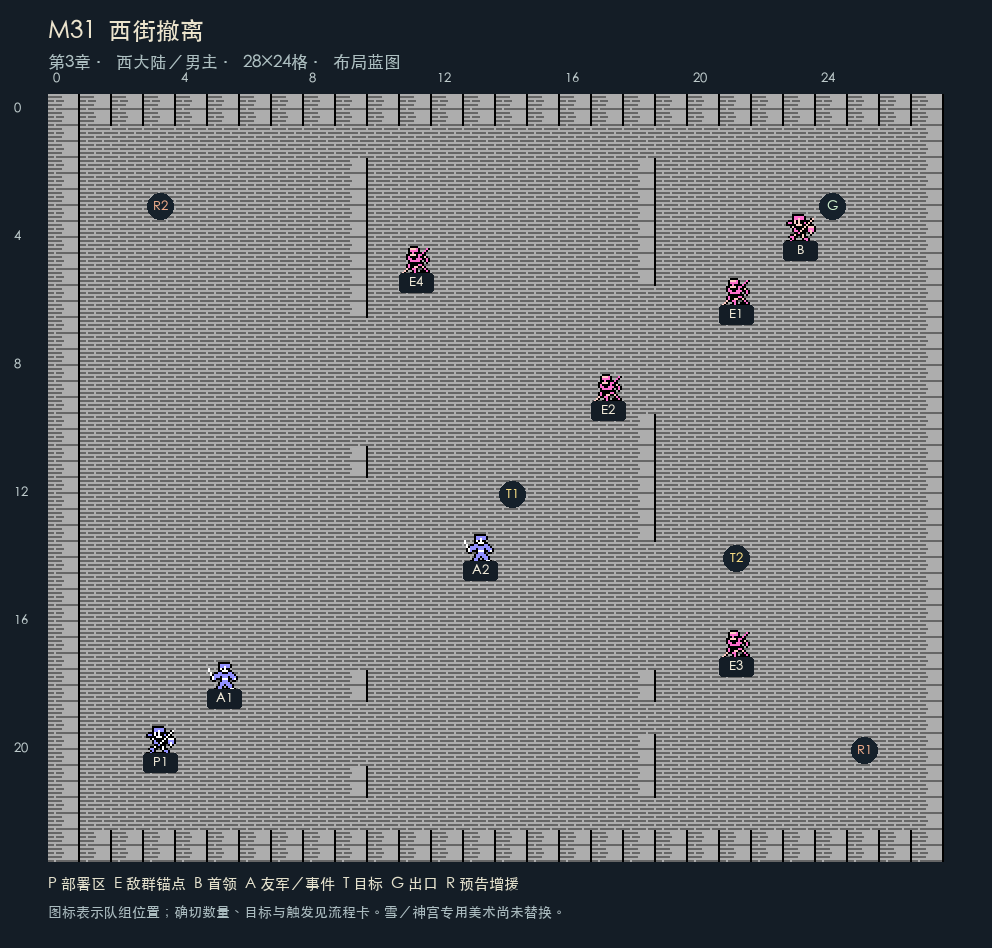

**剧情推动：**D31后神令拘押阻止仪式的人，胡纳普保护艾琳后带西队出城。

**地点与重构：**W06 海峡城；28×24格；采用`city_escape`构图。图块参考原B07／B28，仅借图块、建筑模块和地形配合，部署与通路按本图重新安排。

**部署与空间：**P1 (2,19)—(5,21)。首领B (23,4)；T目标 (14,12)、(21,14)；出口G (24,3)。友军/事件A (5,18)、(13,14)；增援口R (25,20)、(3,3)。

**敌军与增援：**士兵5、弓手3、术士2、队长1；第4回合追兵2，仅一波。 E锚点分别为 (21,6)、(17,9)、(21,17)、(11,5)，四组按实际类型分布。首领必须留独立槽，不与增援重复身份。

**目标格语义：**T1拘押院门；T2侧街路障；A1居民、A2被拘押者；G西门出口。

**AI与时机：**先救人再撤离；队长追胡纳普，弓手封巷口。第4回合R1追兵，仅一波。

**交互契约：**营救院落打开后，被拘押者向G走；任一平民被玩家主动攻击则取消指令并提示对象。

**目标／失败：**救出被拘押者并撤至西门；击败追捕队长。不得攻击平民。 两主角只在自己在场时参与主角败北判定；任一在场主角濒死立即失败，不消耗救治份额。保护、占领类失败另见目标。歼灭与撤离不偷偷切换。

**BEGIN：**蕾娜：西门还没封，先让居民过去。／胡纳普：愿意放下武器的人留在街边。

**MID：**开拘押院门：达恩：这里也有人刚才还在给我们送花。

**END／下一步：**城外D32；若达恩亡，居民认出胡纳普并补充现场，不补发招募。 西队脱围，军需大道开放；D32旧街对话在城外安全区触发。

**招募：**无自动新增正式角色；本关的友军和事件人物不因清场复制进队伍。

**人物缺席分支：**蕾娜未招募或濒死：城外军官指出西门；达恩濒死：居民报告拘押情况，D32仍是两主角私人谈话。

**奖励与返回：**过关经验与明确掉落按现有规则；道具数量与归属另列数值稿。首次完成写`clear_M31`，返程不重复。先返回对应据点/世界节点，完成本卡指定确认后再开放下一节点。

**地形与安全：**P/T/G/A/B均有士兵可通行的地面通路；海面、墙与岩壁阻止步兵。图中的恢复格是有限站位，不能被理解为无限物品或濒死救治点。

#### M32 军需大道截运（主线／西队）

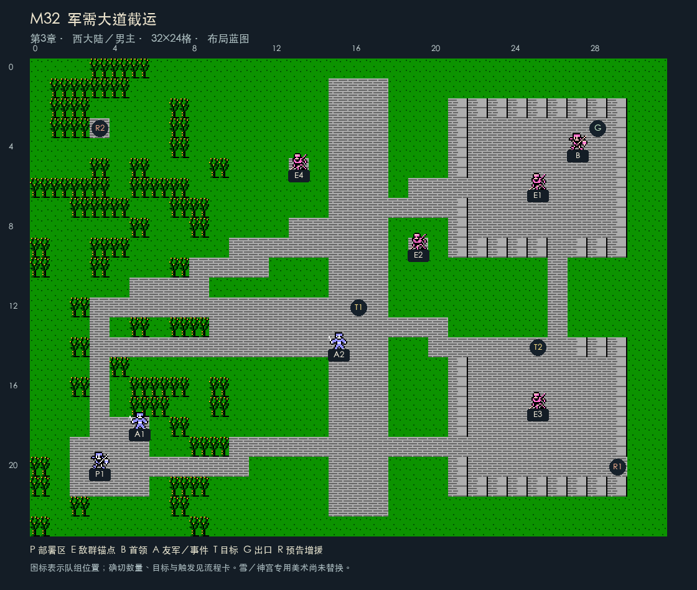

**剧情推动：**神军从道路向东群岛投送物资与拘押工匠，继续扩大仪式。

**地点与重构：**W07 军需大道；32×24格；采用`convoy`构图。图块参考原B17／B33，仅借图块、建筑模块和地形配合，部署与通路按本图重新安排。

**部署与空间：**P1 (2,19)—(5,21)。首领B (27,4)；T目标 (16,12)、(25,14)；出口G (28,3)。友军/事件A (5,18)、(15,14)；增援口R (29,20)、(3,3)。

**敌军与增援：**骑兵4、士兵4、弓手2、护送长1；无追车随机数事件。 E锚点分别为 (25,6)、(19,9)、(25,17)、(13,5)，四组按实际类型分布。首领必须留独立槽，不与增援重复身份。

**目标格语义：**T1/T2两处运输站；A1工匠、A2运输车事件；G敌车北口。

**AI与时机：**车辆在第5回合开始尝试北撤，已被占的站使其停止；护卫优先守站。

**交互契约：**两站控制、工匠释放、护送长败北后胜；车逃走须预先在目标栏说明。

**目标／失败：**占领两处运输站并击败护送长；救出车上的工匠。运输车逃出北口则失败。 两主角只在自己在场时参与主角败北判定；任一在场主角濒死立即失败，不消耗救治份额。保护、占领类失败另见目标。歼灭与撤离不偷偷切换。

**BEGIN：**兰斯：那不是粮车，后面关着修塔的人。／胡纳普：堵住北口，别把车烧了。

**MID：**占领第一站：工匠：沿海石堡还在收我们的工具。

**END／下一步：**奥托或工匠说明地牢支路；确认物资发往沿海营站。 沿海石堡开放；S31救援邀请；取得修复所需普通工具，非唯一终结物。

**招募：**无自动新增正式角色；本关的友军和事件人物不因清场复制进队伍。

**人物缺席分支：**兰斯未招募或濒死：运输工说明车上人员；奥托濒死：地牢邀请来自获救工匠。

**奖励与返回：**过关经验与明确掉落按现有规则；道具数量与归属另列数值稿。首次完成写`clear_M32`，返程不重复。先返回对应据点/世界节点，完成本卡指定确认后再开放下一节点。

**地形与安全：**P/T/G/A/B均有士兵可通行的地面通路；海面、墙与岩壁阻止步兵。图中的恢复格是有限站位，不能被理解为无限物品或濒死救治点。

#### M33 沿海石堡（主线／西队）

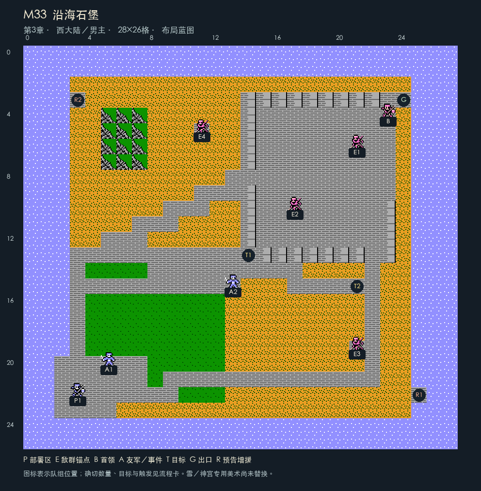

**剧情推动：**石堡护卫提炼院和投送码头，阻止东西队伍联系。

**地点与重构：**W08 沿海石堡；28×26格；采用`shore_fort`构图。图块参考原B29／B04，仅借图块、建筑模块和地形配合，部署与通路按本图重新安排。

**部署与空间：**P1 (2,21)—(5,23)。首领B (23,4)；T目标 (14,13)、(21,15)；出口G (24,3)。友军/事件A (5,20)、(13,15)；增援口R (25,22)、(3,3)。

**敌军与增援：**重装3、士兵5、弓手2、术士1、堡主1、格曼1；投降事件先于清场判断。 E锚点分别为 (21,6)、(17,10)、(21,19)、(11,5)，四组按实际类型分布。首领必须留独立槽，不与增援重复身份。

**目标格语义：**T1码头控制室；T2工房门；A1格曼部下、A2工匠。

**AI与时机：**格曼守工房，不主动追杀工匠；堡主败北后邻接可谈投降，已投降者不计剩敌。

**交互契约：**接受投降不等于自动免罪；据点交代物资与问责后方可招募。

**目标／失败：**击败堡主并控制投送码头；格曼可投降，存活时不作为必须歼灭对象。 两主角只在自己在场时参与主角败北判定；任一在场主角濒死立即失败，不消耗救治份额。保护、占领类失败另见目标。歼灭与撤离不偷偷切换。

**BEGIN：**格曼：里面有工匠，别把主楼拆了。／胡纳普：放下武器的人从南门出来。

**MID：**接近格曼且堡主败北：格曼请求带部下投降，玩家可接纳或只解除武装。

**END／下一步：**取得投送记录；与F33记录互证。D33在两队均到营站后只触发一次。 M33战果记入；与F33都完成后短渡开放，W09共同会谈D33。

**招募：**格曼；接纳投降、存活、据点问责交谈。

**奖励与返回：**过关经验与明确掉落按现有规则；道具数量与归属另列数值稿。首次完成写`clear_M33`，返程不重复。先返回对应据点/世界节点，完成本卡指定确认后再开放下一节点。

**地形与安全：**P/T/G/A/B均有士兵可通行的地面通路；海面、墙与岩壁阻止步兵。图中的恢复格是有限站位，不能被理解为无限物品或濒死救治点。

#### F31 码头脱围（主线／东队）

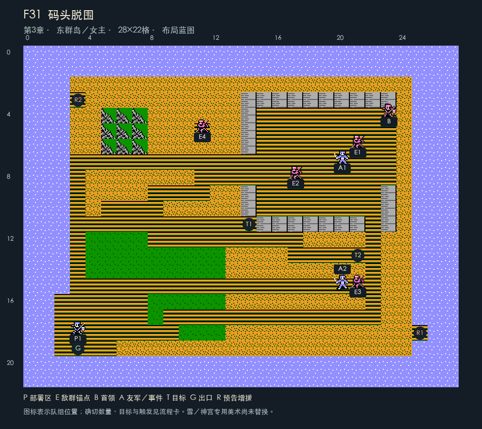

**剧情推动：**神军要把群岛居民送回不可靠岸的海面，东队从码头撤离。

**地点与重构：**W06 海峡城；28×22格；采用`dock_escape`构图。图块参考原B09／B11，仅借图块、建筑模块和地形配合，部署与通路按本图重新安排。

**部署与空间：**P1 (2,17)—(5,19)。首领B (23,4)；T目标 (14,11)、(21,13)；出口G (3,19)。友军/事件A (20,7)、(20,15)；增援口R (25,18)、(3,3)。

**敌军与增援：**海兵5、弓手3、重装2、队长1；第3回合南侧追兵2。 E锚点分别为 (21,6)、(17,8)、(21,15)、(11,5)，四组按实际类型分布。首领必须留独立槽，不与增援重复身份。

**目标格语义：**T1扣船锁；T2停泊通道；A1/A2两组伤者；G己方船口。

**AI与时机：**解除两处封锁后伤者逐组向G撤；首领守扣船所，弓手压跳板。

**交互契约：**返回自己的船而非追入敌仓；伤者的被救状态与之前海战角色一致。

**目标／失败：**保护两组船上伤者回到己方船，并击败扣船队长；伤者全灭失败。 两主角只在自己在场时参与主角败北判定；任一在场主角濒死立即失败，不消耗救治份额。保护、占领类失败另见目标。歼灭与撤离不偷偷切换。

**BEGIN：**米蕾：他们要拖船走，上面还有伤者。／艾琳：卡洛守跳板，我们把人带回来。

**MID：**伤者抵船：罗恩：够了，这一条船先走。下一条还没装完。

**END／下一步：**在城外短暂会合，确认分兵与通信方式，进入东群岛盐路。 盐路开放，母亲航图指向观测路线；D32与男主线战果共同解锁。

**招募：**无自动新增正式角色；本关的友军和事件人物不因清场复制进队伍。

**人物缺席分支：**米蕾濒死：船团医者守跳板；罗恩未招募或濒死：舵手逐船报告人数，不让濒死者承担现场工作或发言。

**奖励与返回：**过关经验与明确掉落按现有规则；道具数量与归属另列数值稿。首次完成写`clear_F31`，返程不重复。先返回对应据点/世界节点，完成本卡指定确认后再开放下一节点。

**地形与安全：**P/T/G/A/B均有士兵可通行的地面通路；海面、墙与岩壁阻止步兵。图中的恢复格是有限站位，不能被理解为无限物品或濒死救治点。

#### F32 盐路解围（主线／东队）

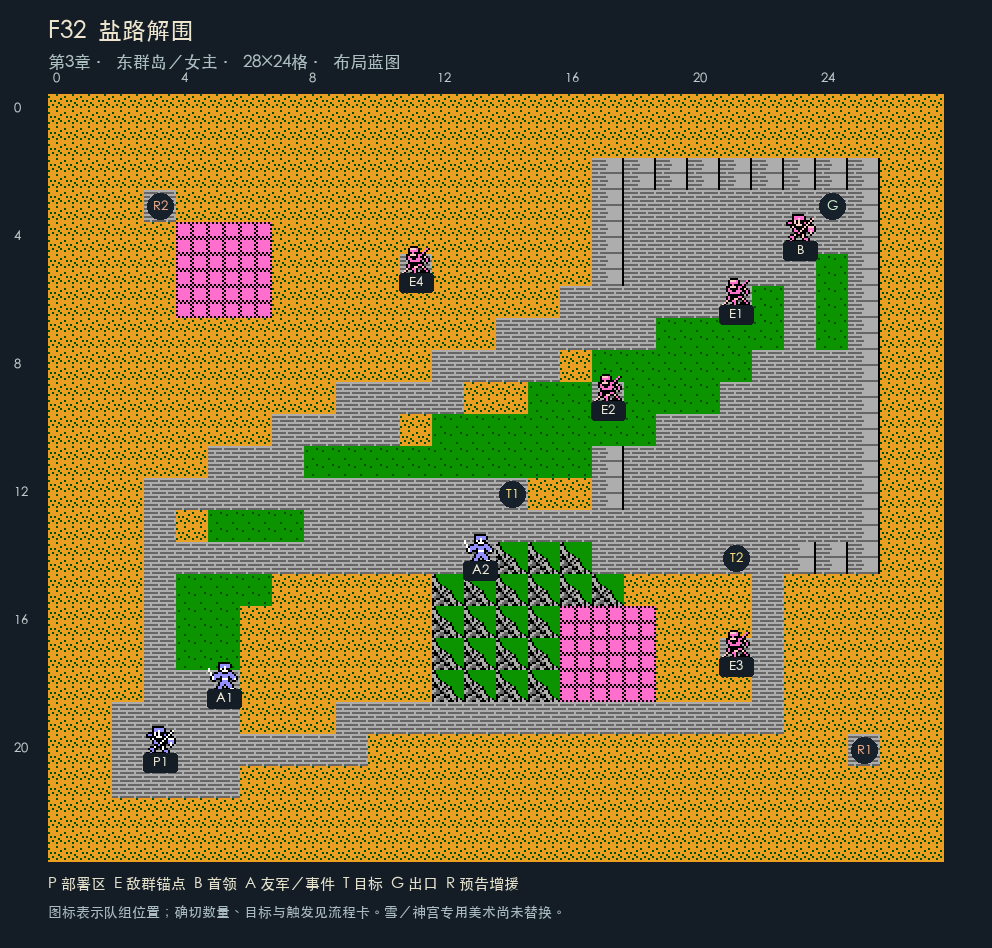

**剧情推动：**神军封锁通往旧海床的路，地方船民无法带队到提炼院。

**地点与重构：**E08 盐路；28×24格；采用`salt_pass`构图。图块参考原B22／B23，仅借图块、建筑模块和地形配合，部署与通路按本图重新安排。

**部署与空间：**P1 (2,19)—(5,21)。首领B (23,4)；T目标 (14,12)、(21,14)；出口G (24,3)。友军/事件A (5,18)、(13,14)；增援口R (25,20)、(3,3)。

**敌军与增援：**佣兵4、弓手3、术士2、飞行2、神官1；无地形隐形伤害。 E锚点分别为 (21,6)、(17,9)、(21,17)、(11,5)，四组按实际类型分布。首领必须留独立槽，不与增援重复身份。

**目标格语义：**T1中央水井；T2路障；A1向导、A2当地船民；G盐路出口。

**AI与时机：**敌术士守长射程区，佣兵借沙边干路追击，飞行威胁法师；避免全体单路堵口。

**交互契约：**向导存活非唯一前提：若已亡，船民留下路线；没有情报锁死。

**目标／失败：**击败封路神官并护送向导至出口；不要求踏遍沙地。 两主角只在自己在场时参与主角败北判定；任一在场主角濒死立即失败，不消耗救治份额。保护、占领类失败另见目标。歼灭与撤离不偷偷切换。

**BEGIN：**罗恩：这里以前是水路，现在他们把井也封了。／艾琳：先让向导穿过那条干道。

**MID：**向导到中央井边：莉莎：右边的术士在等我们走沙地，换一条路。

**END／下一步：**向导报告盐原营地囚犯，给出提炼院后门位置。 提炼院与S32盐原营地开放。

**招募：**无自动新增正式角色；本关的友军和事件人物不因清场复制进队伍。

**人物缺席分支：**罗恩未招募或濒死：向导说明盐井被封；莉莎濒死：艾琳指出侧面术士射程；向导死亡则其路线册保留。

**奖励与返回：**过关经验与明确掉落按现有规则；道具数量与归属另列数值稿。首次完成写`clear_F32`，返程不重复。先返回对应据点/世界节点，完成本卡指定确认后再开放下一节点。

**地形与安全：**P/T/G/A/B均有士兵可通行的地面通路；海面、墙与岩壁阻止步兵。图中的恢复格是有限站位，不能被理解为无限物品或濒死救治点。

#### F33 提炼院后庭（主线／东队）

**剧情推动：**提炼院迫使术士扩大神术转移，男主同时攻占对岸石堡。

**地点与重构：**E09 提炼院；28×24格；采用`refinery`构图。图块参考原B26／B24，仅借图块、建筑模块和地形配合，部署与通路按本图重新安排。

**部署与空间：**P1 (2,19)—(5,21)。首领B (23,4)；T目标 (14,12)、(21,14)；出口G (24,3)。友军/事件A (5,18)、(13,14)；增援口R (25,20)、(3,3)。

**敌军与增援：**重装2、佣兵3、术士3、石像守卫3、控制神官1；同时敌人数不超过14。 E锚点分别为 (21,6)、(17,9)、(21,17)、(11,5)，四组按实际类型分布。首领必须留独立槽，不与增援重复身份。

**目标格语义：**T1调节记录室；T2控制阵台；A1/A2受迫术士。

**AI与时机：**石像守阵台，术士守记录，控制神官不等于所有自然敌源；救人需开门后确认。

**交互契约：**记录复制成功才写clear_F33所对应的信息；与clear_M33双完成后D33会合。

**目标／失败：**击败控制神官，保护两名维持设施的术士，并取得调节记录。 两主角只在自己在场时参与主角败北判定；任一在场主角濒死立即失败，不消耗救治份额。保护、占领类失败另见目标。歼灭与撤离不偷偷切换。

**BEGIN：**艾琳：不要碰中央的阵，先把控制它的人找出来。／卡洛：我守住去工房的门。

**MID：**第一名术士获救：术士说明断裂前循环与现有集中转移的差异。

**END／下一步：**记录移交营站；艾琳承诺先验证再要求男主停塔。 F33战果记入；两端都完成后短渡开放，D33确定第四章修复计划。

**招募：**无自动新增正式角色；本关的友军和事件人物不因清场复制进队伍。

**奖励与返回：**过关经验与明确掉落按现有规则；道具数量与归属另列数值稿。首次完成写`clear_F33`，返程不重复。先返回对应据点/世界节点，完成本卡指定确认后再开放下一节点。

**地形与安全：**P/T/G/A/B均有士兵可通行的地面通路；海面、墙与岩壁阻止步兵。图中的恢复格是有限站位，不能被理解为无限物品或濒死救治点。

#### S31 山村地牢（支线／西队）

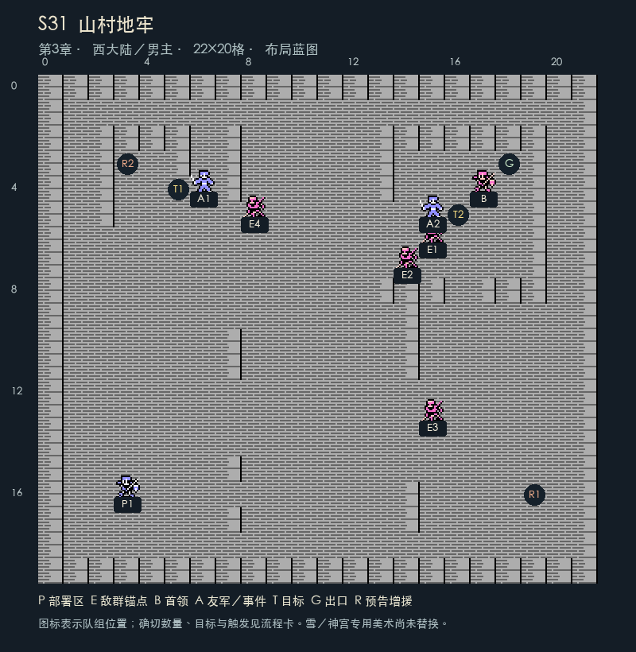

**剧情推动：**蕾娜过去保护的家庭再次被拘押，狱卒中有她旧部。

**地点与重构：**S05 山村地牢；22×20格；采用`dungeon`构图。图块参考原B29／B56，仅借图块、建筑模块和地形配合，部署与通路按本图重新安排。

**部署与空间：**P1 (2,15)—(5,17)。首领B (17,4)；T目标 (5,4)、(16,5)；出口G (18,3)。友军/事件A (6,4)、(15,5)；增援口R (19,16)、(3,3)。

**敌军与增援：**士兵4、重装2、弓手2、狱卒1。 E锚点分别为 (15,6)、(14,7)、(15,13)、(8,5)，四组按实际类型分布。首领必须留独立槽，不与增援重复身份。

**目标格语义：**T1/T2牢门；A1/A2两个家庭。

**AI与时机：**狱卒守通路，旧部可放下武器；援军不无限增。

**交互契约：**保存每组家属生死，缺席蕾娜则由家属叙述。

**目标／失败：**击败狱卒首领，释放两组家庭；至少一组存活。 两主角只在自己在场时参与主角败北判定；任一在场主角濒死立即失败，不消耗救治份额。保护、占领类失败另见目标。歼灭与撤离不偷偷切换。

**BEGIN：**蕾娜或家属：这些人上次已经被准许回家，为什么又被带来了？

**MID：**首领接触蕾娜：旧部可投降，余兵仍可能拒绝。

**END／下一步：**家属请求她战后回来；不自动赦免狱卒责任。 地方协助、蕾娜关系分支；回W07。

**招募：**无自动新增正式角色；本关的友军和事件人物不因清场复制进队伍。

**人物缺席分支：**蕾娜亡由家属指认狱卒；没有本人交涉的投降特例，救援与主线仍可完成。

**奖励与返回：**过关经验与明确掉落按现有规则；道具数量与归属另列数值稿。首次完成写`clear_S31`，返程不重复。支线返回入口节点，保留来向；主线照常可继续。

**地形与安全：**P/T/G/A/B均有士兵可通行的地面通路；海面、墙与岩壁阻止步兵。图中的恢复格是有限站位，不能被理解为无限物品或濒死救治点。

#### S32 盐原营地（支线／东队）

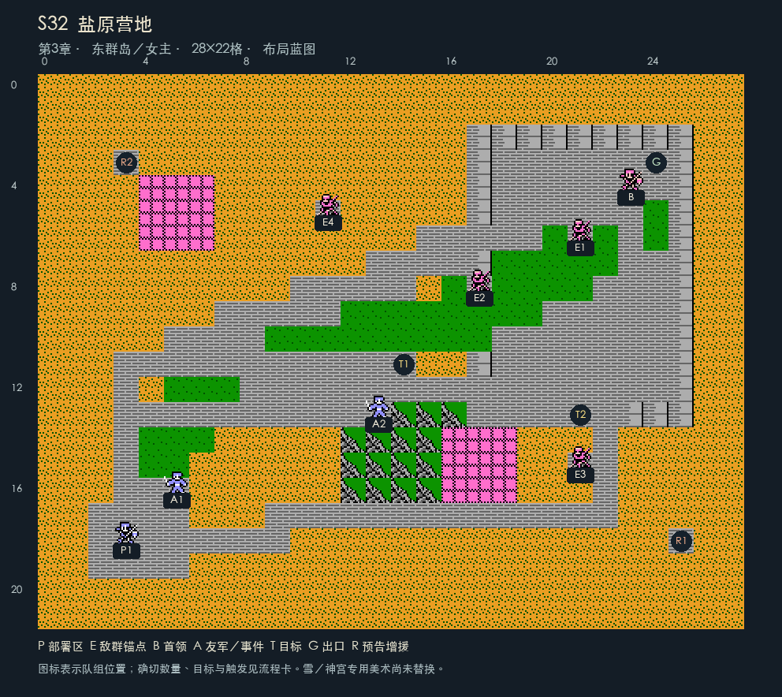

**剧情推动：**被军方征调的诺娅愿提供位置，但必须说明曾泄露船团藏处的事。

**地点与重构：**S06 盐原营地；28×22格；采用`salt_camp`构图。图块参考原B21／B22，仅借图块、建筑模块和地形配合，部署与通路按本图重新安排。

**部署与空间：**P1 (2,17)—(5,19)。首领B (23,4)；T目标 (14,11)、(21,13)；出口G (24,3)。友军/事件A (5,16)、(13,13)；增援口R (25,18)、(3,3)。

**敌军与增援：**佣兵4、弓手2、术士2、营长1。 E锚点分别为 (21,6)、(17,8)、(21,15)、(11,5)，四组按实际类型分布。首领必须留独立槽，不与增援重复身份。

**目标格语义：**T1术士营房；T2居民营房；A1诺娅、A2弟弟与居民。

**AI与时机：**神军守两营，不把诺娅写成被精神控制的无责任角色。

**交互契约：**诺娅与弟弟分别保存，弟弟死亡不自动封死招募。

**目标／失败：**击败营长，打开术士与居民营房；诺娅及弟弟分别记录生死。 两主角只在自己在场时参与主角败北判定；任一在场主角濒死立即失败，不消耗救治份额。保护、占领类失败另见目标。歼灭与撤离不偷偷切换。

**BEGIN：**诺娅：他们用我弟弟逼我。我把船藏在哪里告诉了他们。／艾琳：先把里面的人带出来，之后你要把事情说清楚。

**MID：**打开居民营房：弟弟被救或已死亡分别处理，不能事后补活。

**END／下一步：**诺娅请求参与救援；玩家可招募或只解除武装保护她。 可招诺娅；弟弟结局旗标；回E08。

**招募：**诺娅；存活并接纳，交代责任后加入。

**人物缺席分支：**诺娅招募前死亡则失去招募；弟弟单独保存生死，不能因为后来招募姐姐而复活弟弟。

**奖励与返回：**过关经验与明确掉落按现有规则；道具数量与归属另列数值稿。首次完成写`clear_S32`，返程不重复。支线返回入口节点，保留来向；主线照常可继续。

**地形与安全：**P/T/G/A/B均有士兵可通行的地面通路；海面、墙与岩壁阻止步兵。图中的恢复格是有限站位，不能被理解为无限物品或濒死救治点。

### 第4章

#### M41 雪峡撤离战（主线／西队）

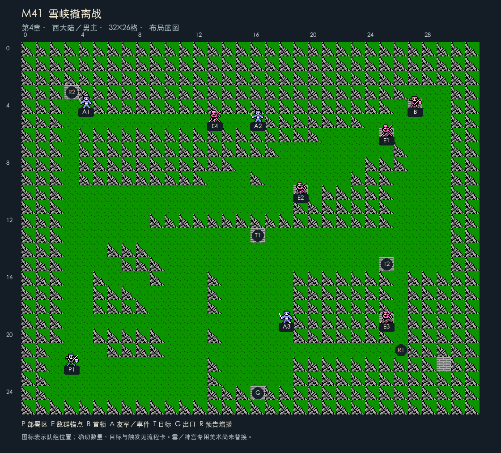

**剧情推动：**乌库布·卡基撤去反抗村落的庇护，护日军堵住撤离道路。

**地点与重构：**W10 雪峡村；32×26格；采用`mountain_evacuate`构图。图块参考原B03／B35，仅借图块、建筑模块和地形配合，部署与通路按本图重新安排。

**部署与空间：**P1 (2,21)—(5,23)。首领B (27,4)；T目标 (16,13)、(25,15)；出口G (16,24)。友军/事件A (4,4)、(16,5)、(18,19)；增援口R (26,21)、(3,3)。

**敌军与增援：**士兵5、重装2、弓手3、骑兵2、指挥官1；第4回合后方骑兵2。 E锚点分别为 (25,6)、(19,10)、(25,19)、(13,5)，四组按实际类型分布。首领必须留独立槽，不与增援重复身份。

**目标格语义：**T1南口路障；T2伤者停靠点；A1/A2/A3三组居民；G南口。

**AI与时机：**居民从北侧向南走2格/己方结束；保住至少两组。第4回合R1北侧追兵2，前一回合提示。

**交互契约：**角色与居民组伤亡分别保存；不能在事后把失败的一组补活。

**目标／失败：**三组居民至少两组抵达南口；击败封路指挥官。失去两组即失败。 两主角只在自己在场时参与主角败北判定；任一在场主角濒死立即失败，不消耗救治份额。保护、占领类失败另见目标。歼灭与撤离不偷偷切换。

**BEGIN：**奥托：这些人留在这里会冻死，先把南口打开。／胡纳普：我带人挡住追兵。

**MID：**第3己方回合：芙拉或居民医者提醒转移病人，说明北口一波援军。

**END／下一步：**奥托承认曾执行封路命令；神的放弃在故乡居民身上成为事实。 居民安置、铁骑关道路开放；S41黑钟村可调查奥托与凯尔旧事。

**招募：**无自动新增正式角色；本关的友军和事件人物不因清场复制进队伍。

**人物缺席分支：**奥托濒死：军令与村民讲述封路，省去奥托本人忏悔；芙拉未招募或濒死：固定医者报告病人。

**奖励与返回：**过关经验与明确掉落按现有规则；道具数量与归属另列数值稿。首次完成写`clear_M41`，返程不重复。先返回对应据点/世界节点，完成本卡指定确认后再开放下一节点。

**地形与安全：**P/T/G/A/B均有士兵可通行的地面通路；海面、墙与岩壁阻止步兵。图中的恢复格是有限站位，不能被理解为无限物品或濒死救治点。

#### M42 铁骑封锁线（主线／西队）

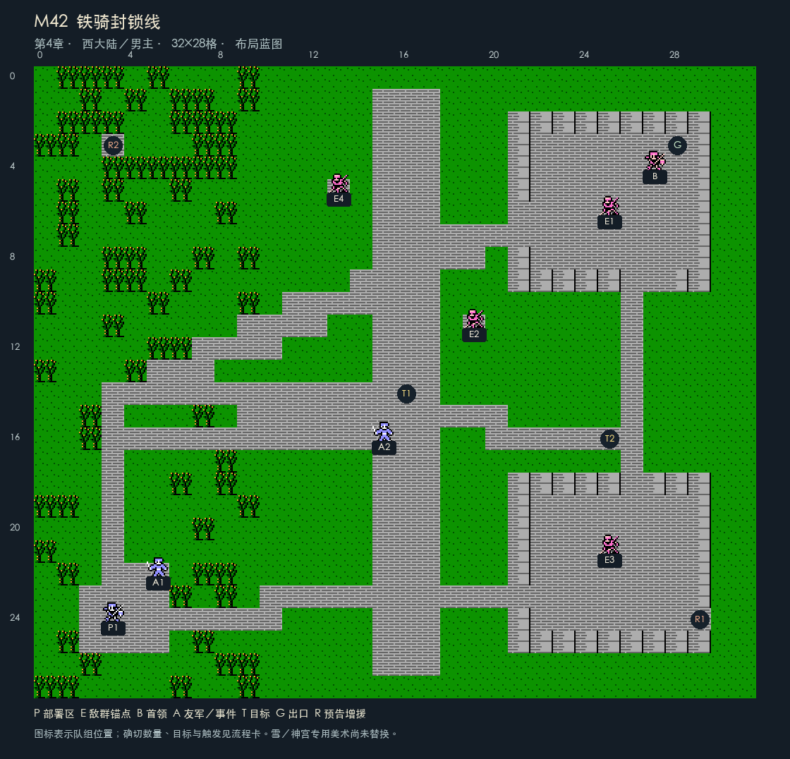

**剧情推动：**亲卫军封交通，同时准备向东群岛投送镇压部队。

**地点与重构：**W11 铁骑关；32×28格；采用`cavalry`构图。图块参考原B33／B34，仅借图块、建筑模块和地形配合，部署与通路按本图重新安排。

**部署与空间：**P1 (2,23)—(5,25)。首领B (27,4)；T目标 (16,14)、(25,16)；出口G (28,3)。友军/事件A (5,22)、(15,16)；增援口R (29,24)、(3,3)。

**敌军与增援：**骑兵7、弓骑2、士兵3、术士1、统领1；最多两名补位骑兵，容量检查。 E锚点分别为 (25,6)、(19,11)、(25,21)、(13,5)，四组按实际类型分布。首领必须留独立槽，不与增援重复身份。

**目标格语义：**T1神术投送站；T2关卡营地；A1旧同袍、A2工匠。

**AI与时机：**骑兵从两翼包抄，弓骑控制开阔地；兰斯交涉可使一组中立，队长仍作战。

**交互契约：**投送站控制后写援军削减旗标，F44开战时固定快照；后到信件不瞬移敌人消失。

**目标／失败：**击败骑兵统领并占领投送站；正式友军可濒死、非正式友军另记真实生死，均不单独导致主线失败。 两主角只在自己在场时参与主角败北判定；任一在场主角濒死立即失败，不消耗救治份额。保护、占领类失败另见目标。歼灭与撤离不偷偷切换。

**BEGIN：**兰斯：我认得他们的队长，先让我说话。／胡纳普：你可以试，但别一个人走到弓手面前。

**MID：**第2回合或首次接触：旧同袍可转中立；拒绝者继续作战，投降不复制正式角色。

**END／下一步：**兰斯处理同袍遗物，发信给艾琳：投送站已停止。 减少F44预告援军一波，并为西线打开北境日塔道路。F44提前完成时改为救后续船队，不重打。

**招募：**无自动新增正式角色；本关的友军和事件人物不因清场复制进队伍。

**人物缺席分支：**兰斯在队且非濒死才有现场的旧同袍交涉。缺席时删掉“我认得”对白、该组照常敌对；不把他的私人关系转给胡纳普。

**奖励与返回：**过关经验与明确掉落按现有规则；道具数量与归属另列数值稿。首次完成写`clear_M42`，返程不重复。先返回对应据点/世界节点，完成本卡指定确认后再开放下一节点。

**地形与安全：**P/T/G/A/B均有士兵可通行的地面通路；海面、墙与岩壁阻止步兵。图中的恢复格是有限站位，不能被理解为无限物品或濒死救治点。

#### M43 北境日塔（主线／西队）

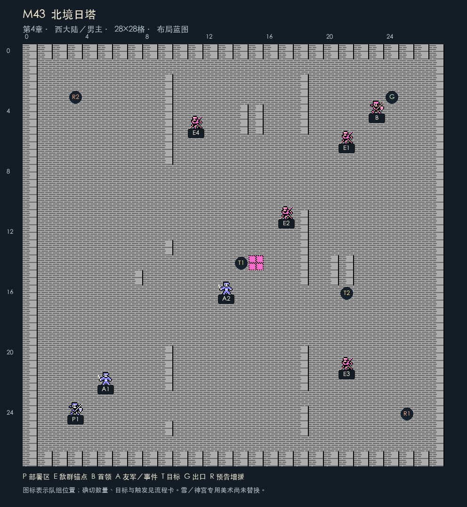

**剧情推动：**日塔继续夺取群岛庇护；直接摧毁会伤害依赖它的西岸居民。

**地点与重构：**W12 北境日塔；28×28格；采用`tower`构图。图块参考原B41／B26，仅借图块、建筑模块和地形配合，部署与通路按本图重新安排。

**部署与空间：**P1 (2,23)—(5,25)。首领B (23,4)；T目标 (14,14)、(21,16)；出口G (24,3)。友军/事件A (5,22)、(13,16)；增援口R (25,24)、(3,3)。

**敌军与增援：**重装4、士兵4、弓手3、术士2、塔卫统领1；无永久无敌拦主线。 E锚点分别为 (21,6)、(17,11)、(21,21)、(11,5)，四组按实际类型分布。首领必须留独立槽，不与增援重复身份。

**目标格语义：**T1外院关卡；T2控制室；A1/A2工匠与病人。

**AI与时机：**重装守台阶、弓手守侧院、塔卫守主室；胜利取得设施，设备等待F42。

**交互契约：**先胜后等待是合法进度：控制室显示缺少的步骤与东线地点，不要求重开关卡。

**目标／失败：**击败塔卫统领、控制外院与控制室；安全停用需要F42记录。未获记录可胜利返回据点，不反复开战。 两主角只在自己在场时参与主角败北判定；任一在场主角濒死立即失败，不消耗救治份额。保护、占领类失败另见目标。歼灭与撤离不偷偷切换。

**BEGIN：**胡纳普：先夺控制室，谁都别拆塔。／芙拉：下面还有看护病人的人。

**MID：**到达控制室：工匠说明缺少调节步骤；字幕提示可转东线，不要求重试战斗。

**END／下一步：**若F42已完成，现场依记录停用；否则军队驻守，玩家切队或探索支线。 记m43_seized；F42完成后据点确认停用，记west_tower_safe，再开放王都道路。

**招募：**无自动新增正式角色；本关的友军和事件人物不因清场复制进队伍。

**人物缺席分支：**芙拉未招募或濒死：工匠报告病人；控制室设备文字始终保留完整操作步骤。

**奖励与返回：**过关经验与明确掉落按现有规则；道具数量与归属另列数值稿。首次完成写`clear_M43`，返程不重复。先返回对应据点/世界节点，完成本卡指定确认后再开放下一节点。

**地形与安全：**P/T/G/A/B均有士兵可通行的地面通路；海面、墙与岩壁阻止步兵。图中的恢复格是有限站位，不能被理解为无限物品或濒死救治点。

#### M44 王都城门（主线／西队）

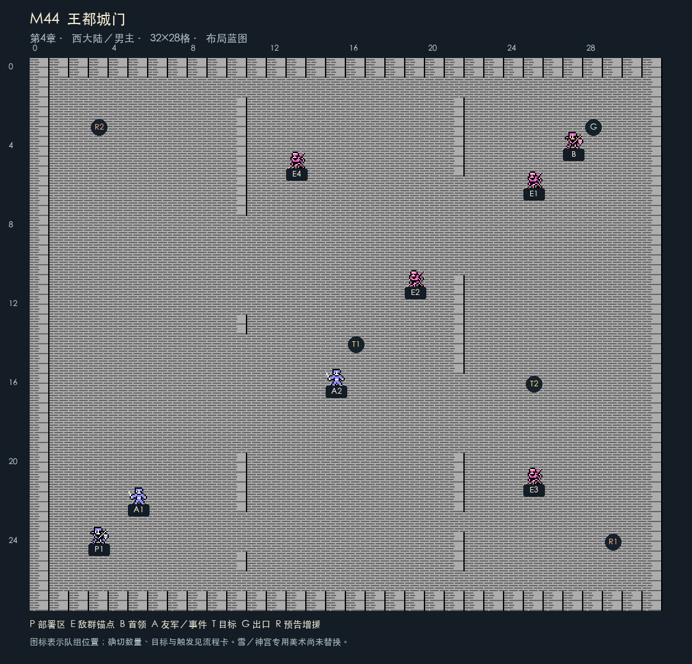

**剧情推动：**赫兰承认东群岛受害，却仍以保护西岸为由阻止停用与讨神。

**地点与重构：**W13 王都；32×28格；采用`city_gate`构图。图块参考原B07／B42，仅借图块、建筑模块和地形配合，部署与通路按本图重新安排。

**部署与空间：**P1 (2,23)—(5,25)。首领B (27,4)；T目标 (16,14)、(25,16)；出口G (28,3)。友军/事件A (5,22)、(15,16)；增援口R (29,24)、(3,3)。

**敌军与增援：**骑兵4、重装4、弓手3、术士2、赫兰1；第4回合卫兵2，合计≤16。 E锚点分别为 (25,6)、(19,11)、(25,21)、(13,5)，四组按实际类型分布。首领必须留独立槽，不与增援重复身份。

**目标格语义：**T1门楼；T2伤兵后撤门；A1/A2教团伤者；B赫兰。

**AI与时机：**赫兰指挥两翼骑兵，半血后让伤兵后退；战败投降立刻结束对其攻击，余兵按投降状态结算。

**交互契约：**保留赫兰承担责任的剧情身份，不将其复制为两队正式单位。

**目标／失败：**击败赫兰并占领门楼；投降后停止针对其攻击，胜利不要求屠尽教团。 两主角只在自己在场时参与主角败北判定；任一在场主角濒死立即失败，不消耗救治份额。保护、占领类失败另见目标。歼灭与撤离不偷偷切换。

**额外前置：**`west_tower_safe`；条件不足在世界/据点说明可操作路径，不消耗本关奖励。

**BEGIN：**D41；蕾娜请求给投降者留下通道。若未招募或濒死，投降军官提出同样诉求。

**MID：**赫兰半血：命令伤兵退入城内；不是回复整支军队或重置战果。

**END／下一步：**赫兰被解除武装；胡纳普要求他先负责带来的伤兵，第四章西线收束。 赫兰失去仪式指挥权，被留守看护伤兵；clear_M44。

**招募：**无自动新增正式角色；本关的友军和事件人物不因清场复制进队伍。

**人物缺席分支：**蕾娜未招募或濒死：投降军官请求留下后撤门；赫兰必须存活到战后承担责任，不做可被任意招募的正式角色。

**奖励与返回：**过关经验与明确掉落按现有规则；道具数量与归属另列数值稿。首次完成写`clear_M44`，返程不重复。先返回对应据点/世界节点，完成本卡指定确认后再开放下一节点。

**地形与安全：**P/T/G/A/B均有士兵可通行的地面通路；海面、墙与岩壁阻止步兵。图中的恢复格是有限站位，不能被理解为无限物品或濒死救治点。

#### F41 沙城守井战（主线／东队）

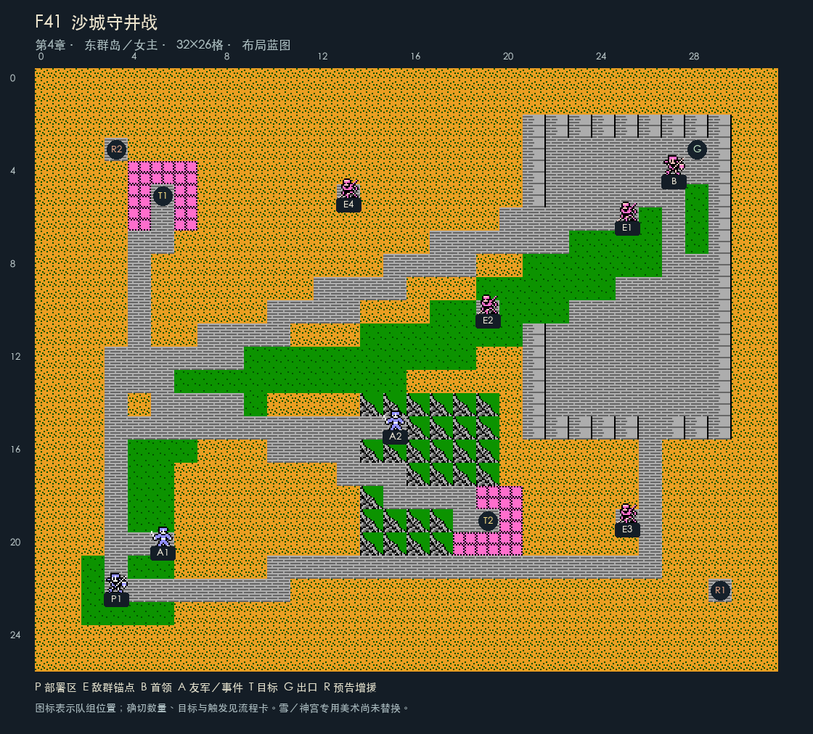

**剧情推动：**神军强迁居民、拆毁通向观测台的道路，沙城即将失去补给。

**地点与重构：**E10 沙城；32×26格；采用`well`构图。图块参考原B21／B23，仅借图块、建筑模块和地形配合，部署与通路按本图重新安排。

**部署与空间：**P1 (2,21)—(5,23)。首领B (27,4)；T目标 (5,5)、(19,19)；出口G (28,3)。友军/事件A (5,20)、(15,15)；增援口R (29,22)、(3,3)。

**敌军与增援：**佣兵4、弓手3、术士2、飞行3、队长1；第3回合东北佣兵2。 E锚点分别为 (25,6)、(19,10)、(25,19)、(13,5)，四组按实际类型分布。首领必须留独立槽，不与增援重复身份。

**目标格语义：**T1/T2两口井；A1地方居民、A2向导。

**AI与时机：**守军强迁，敌群抢井。连续占井一回合才失守；夺回可恢复本战控制。

**交互契约：**第6回合与首领败北双条件齐备才胜；无演员一死便丢唯一古道。

**目标／失败：**守住两处水井至第6己方回合，击败强迁队长；一处可失，全部失守则失败。 两主角只在自己在场时参与主角败北判定；任一在场主角濒死立即失败，不消耗救治份额。保护、占领类失败另见目标。歼灭与撤离不偷偷切换。

**BEGIN：**莉莎：他们要把井封上。／艾琳：我们留在这里，让居民先把水取够。

**MID：**第4己方回合：莉莎主动要求守另一口井，避免所有法师挤在一点。

**END／下一步：**居民向导加入剧情队伍，不能作为唯一可阵亡的开门角色。 居民愿提供向导，观测台道路开放。

**招募：**无自动新增正式角色；本关的友军和事件人物不因清场复制进队伍。

**人物缺席分支：**莉莎濒死：艾琳分配守井；保留向导路线情报，不复制已经死亡的向导。

**奖励与返回：**过关经验与明确掉落按现有规则；道具数量与归属另列数值稿。首次完成写`clear_F41`，返程不重复。先返回对应据点/世界节点，完成本卡指定确认后再开放下一节点。

**地形与安全：**P/T/G/A/B均有士兵可通行的地面通路；海面、墙与岩壁阻止步兵。图中的恢复格是有限站位，不能被理解为无限物品或濒死救治点。

#### F42 盐原观测台（主线／东队）

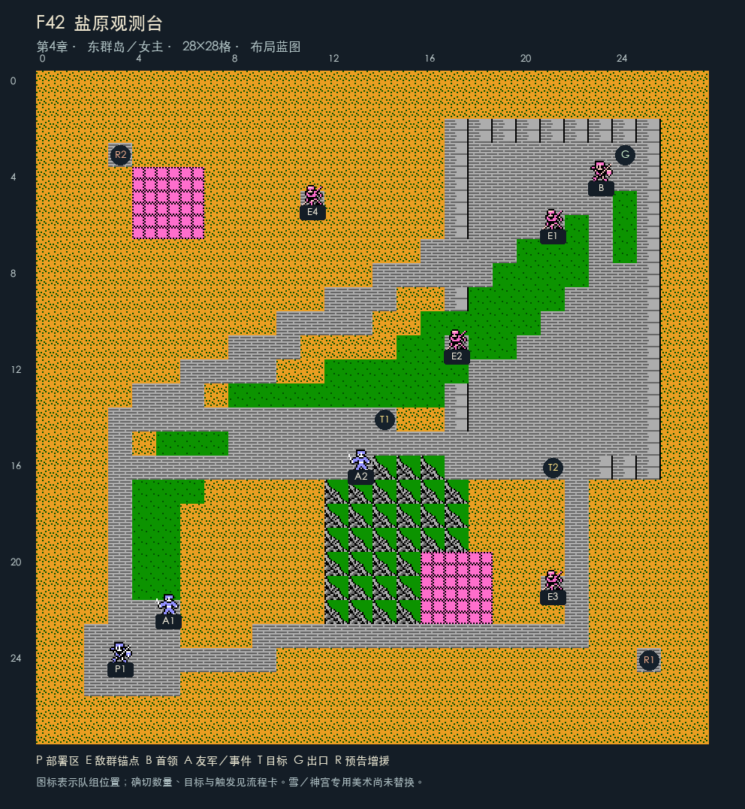

**剧情推动：**萨弥认为地方自行调节会引起新大灾，准备毁掉替代神幕的办法。

**地点与重构：**E11 盐原观测台；28×28格；采用`observatory`构图。图块参考原B26／B24，仅借图块、建筑模块和地形配合，部署与通路按本图重新安排。

**部署与空间：**P1 (2,23)—(5,25)。首领B (23,4)；T目标 (14,14)、(21,16)；出口G (24,3)。友军/事件A (5,22)、(13,16)；增援口R (25,24)、(3,3)。

**敌军与增援：**术士4、弓手3、石像守卫4、重装2、萨弥1；焚毁行动提前一回合明确预告。 E锚点分别为 (21,6)、(17,11)、(21,21)、(11,5)，四组按实际类型分布。首领必须留独立槽，不与增援重复身份。

**目标格语义：**T1记录室；T2观测设备；A1抄录工、A2本地术士。

**AI与时机：**萨弥守设备，焚毁兵在第5回合预告、第6回合开始尝试；需连续两次确认才毁记录。

**交互契约：**保护记录后面对设备复制；信使发送无需装备或丢弃母亲航图。

**目标／失败：**击败神官萨弥，保住记录室并面对设备确认复制资料；资料被焚毁则失败。 两主角只在自己在场时参与主角败北判定；任一在场主角濒死立即失败，不消耗救治份额。保护、占领类失败另见目标。歼灭与撤离不偷偷切换。

**BEGIN：**艾琳：记录在东楼，别让拿火把的人进去。／莉莎：萨弥在中央，我从另一边过去。

**MID：**萨弥半血或接近记录室：讨论地方控制；若诺娅在场，她主动承认曾泄露藏船处。

**END／下一步：**复制记录并派固定信使；信使不占正式名册或玩家救治名单，不收取唯一道具。 F42-MYTH场景线索按5.2节播放，不追加战斗。 obs_steps_ready发出；M43无需重战即可安全停用。女主取得祭所坐标。

**招募：**无自动新增正式角色；本关的友军和事件人物不因清场复制进队伍。

**人物缺席分支：**莉莎濒死：艾琳选择另一条进攻路；诺娅未招募或濒死则省去现场的承认对白，主线资料由记录本身提供。

**奖励与返回：**过关经验与明确掉落按现有规则；道具数量与归属另列数值稿。首次完成写`clear_F42`，返程不重复。先返回对应据点/世界节点，完成本卡指定确认后再开放下一节点。

**地形与安全：**P/T/G/A/B均有士兵可通行的地面通路；海面、墙与岩壁阻止步兵。图中的恢复格是有限站位，不能被理解为无限物品或濒死救治点。

#### F43 亡潮沼泽（主线／东队）

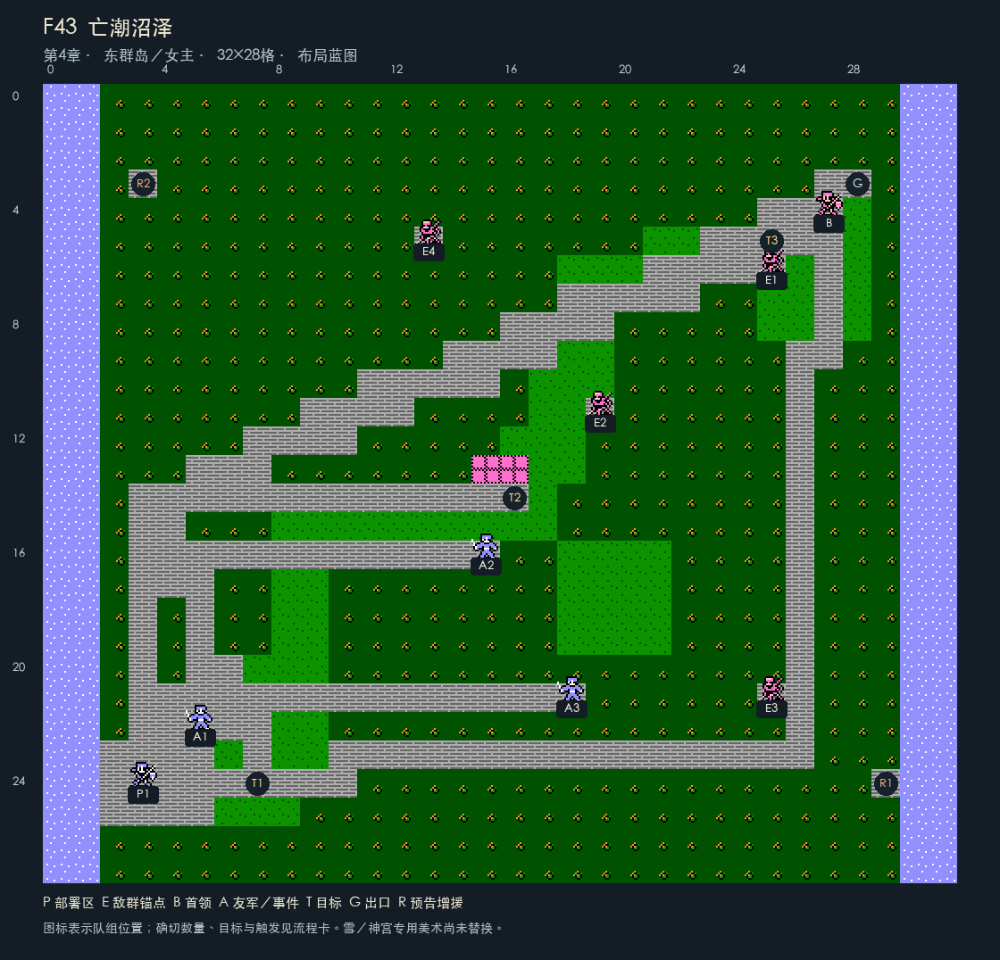

**剧情推动：**祭所古道被魔物与神官阻断，居民不能留在失去庇护的区域。

**地点与重构：**E12 亡潮沼泽；32×28格；采用`swamp`构图。图块参考原B43／B48，仅借图块、建筑模块和地形配合，部署与通路按本图重新安排。

**部署与空间：**P1 (2,23)—(5,25)。首领B (27,4)；T目标 (7,24)、(16,14)、(25,5)；出口G (28,3)。友军/事件A (5,22)、(15,16)、(18,21)；增援口R (29,24)、(3,3)。

**敌军与增援：**僵尸型魔物4、石像鬼3、术士2、召唤神官1；一波召唤最多3，活敌≤20且保留指挥槽。 E锚点分别为 (25,6)、(19,11)、(25,21)、(13,5)，四组按实际类型分布。首领必须留独立槽，不与增援重复身份。

**目标格语义：**T1/T2/T3为三个干地节点；A1/A2/A3三组居民；G祭所古道出口。

**AI与时机：**神官召唤有容量上限，飞行怪威胁医疗；居民沿干路走2格，毒沼保留现行扣HP。

**交互契约：**三个节点依次确认打开，不要求三名正式角色永久同时站住；至少两组居民撤出。

**目标／失败：**打通三处干地节点、击败召唤神官并护送至少两组居民至出口。 两主角只在自己在场时参与主角败北判定；任一在场主角濒死立即失败，不消耗救治份额。保护、占领类失败另见目标。歼灭与撤离不偷偷切换。

**BEGIN：**米蕾或船团医者：有几个人不能走路。／卡洛：我把船留在最后那块干地旁。

**MID：**召唤神官败北：其指定召唤物退去，剩余自然魔物继续行动；恢复点可供有限站位。

**END／下一步：**分批转运完成，艾琳不要求居民与正式成员共享物品槽。 祭所道路与S42孤岛支线开放；清理召唤物不自动消除自然魔物。

**招募：**无自动新增正式角色；本关的友军和事件人物不因清场复制进队伍。

**人物缺席分支：**米蕾濒死：船团医者要求带病人；卡洛濒死：舵手安排船；自然魔物与召唤物清理仍分别判断。

**奖励与返回：**过关经验与明确掉落按现有规则；道具数量与归属另列数值稿。首次完成写`clear_F43`，返程不重复。先返回对应据点/世界节点，完成本卡指定确认后再开放下一节点。

**地形与安全：**P/T/G/A/B均有士兵可通行的地面通路；海面、墙与岩壁阻止步兵。毒沼保留干地与恢复点，阶段伤害沿用类别16。

#### F44 沉没祭所（主线／东队）

**剧情推动：**神军封住修复核心，女主必须证明停塔后地方循环仍能保护岛屿。

**地点与重构：**E13 沉没祭所；32×28格；采用`shrine`构图。图块参考原B72／B77，仅借图块、建筑模块和地形配合，部署与通路按本图重新安排。

**部署与空间：**P1 (2,23)—(5,25)。首领B (27,4)；T目标 (16,14)、(25,16)、(10,9)；出口G (28,3)。友军/事件A (5,22)、(15,16)；增援口R (29,24)、(3,3)。

**敌军与增援：**石像守卫5、飞行魔物3、术士3、天翼守兽1；未完成M42有预告援军2，完成则取消。 E锚点分别为 (25,6)、(19,11)、(25,21)、(13,5)，四组按实际类型分布。首领必须留独立槽，不与增援重复身份。

**目标格语义：**T1/T2/T3为三个调节点；A1/A2修复人员；B天翼守兽。

**AI与时机：**飞行守兽压后排，石像守通路；增援是否有一波在开战前说明并写快照。

**交互契约：**逐点确认后由剧情维修者接手，不占正式队伍槽；局部隔离试验先成功，D42等西塔停用后跨队确认。

**目标／失败：**击败天翼守兽，控制三处调节点；保护修复区至确认成功。 两主角只在自己在场时参与主角败北判定；任一在场主角濒死立即失败，不消耗救治份额。保护、占领类失败另见目标。歼灭与撤离不偷偷切换。

**BEGIN：**艾琳：三个调节点都要有人守住，别只往中央走。／希雅：我可以去最远的那一个。

**MID：**M42信件到达或本关开始：明确告知投送援军有无；可在战前切西队，战中不悄改同一战快照。

**END／下一步：**D42现场验证；修复不自动救治濒死成员、不全队回血、不新增攻击；最后一份救治材料另在D42确认后送至H10。 island_loop_safe；若M43安全停用已完成则触发D42。两线都完成后进入第五章。

**招募：**无自动新增正式角色；本关的友军和事件人物不因清场复制进队伍。

**人物缺席分支：**希雅未招募或濒死时，工匠指出最远节点的干地通路；D42另按人物状态判断，米蕾濒死时由船团医者报告居民，莉莎濒死时由地方技术员报告设备，不让仍在队的濒死者承担现场工作。

**奖励与返回：**过关经验与明确掉落按现有规则；道具数量与归属另列数值稿。首次完成写`clear_F44`，返程不重复。先返回对应据点/世界节点，完成本卡指定确认后再开放下一节点。

**地形与安全：**P/T/G/A/B均有士兵可通行的地面通路；海面、墙与岩壁阻止步兵。图中的恢复格是有限站位，不能被理解为无限物品或濒死救治点。

#### S41 黑钟村名册（支线／西队）

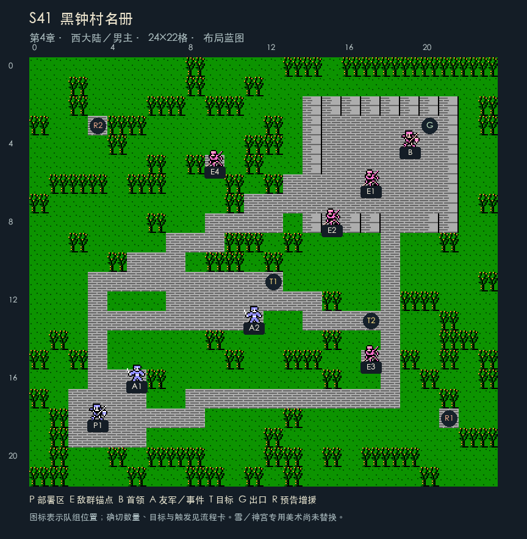

**剧情推动：**奥托旧同袍拒认封路责任，神军要清除失踪者名单。

**地点与重构：**S07 黑钟村；24×22格；采用`black_village`构图。图块参考原B38／B39，仅借图块、建筑模块和地形配合，部署与通路按本图重新安排。

**部署与空间：**P1 (2,17)—(5,19)。首领B (19,4)；T目标 (12,11)、(17,13)；出口G (20,3)。友军/事件A (5,16)、(11,13)；增援口R (21,18)、(3,3)。

**敌军与增援：**士兵4、弓手3、术士1、队长1。 E锚点分别为 (17,6)、(15,8)、(17,15)、(9,5)，四组按实际类型分布。首领必须留独立槽，不与增援重复身份。

**目标格语义：**T1名册屋；T2村中避难院；A1村民、A2旧同袍。

**AI与时机：**焚毁兵第4回合预告、第5回合行动；连续两次焚毁确认才毁名册。

**交互契约：**名册失去可结束清场、记录支线失败，不阻断主线或强制重试。

**目标／失败：**保护名册屋，击败焚毁队长；名册被毁时支线收益失去，但主线仍继续。 两主角只在自己在场时参与主角败北判定；任一在场主角濒死立即失败，不消耗救治份额。保护、占领类失败另见目标。歼灭与撤离不偷偷切换。

**BEGIN：**奥托或村民：名字都在那间屋里。他们说要把村里腾空。

**MID：**到名册屋：明确出现凯尔曾执行迁徙命令的记录。

**END／下一步：**胡纳普保存完整名册，既记兄长救人，也不删掉他此前做过的事。 凯尔与奥托过去的补充证言、普通装备；回W10。

**招募：**无自动新增正式角色；本关的友军和事件人物不因清场复制进队伍。

**人物缺席分支：**奥托濒死时由村民出示名册；凯尔过去的军令仍在，不借别人说奥托自己的忏悔。

**奖励与返回：**过关经验与明确掉落按现有规则；道具数量与归属另列数值稿。首次完成写`clear_S41`，返程不重复。支线返回入口节点，保留来向；主线照常可继续。

**地形与安全：**P/T/G/A/B均有士兵可通行的地面通路；海面、墙与岩壁阻止步兵。图中的恢复格是有限站位，不能被理解为无限物品或濒死救治点。

#### S42 沼泽孤岛（支线／东队）

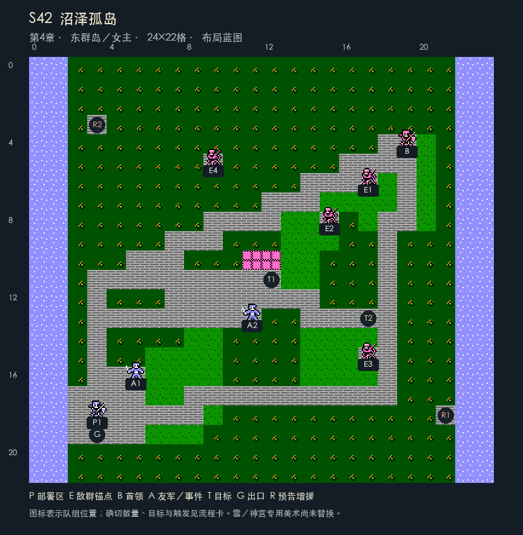

**剧情推动：**赛琳守着不能步行的人，拒绝神官要求烧掉停留处的命令。

**地点与重构：**S08 沼泽孤岛；24×22格；采用`island_clinic`构图。图块参考原B43／B57，仅借图块、建筑模块和地形配合，部署与通路按本图重新安排。

**部署与空间：**P1 (2,17)—(5,19)。首领B (19,4)；T目标 (12,11)、(17,13)；出口G (3,19)。友军/事件A (5,16)、(11,13)；增援口R (21,18)、(3,3)。

**敌军与增援：**飞行魔物3、术士2、士兵3、队长1。 E锚点分别为 (17,6)、(15,8)、(17,15)、(9,5)，四组按实际类型分布。首领必须留独立槽，不与增援重复身份。

**目标格语义：**T1船边停靠点；T2诊疗处；A1赛琳与病人、A2第二组病人；G船口。

**AI与时机：**飞行敌绕干地，士兵从南口进；病人由护送而非传送技能唯一解法。

**交互契约：**安置后地方医者留守，赛琳可选择远征。

**目标／失败：**保护病人至少两组撤离，击败清洗队；赛琳与病人分别记录生死。 两主角只在自己在场时参与主角败北判定；任一在场主角濒死立即失败，不消耗救治份额。保护、占领类失败另见目标。歼灭与撤离不偷偷切换。

**BEGIN：**赛琳：我不能把他们留在这里。你们有能靠岸的船吗？／艾琳：先守住这块干地，我们来安排。

**MID：**第二组病人撤离：赛琳安排地方医者留下，不把全体医疗交给主角。

**END／下一步：**赛琳在安置完成后选择是否远征。 可招赛琳、居民安置旗标；回E12。

**招募：**赛琳；存活、病人安置完成、交谈。

**人物缺席分支：**赛琳死则地方医者负责安置，救援可完成但无招募。

**奖励与返回：**过关经验与明确掉落按现有规则；道具数量与归属另列数值稿。首次完成写`clear_S42`，返程不重复。支线返回入口节点，保留来向；主线照常可继续。

**地形与安全：**P/T/G/A/B均有士兵可通行的地面通路；海面、墙与岩壁阻止步兵。毒沼保留干地与恢复点，阶段伤害沿用类别16。

### 第5章

#### M51 王都内廷（主线／西队）

**剧情推动：**神军要把被赫兰带来的伤兵当违禁者拘押，赫兰第一次违抗神令。

**地点与重构：**W13 王都；28×26格；采用`palace`构图。图块参考原B42／B29，仅借图块、建筑模块和地形配合，部署与通路按本图重新安排。

**部署与空间：**P1 (2,21)—(5,23)。首领B (23,4)；T目标 (14,13)、(21,15)；出口G (24,3)。友军/事件A (5,20)、(13,15)；增援口R (25,22)、(3,3)。

**敌军与增援：**士兵5、重装3、术士2、队长1；第4回合后门卫兵2。 E锚点分别为 (21,6)、(17,10)、(21,19)、(11,5)，四组按实际类型分布。首领必须留独立槽，不与增援重复身份。

**目标格语义：**T1伤兵院门；T2后撤门；A1赫兰及伤兵、A2另一组伤兵；G南路。

**AI与时机：**清洗队追被判违禁的伤者，赫兰只开门不提供额外玩家攻击或免费回合。

**交互契约：**救出至少一组、队长败北后继续；赫兰不会因救人自动获赦。

**目标／失败：**击败清洗队长、救出两组伤兵；至少一组撤离。赫兰作为非正式NPC不能被玩家攻击。 两主角只在自己在场时参与主角败北判定；任一在场主角濒死立即失败，不消耗救治份额。保护、占领类失败另见目标。歼灭与撤离不偷偷切换。

**额外前置：**`chapter4_closed`；条件不足在世界/据点说明可操作路径，不消耗本关奖励。

**BEGIN：**D51；赫兰打开后撤门，正式角色仍由玩家指挥。

**MID：**伤兵抵出口：蕾娜或军官负责看守与救助；不把赫兰自动加入正式队伍。

**END／下一步：**赫兰留下接受审查，提供神宫通道位置，胡纳普继续进军。 D51补偿行动，王都后路开放；登天桥可进入。

**招募：**无自动新增正式角色；本关的友军和事件人物不因清场复制进队伍。

**人物缺席分支：**蕾娜亡由投降军官协助赫兰；赫兰最终留守与问责不需要蕾娜存在。

**奖励与返回：**过关经验与明确掉落按现有规则；道具数量与归属另列数值稿。首次完成写`clear_M51`，返程不重复。先返回对应据点/世界节点，完成本卡指定确认后再开放下一节点。

**地形与安全：**P/T/G/A/B均有士兵可通行的地面通路；海面、墙与岩壁阻止步兵。图中的恢复格是有限站位，不能被理解为无限物品或濒死救治点。

#### F51 祭所底层（主线／东队）

**剧情推动：**地方循环须扩大到能承接解除神幕后的保护，神卫攻击修复者。

**地点与重构：**E13 沉没祭所；28×26格；采用`shrine_depth`构图。图块参考原B73／B74，仅借图块、建筑模块和地形配合，部署与通路按本图重新安排。

**部署与空间：**P1 (2,21)—(5,23)。首领B (23,4)；T目标 (14,13)、(21,15)；出口G (24,3)。友军/事件A (5,20)、(13,15)；增援口R (25,22)、(3,3)。

**敌军与增援：**石像守卫4、魔眼型3、术士3、守卫首领1；第3回合侧门魔物2。 E锚点分别为 (21,6)、(17,10)、(21,19)、(11,5)，四组按实际类型分布。首领必须留独立槽，不与增援重复身份。

**目标格语义：**T1/T2修复区；A1/A2技术人员。

**AI与时机：**神卫同时攻两个修复区；保护人员可由设施NPC替代，不是可阵亡的唯一术士。

**交互契约：**两处修复完成后共同网络接手，女主可以离开，不让她终生留守装置。

**目标／失败：**击败守卫首领，保护两个修复区；工作人员可由剧情替代，不绑定某位正式成员存活。 两主角只在自己在场时参与主角败北判定；任一在场主角濒死立即失败，不消耗救治份额。保护、占领类失败另见目标。歼灭与撤离不偷偷切换。

**额外前置：**`chapter4_closed`；条件不足在世界/据点说明可操作路径，不消耗本关奖励。

**BEGIN：**艾琳：外面的人已经能留在岸上了。这一层得继续修，不能全跟我们走。

**MID：**第二修复区开启：技术员分工，艾琳将记录交给多人，不出现唯一血脉钥匙。

**END／下一步：**维修者接手维持工作，女主进入神宫通道。 east_network_ready；祭所神术通道通向日宫下层。

**招募：**无自动新增正式角色；本关的友军和事件人物不因清场复制进队伍。

**奖励与返回：**过关经验与明确掉落按现有规则；道具数量与归属另列数值稿。首次完成写`clear_F51`，返程不重复。先返回对应据点/世界节点，完成本卡指定确认后再开放下一节点。

**地形与安全：**P/T/G/A/B均有士兵可通行的地面通路；海面、墙与岩壁阻止步兵。图中的恢复格是有限站位，不能被理解为无限物品或濒死救治点。

#### M52 登天桥（主线／西队）

**剧情推动：**神的亲卫仍封住神宫入口，必须由军队夺下通道。

**地点与重构：**W14 登天桥；32×24格；采用`bridge`构图。图块参考原B37／B41，仅借图块、建筑模块和地形配合，部署与通路按本图重新安排。

**部署与空间：**P1 (2,11)—(5,13)。首领B (27,12)；T目标 (16,12)、(25,14)；出口G (28,12)。友军/事件A (5,12)、(15,13)；增援口R (29,12)、(6,10)。

**敌军与增援：**骑兵4、重装3、弓手3、飞行3、统领1；第4回合后桥骑兵2。 E锚点分别为 (25,12)、(19,12)、(22,4)、(11,19)，四组按实际类型分布。首领必须留独立槽，不与增援重复身份。

**目标格语义：**T1中桥控制闸；T2侧桥通路；A1投降兵、A2护桥工；G神宫入口。

**AI与时机：**骑兵压前段，重装阻中桥，飞行可绕但受弓手射程；桥外不额外加随机坠落。

**交互契约：**入口夺取后合法等待另一队，清楚提示F52所在通路。

**目标／失败：**突破三段桥面，击败神骑统领；桥边为不可通行区域，非额外坠落随机判定。 两主角只在自己在场时参与主角败北判定；任一在场主角濒死立即失败，不消耗救治份额。保护、占领类失败另见目标。歼灭与撤离不偷偷切换。

**BEGIN：**兰斯或领队：弓手在中段，前面还有重装。我们别一次全过桥。

**MID：**首领半血：请求服从神令，投降者退至后桥，不延长无限刷兵。

**END／下一步：**西队驻守神宫入口，玩家可切东队；不强制单队进入最终战。 west_palace_gate；等待F52后开放合军整备。

**招募：**无自动新增正式角色；本关的友军和事件人物不因清场复制进队伍。

**奖励与返回：**过关经验与明确掉落按现有规则；道具数量与归属另列数值稿。首次完成写`clear_M52`，返程不重复。先返回对应据点/世界节点，完成本卡指定确认后再开放下一节点。

**地形与安全：**P/T/G/A/B均有士兵可通行的地面通路；海面、墙与岩壁阻止步兵。图中的恢复格是有限站位，不能被理解为无限物品或濒死救治点。

#### F52 日宫下层（主线／东队）

**剧情推动：**女主从祭所通道进入，识别与群岛设施相同的控制术式。

**地点与重构：**E14 日宫下层；32×26格；采用`sun_lower`构图。图块参考原B75／B76，仅借图块、建筑模块和地形配合，部署与通路按本图重新安排。

**部署与空间：**P1 (2,21)—(5,23)。首领B (27,4)；T目标 (16,13)、(25,15)；出口G (28,3)。友军/事件A (5,20)、(15,15)；增援口R (29,22)、(3,3)。

**敌军与增援：**术士4、魔眼型3、石像守卫3、下层神官1；无全图静默传送。 E锚点分别为 (25,6)、(19,10)、(25,19)、(13,5)，四组按实际类型分布。首领必须留独立槽，不与增援重复身份。

**目标格语义：**T1/T2守门阵；A1神宫工匠、A2愿退出的术士；G前庭入口。

**AI与时机：**神官与魔眼守长射程区域，石像护设备；破阵是邻接确认，不因走过就自动触发。

**交互契约：**F52完成后书库开放；玩家收到合军前不可返回支线的提示。

**目标／失败：**解除两处守门阵并击败下层神官；面对阵台确认，不要求特殊可丢失道具。 两主角只在自己在场时参与主角败北判定；任一在场主角濒死立即失败，不消耗救治份额。保护、占领类失败另见目标。歼灭与撤离不偷偷切换。

**BEGIN：**艾琳：左右两座阵与祭所相连，先拆控制，不要碰供给居民的那一端。

**MID：**第一阵解除：莉莎或术士观察神卫防御变化，提示另一阵位置。

**END／下一步：**东队驻守入口；S51书库可选，明确进入合军后支线关闭。 east_palace_gate；双方通过整备确认后在前庭合军。

**招募：**无自动新增正式角色；本关的友军和事件人物不因清场复制进队伍。

**人物缺席分支：**莉莎濒死：艾琳观察设备变化；取得钥匙步骤是持久事实，不依赖唯一术士。

**奖励与返回：**过关经验与明确掉落按现有规则；道具数量与归属另列数值稿。首次完成写`clear_F52`，返程不重复。先返回对应据点/世界节点，完成本卡指定确认后再开放下一节点。

**地形与安全：**P/T/G/A/B均有士兵可通行的地面通路；海面、墙与岩壁阻止步兵。图中的恢复格是有限站位，不能被理解为无限物品或濒死救治点。

#### J53 神宫前庭（主线／合队）

**剧情推动：**两队正式合军，神卫以军阵与法术阵地阻挡会见乌库布·卡基。

**地点与重构：**W15 神宫前庭；32×28格；采用`forecourt`构图。图块参考原B59／B61，仅借图块、建筑模块和地形配合，部署与通路按本图重新安排。

**部署与空间：**P1 (2,23)—(5,25)；P2 (25,23)—(28,25)。首领B (27,4)；T目标 (16,14)、(25,16)；出口G (28,3)。友军/事件A (5,22)、(15,16)；增援口R (29,24)、(3,3)。

**敌军与增援：**重装4、弓手3、术士3、飞行3、魔眼型2、统领1；初始16。 E锚点分别为 (25,6)、(19,11)、(25,21)、(13,5)，四组按实际类型分布。首领必须留独立槽，不与增援重复身份。

**目标格语义：**T1/T2两翼阵台；A1/A2后备守路者；G神座门。

**AI与时机：**两翼用物理与法术不同阵形，统领在中路；西东两队各自有部署区。

**交互契约：**两个目标依次确认，正式角色不需被锁在原格；收益结束后可返回整备。

**目标／失败：**击败护卫统领并打开前庭两翼；进入神座前仍可回整备，收益只结算一次。 两主角只在自己在场时参与主角败北判定；任一在场主角濒死立即失败，不消耗救治份额。保护、占领类失败另见目标。歼灭与撤离不偷偷切换。

**BEGIN：**胡纳普：前面由我们守。／艾琳：两翼的阵我们去看，受伤的人先退到这里。

**MID：**左右阵解除时各一次短对话；正式成员缺席由两主角与设施提示替代。

**END／下一步：**共同决定继续进入神座，后备留守撤离通道；不删除原队身份。 final_access；所有普通物理与法术可在J54伤害乌库布·卡基，不绑定法尔西昂等旧专属规则。

**招募：**无自动新增正式角色；本关的友军和事件人物不因清场复制进队伍。

**奖励与返回：**过关经验与明确掉落按现有规则；道具数量与归属另列数值稿。首次完成写`clear_J53`，返程不重复。先返回对应据点/世界节点，完成本卡指定确认后再开放下一节点。

**地形与安全：**P/T/G/A/B均有士兵可通行的地面通路；海面、墙与岩壁阻止步兵。图中的恢复格是有限站位，不能被理解为无限物品或濒死救治点。

#### J54 太阳神乌库布·卡基（主线／合队）

**剧情推动：**乌库布·卡基拒绝让被救的人自行决定生活，亲自使用神力拘束并攻击联军。

**地点与重构：**W16 神座；32×30格；采用`god`构图。图块参考原B62，仅借图块、建筑模块和地形配合，部署与通路按本图重新安排。

**部署与空间：**P1 (2,25)—(5,27)；P2 (25,25)—(28,27)。首领B (16,4)；T目标 (10,15)、(21,15)；出口G (28,3)。友军/事件A (5,24)、(15,17)；增援口R (29,26)、(3,3)。

**敌军与增援：**乌库布·卡基1、护翼飞行4、法术卫兵3、重装2；半血后一次召唤最多3，同时敌数≤20。 E锚点分别为 (25,6)、(19,12)、(25,23)、(13,5)，四组按实际类型分布。首领必须留独立槽，不与增援重复身份。

**目标格语义：**T1/T2供辉解除残台（终战前已解，作为普通地面）；B乌库布·卡基；G结局触发区。

**AI与时机：**乌库布·卡基依正常射程选择攻击目标；半血一次强化攻击及召唤。不得重置HP、重复阶段或触发旧专属武器免疫。

**交互契约：**两主角必须出场；击败本体后即锁战斗，依次结算经验、掉落、对白和后日谈。

**目标／失败：**击败乌库布·卡基本体；两位主角任一濒死立即失败。全阶段普通物理与法术可伤害。 两主角只在自己在场时参与主角败北判定；任一在场主角濒死立即失败，不消耗救治份额。保护、占领类失败另见目标。歼灭与撤离不偷偷切换。

**BEGIN：**D52，神记得当年救人；对话结束即正式开战。

**MID：**半血一次：乌库布·卡基转为更激烈攻击与一次护翼召唤；不回血重置、不恢复已死成员。

**END／下一步：**神败亡，自然日光与已修复循环继续；逐人检查招募、濒死及救治经历、亲属真实生死、支线与关系。 J54-MYTH场景线索按5.2节播放，不追加战斗。 终战结算一次，进入重建与实际人物后日谈；禁止重发经验与终局旗标。

**招募：**无自动新增正式角色；本关的友军和事件人物不因清场复制进队伍。

**奖励与返回：**过关经验与明确掉落按现有规则；道具数量与归属另列数值稿。首次完成写`clear_J54`，返程不重复。先返回对应据点/世界节点，完成本卡指定确认后再开放下一节点。

**地形与安全：**P/T/G/A/B均有士兵可通行的地面通路；海面、墙与岩壁阻止步兵。图中的恢复格是有限站位，不能被理解为无限物品或濒死救治点。

#### S51 神宫旧书库（支线／东队）

**剧情推动：**被弃用的记录补充乌库布·卡基救灾与逐渐固化措施的经过。

**地点与重构：**S09 神宫旧书库；24×20格；采用`archive`构图。图块参考原B54／B75，仅借图块、建筑模块和地形配合，部署与通路按本图重新安排。

**部署与空间：**P1 (2,15)—(5,17)。首领B (19,4)；T目标 (17,6)、(12,10)；出口G (20,3)。友军/事件A (5,14)、(11,12)；增援口R (21,16)、(3,3)。

**敌军与增援：**石像守卫3、魔眼型2、术士1、首领1。 E锚点分别为 (17,5)、(15,7)、(17,13)、(9,5)，四组按实际类型分布。首领必须留独立槽，不与增援重复身份。

**目标格语义：**T1救灾记录箱；T2侧室补给；A1守库工匠、A2退役祭司。

**AI与时机：**魔眼与石像守书室，路线有可选支房，出口始终保留。

**交互契约：**记录提供完整历史，不免除乌库布·卡基当下责任、不取消讨神。

**目标／失败：**击败守库魔物，取得救灾记录，撤回下层；无需全部探索全部房间。 两主角只在自己在场时参与主角败北判定；任一在场主角濒死立即失败，不消耗救治份额。保护、占领类失败另见目标。歼灭与撤离不偷偷切换。

**BEGIN：**艾琳：先把能带走的记录收好。这里还连着别的房间，不一定都能进去。

**MID：**记录取得：显示最初救灾的真实名单与失败试验。

**END／下一步：**两队之后可讨论真实恩情；讨伐不会因获得该记录被自动取消。 S51-MYTH场景线索按5.2节播放，不追加战斗。 普通补给、神的过去后日谈片段；回E14，不提供唯一终结武器。

**招募：**无自动新增正式角色；本关的友军和事件人物不因清场复制进队伍。

**人物缺席分支：**所有配角都可缺席，由艾琳与记录文本提供历史；不强迫招募某位解读者。

**奖励与返回：**过关经验与明确掉落按现有规则；道具数量与归属另列数值稿。首次完成写`clear_S51`，返程不重复。支线返回入口节点，保留来向；主线照常可继续。

**地形与安全：**P/T/G/A/B均有士兵可通行的地面通路；海面、墙与岩壁阻止步兵。图中的恢复格是有限站位，不能被理解为无限物品或濒死救治点。

## 七、两线联动与章节门槛

| 阶段／事件键 | 写入条件 | 影响另一线 | 防阻断处理 |
|---|---|---|---|
| clear_M33 / clear_F33 | 各自首次胜利结算 | 双方齐备开放W09与D33 | 任一先完成可回补给、做本章支线；不重复战斗 |
| obs_steps_ready | F42胜利、面对记录设备完成复制 | M43控制室可安全停塔 | 信使剧情发送，资料不做可丢失的唯一装备 |
| m43_seized | M43胜利 | 日塔进入驻守状态 | 不足F42时胜利仍结算，控制室保留待操作 |
| west_tower_safe | m43_seized与obs_steps_ready后确认停用 | 女主可验证地方循环持续运转 | 战场内不强制重打一关，工匠缺席有设备文字 |
| west_transport_cut | M42首次胜利 | F44少一波2名预告援军 | 在F44开战快照中固定；已通关时不重置 |
| island_loop_safe | F44勝利、三目标确认 | 两线有可替代神幕的现场证据 | 无唯一正式术士要求 |
| chapter4_closed | M44、west_tower_safe、F44、island_loop_safe、D42收束 | 开M51/F51 | 明确提示缺哪一步与返回对象 |
| west_palace_gate / east_palace_gate | M52/F52首次完成 | 开W15双方整备与合军 | 单队不先进入最终战；可以切队、返回整备 |
| final_access | J53首次结算 | 开J54 | 可返回整备使用尚存救治份额，再次进入不重复发奖或补充份额 |
| ending_done | J54胜利与结局最后确认 | 标题继续展示实际通关状态 | 结局与奖励各自有一次性键 |
| 教堂救治份额 | M13后D12合作完成 | 西队获得1份 | 主线一次性开放，不靠支线或指定治疗者 |
| 灯屋救治份额 | F24胜利、岛民安置完成 | 东队获得1份 | 抗性泉独立计数；未使用份额随队保留 |
| 营站救治份额 | D33结束 | 新增共享1份，并合并前两章剩余份额 | 每个来源只写一次，不因切队或过章重复 |
| 最后救治补给 | west_tower_safe与island_loop_safe齐备、D42确认 | H10新增最后共享1份 | 固定运输人员交接；不增加战斗，全程总额最多4 |

合军需要对两队分别保留来源、装备、濒死状态与个人救治经历。整备显示完整在队名册、濒死标识、可出阵人数与容量；部署只选择非濒死成员，濒死者继续随队照护，关闭整备不会吞物品或移除人员。剧情托管人物不塞进玩家装备栏，母亲航图与复制记录是持久剧情信息，不能因道具满手卡住主线。

## 八、支线时机与人物缺席

| 支线 | 收到邀请 | 可返回入口 | 收束前提醒 | 必要收益是否唯一 |
|---|---|---|---|---|
| S11 旧矿道救援 | 到达W02并读据点邀请 | W02 | 第1章收束确认前再次列出 | 否；贝克；保护存活、战后交谈。 |
| S12 林村诊所道路 | 到达W02并读据点邀请 | W02 | 第1章收束确认前再次列出 | 否；赫维；送药完成、面对交谈。 |
| S21 漂泊渔船 | 到达E02并读据点邀请 | E02 | 第2章收束确认前再次列出 | 否；人物与普通物资补充 |
| S22 碎石海洞 | 到达E04并读据点邀请 | E04 | 第2章收束确认前再次列出 | 否；人物与普通物资补充 |
| S31 山村地牢 | 到达W07并读据点邀请 | W07 | 第3章收束确认前再次列出 | 否；人物与普通物资补充 |
| S32 盐原营地 | 到达E08并读据点邀请 | E08 | 第3章收束确认前再次列出 | 否；诺娅；存活并接纳，交代责任后加入。 |
| S41 黑钟村名册 | 到达W10并读据点邀请 | W10 | 第4章收束确认前再次列出 | 否；人物与普通物资补充 |
| S42 沼泽孤岛 | 到达E12并读据点邀请 | E12 | 第4章收束确认前再次列出 | 否；赛琳；存活、病人安置完成、交谈。 |
| S51 神宫旧书库 | 到达E14并读据点邀请 | E14 | 第5章收束确认前再次列出 | 否；人物与普通物资补充 |

第五章书库在F52之后、合军之前可选；确认合军时说明关闭。早期支线过章后不强制追补招募；结局只按实际状态书写。主线资料、开门、停塔、修复都至少有一个不依赖可濒死正式成员的固定执行途径。

## 九、对白、界面与美术验收要求

每条运行对白按12像素中文字体实际测宽拆页，默认一页2—3行、一行约16—18字；不要按字符数一刀切。人名、选择、按钮和动态数字须在位图框安全区内。神令、退路、失败条件在进入战斗前可回看；非唯一物资不会伪装成必须装备的终结手段。

对白应保留故事样段的具体语气：达恩谈钱与回家，米蕾谈伤者，卡洛谈承诺，蕾娜谈旧部，赫兰谈自己救过的人。关系推进放在据点与战后，不让每个角色轮流复述同一主题。

后续素材接入验收要检查背景角与边线、透明轮廓、16像素原尺寸及运行放大；复用背景检查宽／高两比例，专用神宫背景记录固定尺寸。选中与焦点用与材质一致的阴影或位图反馈。质量优先，再用本机无损工具优化；本稿图片大小逐张记录于规划索引。

## 十、分步制作与验证范围

1. 先按本文复建第一章五张主线与两个支线房间，验证救人、粮仓、科兰逃离和章末保存。
2. 再复建第二章六张主线，验证甲板／海面、飞行、HP施法、俘虏撤离与回忆接回。
3. 接入第三章两队位置、来向、独立军队、会谈与通信。
4. 重点验证第四章两种先后顺序：先M43再F42、先F42再M43；F44先／后M42；据点确认与重试回滚。
5. 最后合军、神宫、终战与后日谈。做真实成长、真实伤亡的新档实玩，不用强制胜利代替难度验证。

本次完成的是文档与静态地图检查：40张图块尺寸／路径、地图节点与道路、编号对应、图像大小与标签安全区、原文件保护。大地图已完成一轮地理与图块重绘，按用户要求停止细节打磨；专用美术与成品运行验收仍未完成。小地图也是布局蓝图，未取得运行验收结论。未启动Godot、未做运行截图、未修改代码、未宣称新目标已经可玩。后续需要图形检查时继续使用工程已验证的后台捕获方式。

### 10.1 交付图像记录

| 文件 | 用途 | 像素尺寸 | 字节数 |
|---|---|---|---|
| 新剧情大地图.png | 地理重绘审阅稿 | 1352×1248 | 169778 |
| 大地图地形底图.png | 大地图／底图 | 896×1024 | 73862 |
| 关卡布局/M11.png | 战场重构蓝图 | 864×820 | 52500 |
| 关卡布局/M12.png | 战场重构蓝图 | 864×884 | 48624 |
| 关卡布局/M13.png | 战场重构蓝图 | 992×884 | 49116 |
| 关卡布局/M14.png | 战场重构蓝图 | 992×948 | 55776 |
| 关卡布局/M15.png | 战场重构蓝图 | 1120×1012 | 52170 |
| 关卡布局/F21.png | 战场重构蓝图 | 992×884 | 50844 |
| 关卡布局/F22.png | 战场重构蓝图 | 1120×884 | 53284 |
| 关卡布局/F23.png | 战场重构蓝图 | 864×884 | 53583 |
| 关卡布局/F24.png | 战场重构蓝图 | 992×948 | 56064 |
| 关卡布局/F25.png | 战场重构蓝图 | 1120×1012 | 59111 |
| 关卡布局/F26.png | 战场重构蓝图 | 1120×948 | 52060 |
| 关卡布局/M31.png | 战场重构蓝图 | 992×948 | 49262 |
| 关卡布局/M32.png | 战场重构蓝图 | 1120×948 | 60310 |
| 关卡布局/M33.png | 战场重构蓝图 | 992×1012 | 57856 |
| 关卡布局/F31.png | 战场重构蓝图 | 992×884 | 53193 |
| 关卡布局/F32.png | 战场重构蓝图 | 992×948 | 56825 |
| 关卡布局/F33.png | 战场重构蓝图 | 992×948 | 49841 |
| 关卡布局/M41.png | 战场重构蓝图 | 1120×1012 | 61783 |
| 关卡布局/M42.png | 战场重构蓝图 | 1120×1076 | 64685 |
| 关卡布局/M43.png | 战场重构蓝图 | 992×1076 | 50519 |
| 关卡布局/M44.png | 战场重构蓝图 | 1120×1076 | 51351 |
| 关卡布局/F41.png | 战场重构蓝图 | 1120×1012 | 61970 |
| 关卡布局/F42.png | 战场重构蓝图 | 992×1076 | 60348 |
| 关卡布局/F43.png | 战场重构蓝图 | 1120×1076 | 60426 |
| 关卡布局/F44.png | 战场重构蓝图 | 1120×1076 | 52901 |
| 关卡布局/M51.png | 战场重构蓝图 | 992×1012 | 49610 |
| 关卡布局/F51.png | 战场重构蓝图 | 992×1012 | 50433 |
| 关卡布局/M52.png | 战场重构蓝图 | 1120×948 | 52022 |
| 关卡布局/F52.png | 战场重构蓝图 | 1120×1012 | 50379 |
| 关卡布局/J53.png | 战场重构蓝图 | 1120×1076 | 51913 |
| 关卡布局/J54.png | 战场重构蓝图 | 1120×1140 | 54181 |
| 关卡布局/S11.png | 战场重构蓝图 | 736×756 | 50506 |
| 关卡布局/S12.png | 战场重构蓝图 | 736×756 | 52344 |
| 关卡布局/S21.png | 战场重构蓝图 | 864×820 | 49272 |
| 关卡布局/S22.png | 战场重构蓝图 | 736×820 | 52262 |
| 关卡布局/S31.png | 战场重构蓝图 | 800×820 | 45463 |
| 关卡布局/S32.png | 战场重构蓝图 | 992×884 | 55067 |
| 关卡布局/S41.png | 战场重构蓝图 | 864×884 | 54941 |
| 关卡布局/S42.png | 战场重构蓝图 | 864×884 | 52912 |
| 关卡布局/S51.png | 战场重构蓝图 | 864×820 | 45836 |

所有战场图都是组合设计图，不是独立小图标；原图块、角色轮廓与坐标字形保持整数放大。大地图经无损压缩与95—100质量量化后保持1888×1592原尺寸，优化副本为121272字节；无损原稿保留在源稿目录。已查看字体、岸线与图块，量化每通道平均误差小于0.02/255，未裁切或缩小。SVG保留原始图块底图与独立线路。

## 十一、养成、补给与长期推进的具体安排

### 11.1 训练、转职、属性泉与濒死救治

濒死、在队与可出阵是不同状态，详细规则见[泉水与濒死救治设定](泉水与濒死救治设定.md)。以下均为新战役文档设定，救治规则尚未接入当前运行版本。

| 地点／交互位置 | 解锁 | 可用内容 | 次数与叙事处理 |
|---|---|---|---|
| H04旧塔教堂训练台(7,10) | D12合作完成 | 达到现有等级门槛的成员按原职业线进阶；村民仍可选五方向 | 训练不发免费经验；原最低属性与法术训练计数保留 |
| H08海灯岛训练台(18,10) | F24胜利、岛民安置 | 东队职业进阶与法术名单说明 | 航灯骑士与船团导师主持，不写成只有主角能用的血脉仪式 |
| H10沿海营站训练台(4,11) | D33完成 | 两队分别训练、各自行囊整理 | 两队都在营站时才允许面对面交换装备；离开后各自持有实际物品，不靠信件复制 |
| H12祭所地脉室训练台(3,10) | F44完成 | 东队与后来合军成员继续进阶 | 个人法术是已有学习能力，不因反神而失去 |
| H12神宫整备室训练台(3,10) | M52/F52都完成 | 最后训练、双方后备与装备交换 | 保留J53前返回整备；不提供无限新奖励 |
| S12诊所泉位(17,9) | 送药完成 | 最大HP提升泉，采用现有泉水效果 | 初版共3次，每次给一名非濒死正式角色；使用次数入档、重进不刷新 |
| H08灯屋泉位(5,11) | F24完成 | 抗性提升泉，仅非濒死正式成员可用 | 共1次；帮助处理之后术士射程，非主线必需 |
| H12祭所泉位(21,10) | F44修复完成 | 有限力量提升泉，仅非濒死正式成员可用，共3次 | 由玩家分配，计数与重试快照独立，不给所有人自动加成 |
| H04教堂救治泉(5,11) | M13后D12合作完成 | 救治一名在队濒死成员 | 西队1份；每人最多一次，保留经验、成长与原队归属 |
| H08灯屋救治泉(8,11) | F24胜利、岛民安置完成 | 救治一名在队濒死成员 | 东队1份；与抗性泉独立，由固定医者主持，不依赖已招募治疗者 |
| H10营站救治处(18,11) | D33结束 | 两队共用濒死救治 | 新增1份，合并早期未使用份额，不重新招募或换队 |
| H10营站最后补给(18,11) | 日塔安全停用、祭所修复及D42确认完成 | 固定运输人员交接最后救治材料 | 新增共享1份；四个来源合计4次，不随返程刷新 |
| H12神宫整备室救治处(18,11) | 两队入口齐备、资源随队带入 | 使用尚存份额；J53后仍可返回 | 第五章不新增，沿用同一库存，濒死者保留在合军名册 |
| S51旧书库侧室(6,9) | 支线记录取得 | 救灾记录与普通补给 | 不再提供复活泉或救治份额；未探索不失去主线四次机会 |

全战役只有4份濒死救治资源，每次救治1名符合条件的在队成员、每人最多接受1次。取消经验归零，保留等级、属性、法术和训练记录；恢复满HP与作战资格，装备从原队行囊重新分配，不复制、不换队。救治后再次濒死者仍在原队，但不可再次使用泉水。未治者持续随队照护、不可出阵；结局写疗养或伤残退役，不自动死亡。

凯尔与薇娅已经真实死亡，泉液只能修复活人的伤损，不能救回他们；排除依据不是玩家名册。普通回血、过章、合军、读档和神战均不解除濒死。取消、无符合条件对象及无份额时不消耗资源；救治事件与资源扣除一并保存。属性泉与救治库存各自计数，前两章剩余救治份额不清零。

胡纳普在安全停塔、艾琳在祭所验证成功后获得主角进阶剧情。能力补足与权限直接采用现有主角进阶规则对应的配置，不增加新攻击次数、自动回血或无限法术。胡纳普可开放弓相容权限；艾琳保留剑与个人法术表，法术学习计数不因显示等级变化被重置。具体基础数值只从现有设定取表，后续实玩再调。

### 11.2 首轮掉落配置

以下保留初版投放草案。前两章已由actual 0.3.8的开局装备、固定补给和概率掉落方案更新，以[完整游戏设定第九节](完整游戏设定.md#九装备武器与道具)及[前两章武器与投放设定](../actual/docs/前两章武器与投放设定.md)为准；第三至五章仍为待制作设计。不能把本表前两章旧条目与新版补给叠加发放。

以下只列首次胜利的明确装备，全部取现有物品规则；属性、重量、射程、特效沿用原表。每项由本关指定首领或携带者持有并掉落。失败、重试、重复进入不新增数量。并列主线未列装备时只发原规则经验与过关经验，不虚构新金币、药水或货币系统。

| 战场 | 首次掉落／取得 | 分配与目的 |
|---|---|---|
| M11 | 无装备掉落 | 先学习护送与地形；村民提供的粮是剧情物资 |
| M12 | 钢盾1 | 粮站守将持有；让前排承担风险 |
| M13 | 钢枪1 | 押送长持有；蕾娜或原枪系同伴可用 |
| M14 | 钢弓1 | 指挥官持有；不要求必给达恩 |
| M15 | 钢剑1 | 科兰普通武器；不赋太阳神专属权限 |
| F21 | 无装备掉落 | 护航费属于剧情交易，不创金币钱包 |
| F22 | 钢盾1 | 舰长持有；给物理护卫或相容角色 |
| F23 | 圣剑1 | 岸上宝箱，战后面对确认；提供应对魔物的物理选择 |
| F24 | 投枪1 | 搜捕首领持有；支持飞骑远近配合 |
| F25 | 圣弓1 | 军港武器箱；神教箱的航图另作剧情信息 |
| F26 | 无装备掉落 | 获救船民不被当作奖励道具 |
| M31、F31 | 无装备掉落 | 救人、脱围与状态续接优先 |
| M32 | 银枪1 | 护送长持有，首次截运取得 |
| M33 | 银盾1 | 堡主持有；格曼投降不额外复制同一件物品 |
| F32 | 钢弓1 | 封路弓手持有 |
| F33 | 圣盾1 | 控制神官持有；两记录不占装备栏 |
| M41 | 钢盾1 | 封路队长持有 |
| M42 | 银枪1 | 骑兵统领持有 |
| M43 | 银弓1 | 塔卫携带者持有 |
| M44 | 圣剑1 | 教团武器库，战后取得；赫兰投降后不从其身上重复抢取 |
| F41 | 银盾1 | 强迁队长持有 |
| F42 | 魔道戒1 | 萨弥持有；扩展射程与恢复沿原表，不给所有法师复制 |
| F43 | 无装备掉落 | 召唤物不发额外掉落、自然敌按原经验规则 |
| F44 | 银弓1 | 神军携带者持有；神兽不凭剧情生出武器 |
| M51、F51 | 无装备掉落 | 留给后备与修复人员的物资是剧情信息 |
| M52 | 银剑1 | 神骑统领持有 |
| F52 | 银枪1 | 守门武器箱 |
| J53 | 普通装备无新增 | 只做实际经验与已有掉落处理，不放唯一终结手段 |
| J54 | 无新装备 | 经验与结局一次性；继续游戏不重领 |
| S11、S12 | 钢剑1、钢盾1，分别一次 | 矿道工具不作为武器；属性泉另计次数 |
| S21、S22 | 投枪1、钢盾1，分别一次 | 提供探索回报，主线仍有对应类型选择 |
| S31、S32 | 银枪1、圣盾1，分别一次 | 营救与问责不以必须拿武器为条件 |
| S41、S42 | 银弓1、圣剑1，分别一次 | 后期补足不同阵容，不自动装备 |
| S51 | 圣盾1 | 记录与普通补给是各自交互事件，无救治份额或唯一终结神器 |

装备被击杀者满手时按原规则选择替换或回本队行囊；确认丢弃明确说明。正式成员濒死时装备回来源队行囊，合军也不能让同一件装备同时存在于两队。母亲航图、军令、复制记录、名单和修复步骤统一保存为剧情事实，玩家无法误丢而封死主线。

### 11.3 节点内的不同战场与返回

W06第一章进入北侧旧塔堡M15，第三章男主进入西街M31、女主进入码头F31。W13第四章是城门M44，第五章是内廷M51。E13第四章是祭所F44，第五章是底层F51。选择由章节、路线和实际完成状态共同决定，世界面板显示当前入口名称，不凭一个节点编号重复开旧战。

每次进入先保存原路线、节点、入口、来向、战役阶段和开战快照。战斗结束回同一地区的对应据点；需要短渡时由已夺取的船队执行，大地图上的短渡线不允许人物步行穿海。W09—W10明确为短渡后进入西大陆军路。

序章状态只保存展示进度；第一章后保存西队，第二章后保存东队。接回第三章恢复的是两队真实结果。战役阶段应区分序章前段、男主回忆、女主回忆、序章续接、现在与通关，避免读取存档时又从半年前重开。

### 11.4 对白事件与关系事件的落地

故事文档R01—R08各有独立一次性事件。R01/R03常规事件仅在两人已招募、非濒死且两队共同在营站或整备室时可谈；濒死时采用照护短谈或信件变体，另记事件，不伪造常规行动已完成。R02由固定信使送普通包裹，濒死的收件人接受照护用品，包裹不在装备栏生出可复制武器。救治后仅参与仍开放的后续事件，事件记录保留到后日谈。

神宫旧书库的内容是可选历史，主要事实已由第三章神本人、第四章观测与村民提供。玩家漏掉书库仍能完整理解讨伐目标。未招募、濒死、曾接受救治及招募前真实死亡分别处理；真正涉及某人的旧关系时，缺席应删除该段私人对话，不随意把台词给另一名角色。

动态牢门、路障、粮仓焚毁、运输车、伤者组、井控制与设备工作状态是布局底图之上的事件层。图中T/A只是坐标锚点，后续制作需按本卡的对象语义设置初始锁定、碰撞、攻击许可与动作。静态地面通路通过不等于门锁、AI与胜负判定已经实现；这些仍须接入后的定向验证。

道路派生条：256×16像素，596字节；原生16像素下保留原道路纹理，用于规划示意，尚未接入运行图集。
