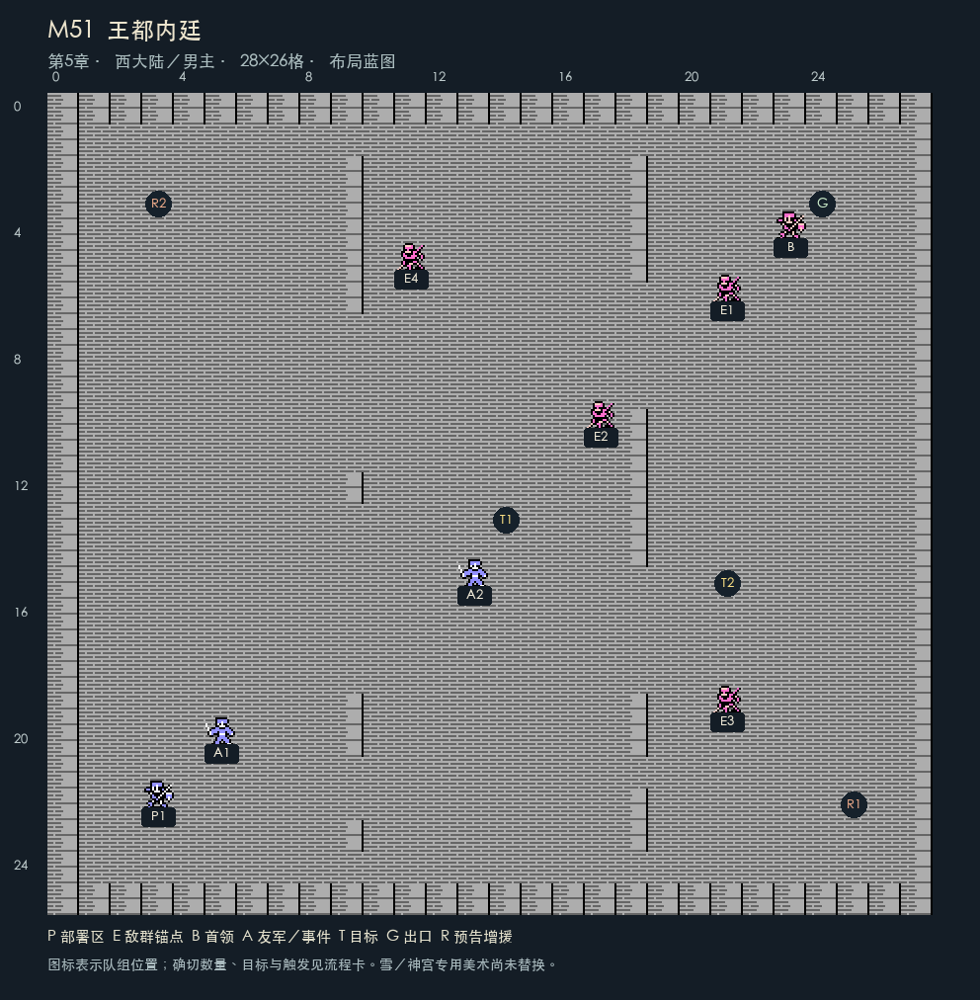
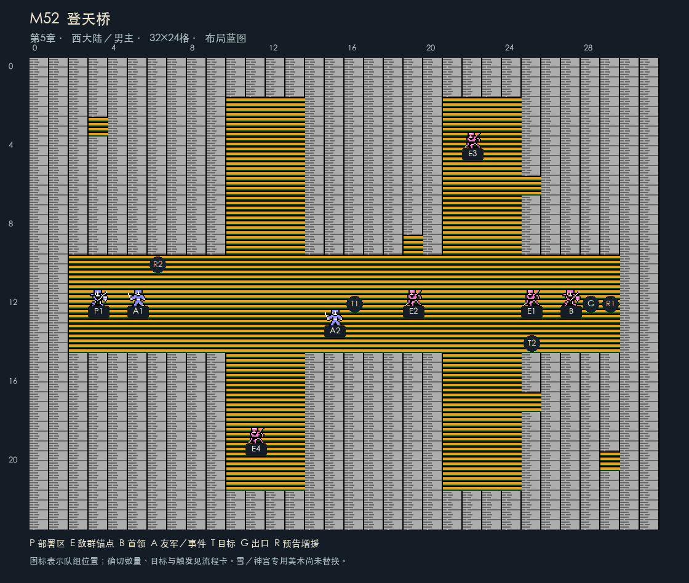
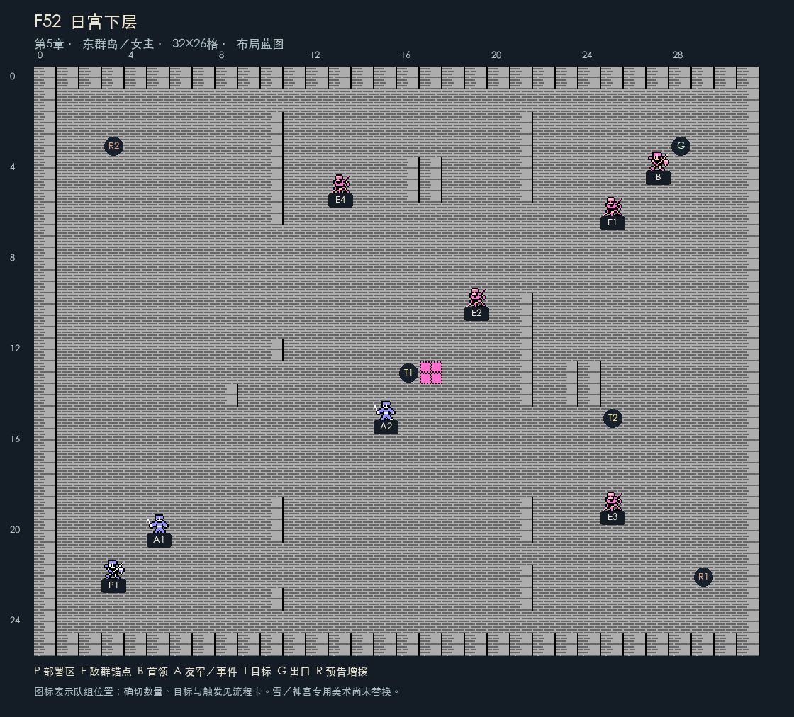
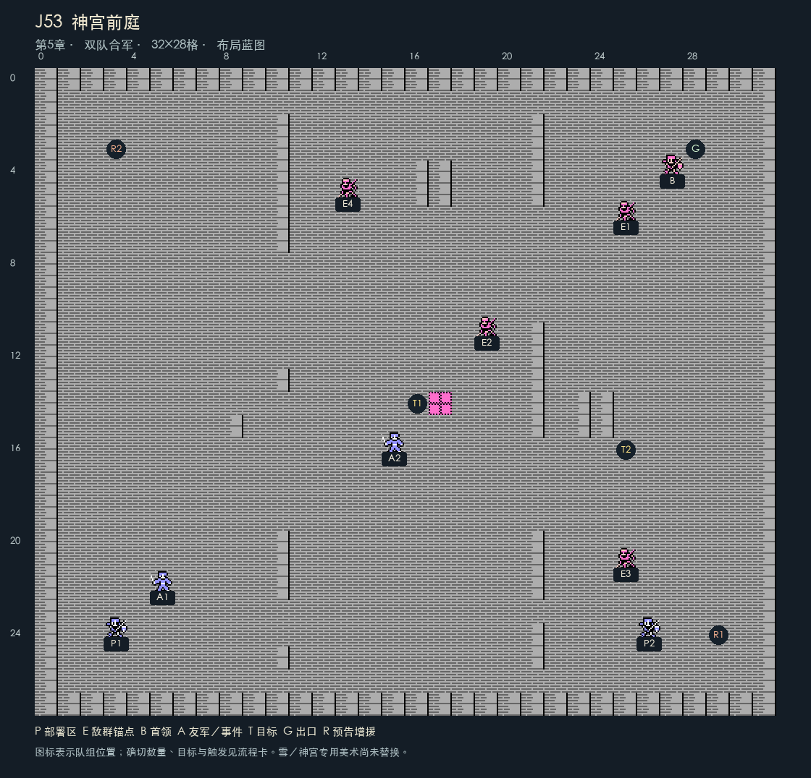
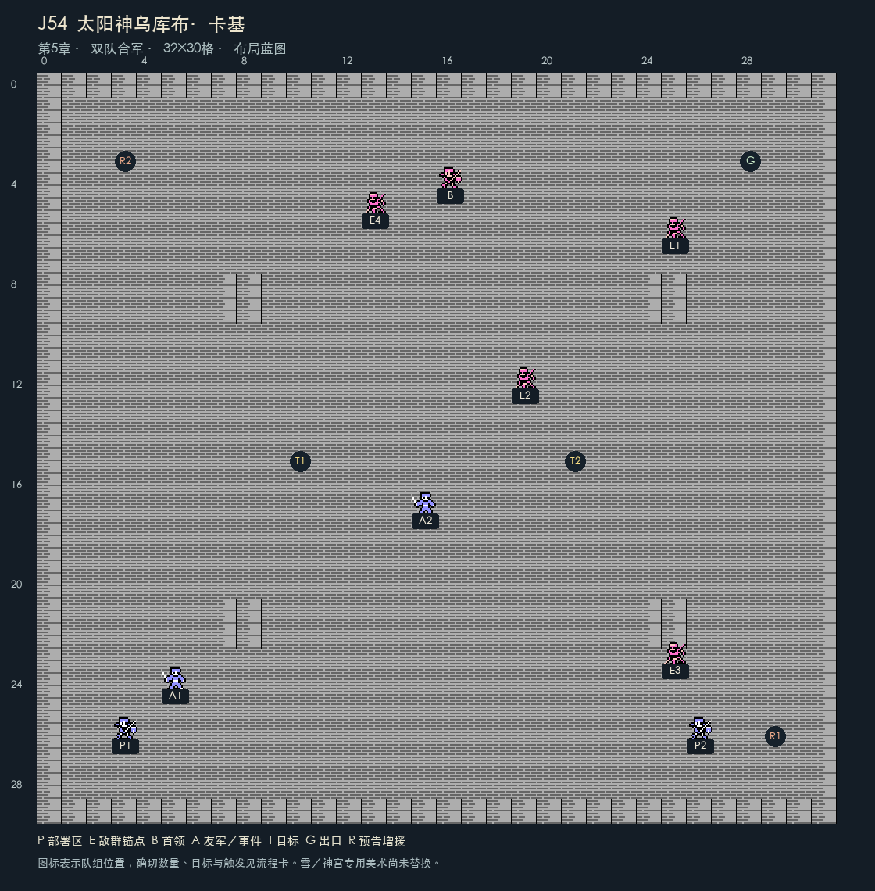
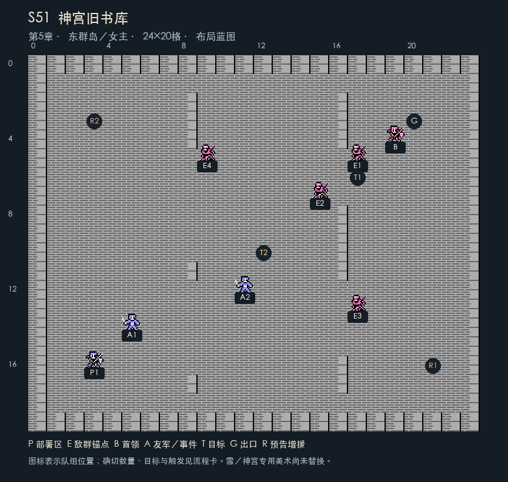

# 《revenge-memories》完整游戏流程

四份主文档：[完整游戏设定](完整游戏设定.md) · [完整故事剧情](完整故事剧情.md) · [完整游戏流程](完整游戏流程.md) · [完整台词汇总](完整台词汇总.md)。

版本：流程同步稿1.4；更新日期：2026-10-20。第四章按actual 0.9.0运行实现与两轮验收同步；前三章保留此前流程核对，五槽记录与装备预览继续沿用。第五章仍保留设计1.2，尚未开放。配套[《完整故事剧情》](完整故事剧情.md)与[《泉水与濒死救治设定》](泉水与濒死救治设定.md)中的旧实现状态未在本次批量改写；第四章当前事实以本文件和运行数据为准。

全篇仍为39个世界节点、31场主线、9场支线，共40场。当前实现序章与前四章33场；第五章7场保留为待实现设计。前四章旧布局图与规划索引属于1.2历史蓝图，当前地图以actual/data/stages和实机截图为准。第四章新增8场主线、2场支线、10个战后据点，沿用既有移动与战斗动画。

## 一、沿用设定与需要新做的部分

| 内容 | 本方案处理 | 接入状态 |
|---|---|---|
| 回合、移动、地形费用、射程、反击追击、法术HP支付 | 沿用docs/完整游戏设定和现行规则 | 现有底层可复用；新地图仍需验证 |
| 职业、个人成长、装备携带、恢复与召唤 | 使用现有职业和技能；剧情名与角色身份重建 | 不新增MP，不因台词获得额外攻击 |
| 正式成员伤情与泉水救治 | 濒死留队、禁出阵、个人一次、保留成长 | 四个来源均已接入；第四份需两岸安全与D42，神宫使用待第五章 |
| 大地图节点与道路 | 39节点、40路线；按章节开放，两队独立位置与来向 | 第四章双队道路与停塔门槛已接入；第五章待实现 |
| 战术地图 | 40场总规划 | 前四章33张已有运行配置；第五章7张为设计 |
| 据点、招募、对白、章节转换 | 新房间交互与独立剧情旗标 | 序章至第四章已接入；第三章完成菜单可开始第四章 |
| 护送、占领、守护与设备 | 明确新目标和失败条件 | 护送、守井、焚毁、停塔等待、指定召唤物与祭所隔离试验均已接入 |
| 太阳神终战 | 普通物理和法术可伤害，不依赖旧专属终结手段 | 原多玛终结限制须在新战役中移除 |
| 存档 | 独立战役标识、命名空间和存档文件 | 不将现有外传存档自动迁入新故事 |

不把80张原地图按旧顺序改名。源地图编号仅说明可借用的图块和构图参考，不继承道路、敌人、原部署或剧情。主线初步时长目标12—16小时，属于设计目标，尚未自然实玩校准。

## 二、时间、章节与队伍

| 阶段 | 可操作路线 | 切换／收束规则 |
|---|---|---|
| 序章P00 | 第三章广场片段，无战斗收益 | 自动进入第一章；序章不写未来队伍成长 |
| 第一章 | 西队，M11—M15；S11/S12可选 | M15结算、救劳工、举行日返、确认章节结束后保存西队 |
| 第二章 | 东队，F21—F26；S21/S22可选 | 新建东队；西队保持第一章真实成长、濒死状态与救治经历 |
| 第三章〔已实现〕 | M31—M33、F31—F33 | D31后先打M31；西队脱围后可切队。M31/F31都完成并确认D32再分路；两边记录确认、两队到营站后D33会谈 |
| 第四章〔已实现〕 | M41—M44、F41—F44 | M43可先夺塔再切东队；F42传步骤；两边安全节点齐备后收束 |
| 第五章〔待实现〕 | M51/M52、F51/F52，然后J53/J54 | 两入口齐备，玩家完成双方整备，按完整在队名册合军，部署只选择非濒死成员 |

同一时段的第一、二章分别完整讲一路；第二章回到半年前有明确字幕与地图起点，不将男主经验回滚或复制给女主。序章与第三章的庆典是同一个事件，庆典骚乱不重复结算。

**战斗数量口径：**序章不计战斗；第一章5主线＋2支线，第二章6＋2，第三章两队各3场主线＋2支线，第四章两队各4场主线＋2支线，第五章两队各2场、合军2场主线＋1支线。合计31场必经主线、9场可选支线，共40张独立战术地图。重试、增援、据点谈话与返程均不另算一场。

故事文档的4.1包含M11，4.2包含M12/M13，4.3包含M14/M15。三个叙事分节合计五场主线，每场独立部署与结算，另有S11、S12两场可选战斗。

主角年龄按周岁与同一时间轴保存：第一、二章起行时胡纳普17岁、艾琳16岁；序章／第三章仍为17岁、16岁；第五章18岁、17岁。十年前失散时为7岁、6岁。第一、二章共用约半年，第三至五章约四个月，两人的生日落在后四个月；不累计为两个半年，也不按玩家刷图或停留时间增长。成人职业与长期建设采用明确标注“数年后”的后日谈，不改变终战时年龄。

### 2.1 新阵容与出战容量

全篇规划西队九人：胡纳普、达恩、奥托、芙拉、蕾娜、兰斯、贝克、赫维、格曼。东队九人：艾琳、米蕾、莉莎、卡洛、洛德、罗恩、希雅、诺娅、赛琳。当前共18个角色模板，最多西9、东9；赛琳在S42病人获救、本人存活后，于H50明确邀请才加入。按实际招募进入正式名册；濒死成员仍在原队，可查看状态但不可出阵。未招募者不自动补入。

起始西队胡纳普、达恩、奥托；起始东队艾琳、米蕾、莉莎、卡洛。M12可得芙拉，M13可得蕾娜，M13后的D12合作结束时兰斯正式加入；F22可得洛德，F23可得罗恩，F24可得希雅。芙拉、蕾娜、贝克、赫维及东队后续同伴按各据点条件交谈；兰斯在M13后的D12合作结束时自动入队，早于M14开战。格曼在M33接受投降后到H33交谈，诺娅在S32存活后到H37问责并确认邀请。除两位主角濒死立即导致本场失败外，已入队同伴HP归零进入濒死并继续在队，主线见证有伤情与缺席分支；招募前死亡的NPC另按真实生死处理。

当前F31提供9个部署槽，前三章其余22张图各10个；第四章M41/F41各12个部署候选格，其余8张各10个；正式在队仍各最多9人。第五章部署待实现，按实际在队且非濒死成员填入；濒死者不占部署槽，但计入队伍总人数。J53/J54按两队完整名册合军，各最多10人、合计不超过20个正式出战者，仅非濒死者可选；本稿全招募合计18人。友军、幻影与召唤占各自阵营容量，不能以本稿“组锚点”突破引擎20槽上限。

## 三、新剧情大地图

当前世界图使用[formal_world.json](../actual/data/formal_world.json)：56×64格，每格16像素，39节点、40路线；主控制器沿路线格行进。世界地理坐标沿用下表；地图数据包含后续节点不表示第四、五章已经开放。

原文引用的新剧情大地图PNG/SVG、地形底图与道路派生条已不在当前工作区，移除失效预览链接；本次不恢复删除素材。当前画面与资源说明见[actual README](../actual/README.md)、[世界图资源](../actual/assets/world_tiles/README.md)。[规划索引](规划索引.json)与[交付检查](交付检查.json)仍是2026-10-16的文档历史快照，本次未改这两个JSON，不作为当前运行地图、实装进度或验收报告。

地理和背景继续要求原比例图块、连续岸线/道路、清楚地点辨识、文字安全区及正确伸缩。专用雪原、神宫和终极敌人美术按对应制作任务另验；既有截图或自动检查不替代用户的视觉确认。

### 3.1 世界节点：编号与坐标

当前世界数据56×64个16像素图块。坐标从左上角(0,0)起，x向右、y向下；运行地图坐标不包含界面标题与图例。W表示西线/公共/神宫节点，E表示东线节点，S表示支线节点。战场编号和世界节点编号独立，同一王都或祭所可有不同战场。

| 世界ID | 地点 | 图块坐标 | 类型 | 开放章／所含战场 |
|---|---|---|---|---|
| W01 | 雪原村 | (12,57) | 据点 | 1；据点／事件 |
| W02 | 流民林路 | (14,52) | 战场 | 1；M11 |
| W03 | 丘堡粮站 | (10,46) | 战场／据点 | 1；M12 |
| W04 | 南岗押送所 | (19,45) | 战场／据点 | 1；M13 |
| W05 | 旧塔外营 | (23,39) | 战场 | 1；M14 |
| W06 | 海峡城 | (25,34) | 战场／港口／庆典 | 1—3；M15、M31、F31 |
| W07 | 军需大道 | (19,29) | 战场 | 3；M32 |
| W08 | 沿海石堡 | (27,26) | 战场 | 3；M33 |
| W09 | 会合营站 | (31,25) | 据点／通信 | 3—4；据点／事件 |
| W10 | 雪峡村 | (13,25) | 战场／据点 | 4；M41 |
| W11 | 铁骑关 | (8,20) | 战场 | 4；M42 |
| W12 | 北境日塔 | (14,16) | 战场／控制室 | 4；M43 |
| W13 | 王都 | (21,13) | 城门／内廷 | 4—5；M44、M51 |
| W14 | 登天桥 | (25,10) | 专用通道 | 5；M52 |
| W15 | 神宫前庭 | (29,7) | 合军战场 | 5；J53 |
| W16 | 神座 | (32,4) | 最终战场 | 5；J54 |
| E01 | 风灯岛 | (46,58) | 据点 | 2；据点／事件 |
| E02 | 海上拦截 | (40,54) | 海战 | 2；F21 |
| E03 | 押送舰 | (36,48) | 船战 | 2；F22 |
| E04 | 礁岛 | (44,46) | 战场／据点 | 2；F23 |
| E05 | 海灯岛 | (51,42) | 战场／据点 | 2；F24 |
| E06 | 潮狩军港 | (49,34) | 战场／牢房 | 2；F25 |
| E07 | 断航古道 | (39,38) | 海战通道 | 2；F26 |
| E08 | 盐路 | (36,29) | 战场 | 3；F32 |
| E09 | 提炼院 | (37,23) | 战场 | 3；F33 |
| E10 | 沙城 | (43,29) | 战场／据点 | 4；F41 |
| E11 | 盐原观测台 | (48,23) | 战场／观测室 | 4；F42 |
| E12 | 亡潮沼泽 | (44,19) | 战场 | 4；F43 |
| E13 | 沉没祭所 | (44,15) | 战场／地脉室 | 4—5；F44、F51 |
| E14 | 日宫下层 | (40,11) | 专用通道 | 5；F52 |
| S01 | 旧矿道 | (6,51) | 支线迷宫 | 1；S11 |
| S02 | 林村诊所 | (20,55) | 支线据点 | 1；S12 |
| S03 | 漂泊渔船 | (35,56) | 支线船战 | 2；S21 |
| S04 | 碎石海洞 | (51,51) | 支线迷宫 | 2；S22 |
| S05 | 山村地牢 | (20,33) | 支线救援 | 3；S31 |
| S06 | 盐原营地 | (51,28) | 支线救援 | 3；S32 |
| S07 | 黑钟村 | (5,26) | 支线战场 | 4；S41 |
| S08 | 沼泽孤岛 | (35,18) | 支线救援 | 4；S42 |
| S09 | 神宫旧书库 | (48,9) | 支线迷宫 | 5；S51 |

### 3.2 道路与门槛

| 起点—终点 | 道路 | 开放条件 |
|---|---|---|
| W01—W02 | 陆路 | 第一章前关结算与据点确认 |
| W02—W03 | 陆路 | 第一章前关结算与据点确认 |
| W03—W04 | 陆路 | 第一章前关结算与据点确认 |
| W04—W05 | 陆路 | 第一章前关结算与据点确认 |
| W05—W06 | 陆路 | 第一章前关结算与据点确认 |
| E01—E02 | 海路 | 第二章前关结算与船团确认 |
| E02—E03 | 海路 | 第二章前关结算与船团确认 |
| E03—E04 | 海路 | 第二章前关结算与船团确认 |
| E04—E05 | 海路 | 第二章前关结算与船团确认 |
| E05—E06 | 海路 | 第二章前关结算与船团确认 |
| E06—E07 | 海路 | 第二章前关结算与船团确认 |
| E07—W06 | 古航路 | F26完成；不可提前交换两队物品 |
| W06—W07 | 陆路 | 第三章西线前关完成 |
| W07—W08 | 陆路 | 第三章西线前关完成 |
| W06—E08 | 海路／盐路 | 第三章东线前关完成 |
| E08—E09 | 海路／盐路 | 第三章东线前关完成 |
| W08—W09 | 短渡 | M33/F33胜利且两边据点记录均已确认；两队到达营站后会谈 |
| E09—W09 | 短渡 | M33/F33胜利且两边据点记录均已确认；两队到达营站后会谈 |
| W09—W10 | 短渡／陆路 | 开始第四章即开放 |
| W10—W11 | 陆路 | M41胜利，H41南口安置处确认居民 |
| W11—W12 | 陆路 | M42胜利；投送站实际控制写援军旗标 |
| W12—W13 | 陆路 | M43胜利且F42步骤已送到，再在H43确认安全停塔 |
| W09—E10 | 海路／古道 | 开始第四章即开放 |
| E10—E11 | 海路／古道 | F41胜利，H45井台确认古道 |
| E11—E12 | 海路／古道 | F42胜利，obs_steps_ready已写入 |
| E12—E13 | 海路／古道 | F43胜利，H47船口确认分批转运 |
| W13—W14 | 登天通道 | M51完成；第四章双方收束完成 |
| W14—W15 | 神宫通道 | M52与F52均完成，双方整备确认 |
| E13—E14 | 祭所神术通道 | F51完成；第四章双方收束完成 |
| E14—W15 | 神宫通道 | M52与F52均完成，双方整备确认 |
| W15—W16 | 神宫通道 | J53完成；在前庭可返回整备 |
| W02—S01 | 支路 | 收到据点邀请后开放；出发前说明收束时机 |
| W02—S02 | 支路 | 收到据点邀请后开放；出发前说明收束时机 |
| E02—S03 | 支路 | 收到据点邀请后开放；出发前说明收束时机 |
| E04—S04 | 支路 | 收到据点邀请后开放；出发前说明收束时机 |
| W07—S05 | 支路 | 收到据点邀请后开放；出发前说明收束时机 |
| E08—S06 | 支路 | 收到据点邀请后开放；出发前说明收束时机 |
| W10—S07 | 支路 | 收到据点邀请后开放；出发前说明收束时机 |
| E12—S08 | 支路 | 收到据点邀请后开放；出发前说明收束时机 |
| E14—S09 | 支路 | 收到据点邀请后开放；出发前说明收束时机 |

道路双向开放后允许返程，当前战斗、据点来向和所属队伍分别保存。已完成战场不因返程重复发经验与战利品；需要世界敌軍重访时创建独立军队身份，不把主线首领复制出来。第一、二章不额外生成随机封路军，避免回忆推进被随机事件拖长。

### 3.3 主线道路总表

第1章西线：M11 流民林路 → M12 丘堡粮站 → M13 南岗押送所 → M14 旧塔外营 → M15 海峡旧塔堡。

第2章东线：F21 海上拦截 → F22 押送舰救援 → F23 礁岛登岸 → F24 海灯岛防卫 → F25 潮狩军港 → F26 断航古道。

第3章西线：M31 西街撤离 → M32 军需大道截运 → M33 沿海石堡。

第3章东线：F31 码头脱围 → F32 盐路解围 → F33 提炼院后庭。

第4章西线：M41 雪峡撤离战 → M42 铁骑封锁线 → M43 北境日塔 → M44 王都城门。

第4章东线：F41 沙城守井战 → F42 盐原观测台 → F43 亡潮沼泽 → F44 沉没祭所。

第5章西线：M51 王都内廷 → M52 登天桥。

第5章东线：F51 祭所底层 → F52 日宫下层。

第5章合线：J53 神宫前庭 → J54 太阳神乌库布·卡基。

当前第三章M31完成后可切东队，M31/F31都完成并在H31确认D32后才能沿两路调查。M33/F33顺序自由；双方胜利并分别在H33/H35确认记录后开放W09短渡，两队实际抵达H10后触发D33。第四章已实现：M43先打不会卡档：夺塔结算后可返回控制室、切东队取得F42步骤，再完成停用，不重打守军。F44不硬等M42：战前提示援军差异，提前挑战者可照常取胜；M42后来完成保护后续船队，不使已完成F44重新开战。

## 四、素材复用与小地图重构规范

当前战场的逻辑地形、可见地面、建筑、自然物和交互对象分层配置，以各关JSON的map、logic_grid、visual_ground、art_layers、objects等实际字段及控制器为准。当前资源包括actual/assets/battle_tiles/、world_tiles/、chapter2/、nature/及各关指定图集；角色接入见party_visuals.json、portraits.json、reviewed_animations.json、m11_party_motion.json。职业身体共享、角色重绘和当前接入状态不等于所有美术已经验收。

所有图块保留16像素原生比例，最近邻整数放大；复用背景保留边角比例和连续边线，不能整图非等比拉伸。墙、牢门、桥和建筑的显示层要与碰撞及开放格一致。正文、标题、数字、按钮、地图提示在实测安全区内，选中/焦点使用材质一致的位图或柔和阴影；继续遵守后台截图、不抢焦点要求。

### 4.1 历史蓝图与后续布局图读法

关卡布局目录保留原40张1.2规划图。本稿不把旧图当作当前运行截图：前四章33张已被实际地图重构替代；第五章7张仍为待实现构图参考。旧图P/E/B/A/T/G/R分别为部署、敌群、首领、友军/事件、目标、出口和增援口；敌群锚点不等于每个单位的位置。

原规划tile ID和图集仅属于该蓝图。后续制作须重新核对实际图集映射、通路、地形费用、门锁、对象位置和胜负判定；不能把规划索引的矩阵或派生编号直接覆盖当前stage数据。当前可站立访问点、真实对象格、动态车船位置和地图边界，按下面23张运行卡及控制器执行。

## 五、据点、对白与触发顺序

### 5.1 当前房间与实际对象格

当前房间为14×9格，界面原点(16,8)像素；通常入场(6,7)、出口格(6,8)，首次序章位置另由初始状态指定。下表是对象所在格，玩家通常需走到相邻一格、面向对象确认。H04为H03内的教堂入口，与旧设计把教堂挂在W05的写法不同；H08/H09当前是矿道/诊所，海灯岛使用H25，不能把旧H08规划编号当作运行ID。

|运行房间ID|世界地点|名称|对象格|
|---|---|---|---|
|P00|W06（序章）|序章 · 海峡城庆典|教团守卫(4,4)；赫兰(7,2)；艾琳(10,3)；传光台(6,1)|
|H01|W01|半年前 · 雪原村|凯尔的墓(6,3)；奥托(3,4)；达恩(10,5)|
|H02|W03|丘堡粮站 · 战后|粮车(6,3)；芙拉(3,5)；救济牌(10,3)|
|H03|W04|南岗押送所 · 战后|军令箱(6,3)；蕾娜(3,5)；教堂入口(11,2)|
|H04|W04旁教堂|押送所旁 · 旧塔教堂|赫兰(6,3)；兰斯(10,5)；教堂祭台(3,5)；救治泉(4,6)，份额随状态显示|
|H05|W05|旧塔外营 · 战后|投降兵(6,3)|
|H06|W06|海峡城 · 旧塔内院|伤者与医者(4,5)；日返仪式(7,2)|
|H07|W02|林路营地|村民(6,3)；奥托(10,5)|
|H08|S01|旧矿道 · 战后|贝克(6,3)；矿工工具(10,5)|
|H09|S02|林村诊所 · 战后|管理员(4,3)；赫维(9,5)|
|H21|E01|半年前 · 风灯岛船坞|卡洛(8,5)；米蕾(3,4)；莉莎(6,2)；母亲的残图(5,1)|
|H22|E02|船团停泊栈桥|船长(6,2)；求救船员(4,4)；地方医者(9,5)|
|H23|E03|押送舰旁 · 救护栈桥|伤者安置处(3,4)；洛德(9,5)；引航者(6,2)|
|H24|E04|礁岛 · 渔村岸边|渔村长者(6,2)；罗恩(3,5)；旧船员(10,5)；岸上宝箱(8,3)|
|H25|E05|海灯岛 · 航灯院|留守骑士(6,2)；希雅(9,5)；训练台(3,4)；抗性泉 · 剩余一次(3,6)；卡洛(8,6)；救治泉 · 东队(5,6)|
|H26|E06|潮狩军港 · 神教仓院|神教箱(6,2)；军港武器箱(3,4)；船长(10,5)；撤离者安置处(6,5)；卡洛(9,3)|
|H27|E07战后，抵达确认后W06|现在 · 海峡城广场外|教团守卫(7,3)；船长(3,5)；传光台(6,1)|
|H30|W06|第三章 · 海峡城庆典|赫兰(7,3)；传光台(10,4)|
|H31|W06|城外旧街 · 避难处|会合约定(7,3)；留守医者(3,5)|
|H32|W07|军需大道 · 转运站|获救工匠(7,3)；山村来信(3,5)|
|H33|W08|沿海石堡 · 工房|投送记录(7,3)；格曼(3,5)|
|H34|E08|盐路 · 船民井台|船民(7,3)；盐原求助(3,5)|
|H35|E09|提炼院 · 记录庭|获救术士(7,3)|
|H36|S05|山村地牢 · 安置处|家属(7,3)|
|H37|S06|盐原营地 · 安置处|诺娅(7,3)；留守医者(3,5)|
|H10|W09|沿海会合营站|会谈处(7,3)；共享救治处(3,5)；训练台(10,5)；信使(10,7)；营火旁(3,7)|

房间来源：[story_hub.gd](../actual/core/story_hub.gd)、[第二章房间](../actual/data/chapter2_hubs.json)、[第三章房间](../actual/data/chapter3_hubs.json)、[第四章房间](../actual/data/chapter4_hubs.json)。第四章实际使用H41—H50，H10继续共享整备；旧H11/H12编号仍是历史规划，不与当前房间混用。

### 5.2 当前推进的必要确认

- 第一章：H01墓前完成D11开放林路；M11胜利开放粮站和本章支路。M12后H02确认分粮；M13后H03取军令、进入H04完成D12合作，兰斯入队并开放西队救治，随后开M14。M15后H06先安置伤者再确认日返，提醒未做支线后收束第一章。
- 第二章：H21确认出航；F21后H22确认灯线并可接受S21邀请；F22后H23安置伤者；F23后H24确认岸线并可接受S22邀请；F24后H25安置岛民。F25后H26取航图、安置撤离者并确认西渡，关闭未完成支路入口后开F26；抵达H27后确认D26_ARRIVAL，进入第二章结束页。
- 第三章：开始第三章后H30完成D31；M31后才可切队。M31/F31都完成，再在H31确认D32。M32后H32确认物资，F32后H34确认路线；各自开放M33/F33。两关胜利且H33/H35都确认记录后，两队分别走短渡到W09/H10；两队都在场才可D33会谈，新增共享一份并合并早期剩余。
- D33后H10可训练、从另一队行囊接收真实物品、救治当前队符合条件的成员及进行已有关系谈话；切队可处理另一队。信使提醒本章未做支路，确认后进入第三章收束页，可从完成菜单开始第四章。

### 5.3 战场对白与结算

战前/战中/战后文本按各关数据及控制器触发，已有一次性事件键防重复；JSON的during、after、absent_branch不保证全部被直接播放，不能只复制这些字段断言触发已实现。第三章有独立事件和战后覆盖文本，F25的D22_FIRST、D22_DEFEAT及取箱场景分阶段发生。具体原文及条件见台词汇总第四部分。

胜利先完成目标与伤情/经验/掉落结算，随后返回对应据点；必要军令、航图、记录和安置仍需实际确认。重试恢复开战快照，保留此前成长、伤情和已消耗份额；不重复领取奖励。人物缺席时当前代码筛选或替换说话者，尚未实现的全篇照护、书信与结局变体继续作为设计。

### 5.4 神话线索

M12分粮与救济牌、F25神教箱/航图已有运行文字；来源是实际据点动作和F25_MYTH。F42观测、S51旧书库与J54晨光仍待制作。七羽冠印及终极敌人的专用形象不凭通用地点图标认定已完成视觉验收。出处与改编边界沿用故事2.4，本轮未重新核验外部文献。

## 六、前四章33场当前战场与第五章7场设计卡

本节分为两种状态：前三章23场已实现，按当前实际数据与胜负代码重写；第四、五章17场保留1.2设计卡，尚未导入为可玩关卡。当前卡列初始部署、敌军、任务NPC、交互对象和一次性增援；动态运输车/船位置、已开牢门与兼容旧档另按存档状态恢复。

与1.2历史蓝图比较，23张当前图的目标坐标清单均有变化，其中15张尺寸改变、17张首领位置改变、18张出口字段改变。旧图不能用来覆盖当前配置；同尺寸也不代表布局一致。下表仅保留尺寸沿革，详细当前坐标见各卡。

|关卡|1.2旧蓝图尺寸|当前运行尺寸|状态|
|---|---|---|---|
|M11|24×20|22×18|已实现|
|M12|24×22|36×28|已实现|
|M13|28×22|40×30|已实现|
|M14|28×24|40×32|已实现|
|M15|32×26|44×34|已实现|
|S11|20×18|32×26|已实现|
|S12|20×18|34×26|已实现|
|F21|28×22|44×30|已实现|
|F22|32×22|46×32|已实现|
|F23|24×22|38×30|已实现|
|F24|28×24|40×32|已实现|
|F25|32×26|44×34|已实现|
|F26|32×24|44×32|已实现|
|S21|24×20|36×28|已实现|
|S22|20×20|32×28|已实现|
|M31|28×24|28×24|已实现|
|M32|32×24|32×24|已实现|
|M33|28×26|28×26|已实现|
|F31|28×22|28×22|已实现|
|F32|28×24|28×24|已实现|
|F33|28×24|28×24|已实现|
|S31|22×20|22×20|已实现|
|S32|28×22|28×22|已实现|

### 第1章〔当前已实现〕

#### M11 流民林路（主线／西队）

**状态与来源：**当前已实现，[运行数据](../actual/data/stages/M11.json)；胜负与事件同时对照[game_state](../actual/core/game_state.gd)、[第二章规则](../actual/core/chapter2_rules.gd)、[第三章规则](../actual/core/chapter3_rules.gd)。

**剧情推动：**科兰押送兵把凯尔放走的居民重新赶回雪原；胡纳普先完成兄长没完成的护送。

**地点与地图：**W02 流民林路；22×18格；单格16原生像素。

**部署与空间：**10个实际部署位置：(6,13)、(7,13)、(8,13)、(9,13)、(10,13)、(6,14)、(7,14)、(8,14)、(9,14)、(10,14)。首领M11_boss (16,4)；出口字段G (16,3)；targets清单：(16,3)。G是否参与胜利或失败，以本卡下述判定为准。

**初始敌军：**10名，含首领；增援不计入本表。

|ID|名称|职业|等级|初始位置|携带|
|---|---|---|---|---|---|
|M11_boss|追击队长|士兵|4|(16,4)|钢枪|
|M11_e1|士兵|士兵|1|(10,11)|无|
|M11_e2|士兵|士兵|1|(12,11)|无|
|M11_e3|士兵|士兵|1|(14,10)|无|
|M11_e4|士兵|士兵|1|(10,5)|无|
|M11_e5|弓手|弓箭手|1|(13,5)|铜弓|
|M11_e6|弓手|弓箭手|1|(13,9)|无|
|M11_e7|士兵|士兵|1|(15,5)|无|
|M11_e8|士兵|士兵|1|(9,5)|无|
|M11_e9|士兵|士兵|1|(12,5)|无|

**增援：**第4敌回合一次：M11_r0／士兵(14,6)；M11_r1／士兵(13,5)。单位身份各自独立，进入位置被占时按控制器寻找合法落点。

**任务NPC：**流民队1（M11_refugees0）(8,12)；流民队2（M11_refugees1）(9,12)。任务NPC、被救者与正式名册分开；正式招募前的真实死亡不会变为濒死救治对象。

**战场交互：**

|ID／对象|实际对象格|操作|
|---|---|---|
|M11_visit_0／访问雪原村舍|(10,3)|邻接确认|

**目标／失败：**两组流民均抵达出口，并击败追击队长；任一组死亡或胡纳普濒死失败。 当前在场主角HP归零均立即失败；普通正式成员按濒死留队处理。

**AI与时机：**流民基础移动3格，可在生命与反击风险合适时主动攻击；无安全攻击才沿撤离路线移动，附近有威胁会等待。追击队长固守出口，弓手主动寻找射击位置。清场且无未到增援时，护送单位可加速到至少5格。

**招募与下一步：**回H07查看支路求助；粮站与S11/S12开放。

**奖励与返回：**配置固定通关补给：铁剑。访问、宝箱、携带装备击杀掉落另记，投降不复制战利品。战后先结算再回据点/世界；首次奖励与事件入档。当前过关经验可以升级，濒死者不领该笔经验。

**对白与缺席：**当前原文和控制器覆盖见台词汇总第四部分。JSON的absent_branch保留部分旧“亡”元数据，不直接当作正式成员死亡或完整照护分支；按实际招募、伤情与控制器筛选说话者。

#### M12 丘堡粮站（主线／西队）

**状态与来源：**当前已实现，[运行数据](../actual/data/stages/M12.json)；胜负与事件同时对照[game_state](../actual/core/game_state.gd)、[第二章规则](../actual/core/chapter2_rules.gd)、[第三章规则](../actual/core/chapter3_rules.gd)。

**剧情推动：**赈灾粮被科兰扣留，修女芙拉与领粮居民也被拘押。

**地点与地图：**W03 丘堡粮站；36×28格；单格16原生像素。

**部署与空间：**10个实际部署位置：(15,21)、(14,21)、(15,22)、(15,20)、(16,21)、(13,21)、(14,22)、(15,23)、(14,20)、(16,22)。首领M12_boss (31,6)；出口字段G (31,3)；targets清单：(28,8)、(19,14)。G是否参与胜利或失败，以本卡下述判定为准。

**初始敌军：**9名，含首领；增援不计入本表。

|ID|名称|职业|等级|初始位置|携带|
|---|---|---|---|---|---|
|M12_boss|指挥官|士兵|3|(31,6)|铁枪|
|M12_e1|焚毁兵|士兵|1|(22,15)|无|
|M12_e2|士兵|士兵|1|(25,11)|无|
|M12_e3|士兵|士兵|1|(24,21)|无|
|M12_e4|士兵|士兵|1|(15,7)|无|
|M12_e5|士兵|士兵|1|(30,7)|无|
|M12_e6|弓手|弓箭手|1|(26,11)|无|
|M12_e7|弓手|弓箭手|1|(30,17)|无|
|M12_e8|佣兵|佣兵|1|(16,7)|无|

**增援：**无配置增援。单位身份各自独立，进入位置被占时按控制器寻找合法落点。

**任务NPC：**芙拉（fula）(8,21)。任务NPC、被救者与正式名册分开；正式招募前的真实死亡不会变为濒死救治对象。

**战场交互：**

|ID／对象|实际对象格|操作|
|---|---|---|
|M12_occupy_0／占领粮仓|(28,8)|目标格确认|
|M12_visit_0／访问仓吏小屋|(23,3)|邻接确认|

**目标／失败：**在粮仓目标格确认占领并击败守将；焚毁兵连续两次在门前完成行动使粮仓烧毁则失败。 当前在场主角HP归零均立即失败；普通正式成员按濒死留队处理。

**AI与时机：**burner_departure_turn=7：第6己方回合提示，第7回合起焚毁兵向仓门移动；连续两次在仓门结束行动才烧毁。

**招募与下一步：**回H02确认分粮后开M13；芙拉存活且分粮完成时可交谈招募。

**奖励与返回：**配置固定通关补给：铁枪、钢盾。访问、宝箱、携带装备击杀掉落另记，投降不复制战利品。战后先结算再回据点/世界；首次奖励与事件入档。当前过关经验可以升级，濒死者不领该笔经验。

**对白与缺席：**当前原文和控制器覆盖见台词汇总第四部分。JSON的absent_branch保留部分旧“亡”元数据，不直接当作正式成员死亡或完整照护分支；按实际招募、伤情与控制器筛选说话者。

#### M13 南岗押送所（主线／西队）

**状态与来源：**当前已实现，[运行数据](../actual/data/stages/M13.json)；胜负与事件同时对照[game_state](../actual/core/game_state.gd)、[第二章规则](../actual/core/chapter2_rules.gd)、[第三章规则](../actual/core/chapter3_rules.gd)。

**剧情推动：**牢中有违抗强迁命令的骑士蕾娜，以及准备运往旧塔堡的劳工。

**地点与地图：**W04 南岗押送所；40×30格；单格16原生像素。

**部署与空间：**10个实际部署位置：(8,8)、(7,8)、(8,9)、(8,7)、(6,8)、(7,9)、(8,10)、(7,7)、(9,9)、(8,6)。首领M13_boss (35,6)；出口字段G (35,3)；targets清单：(10,8)、(33,10)。G是否参与胜利或失败，以本卡下述判定为准。

**初始敌军：**10名，含首领；增援不计入本表。

|ID|名称|职业|等级|初始位置|携带|
|---|---|---|---|---|---|
|M13_boss|指挥官|士兵|3|(35,6)|无|
|M13_e1|士兵|士兵|1|(31,9)|无|
|M13_e2|士兵|士兵|1|(26,12)|无|
|M13_e3|士兵|士兵|1|(32,22)|无|
|M13_e4|士兵|士兵|1|(17,8)|无|
|M13_e5|士兵|士兵|1|(35,9)|无|
|M13_e6|重装兵|黄金骑士|1|(28,12)|无|
|M13_e7|重装兵|黄金骑士|1|(34,22)|无|
|M13_e8|弓手|弓箭手|1|(18,8)|无|
|M13_e9|弓手|弓箭手|1|(32,11)|无|

**增援：**第5敌回合一次：M13_r0／佣兵(38,27)；M13_r1／佣兵(37,27)。单位身份各自独立，进入位置被占时按控制器寻找合法落点。

**任务NPC：**劳工队1（M13_workers0）(10,7)〔初始锁定〕；劳工队2（M13_workers1）(33,9)〔初始锁定〕；蕾娜（lena）(12,7)〔初始锁定〕。任务NPC、被救者与正式名册分开；正式招募前的真实死亡不会变为濒死救治对象。

**战场交互：**

|ID／对象|实际对象格|操作|
|---|---|---|
|M13_door_0／打开牢门1|(10,8)|邻接确认|
|M13_door_1／打开牢门2|(33,10)|邻接确认|
|M13_visit_0／访问营地文书帐|(20,4)|邻接确认|

**目标／失败：**击败押送长、打开两扇牢门，且至少一组存活劳工解除锁定；不要求劳工全部走到出口。蕾娜招募前死亡不阻断主线。 当前在场主角HP归零均立即失败；普通正式成员按濒死留队处理。

**AI与时机：**两扇门从相邻格确认，分别解锁蕾娜及劳工；第5敌回合一次增援。

**招募与下一步：**回H03取军令，可与存活蕾娜交谈；进H04完成D12合作，兰斯入队，开放西队一份救治和M14。

**奖励与返回：**配置固定通关补给：铁弓。访问、宝箱、携带装备击杀掉落另记，投降不复制战利品。战后先结算再回据点/世界；首次奖励与事件入档。当前过关经验可以升级，濒死者不领该笔经验。

**对白与缺席：**当前原文和控制器覆盖见台词汇总第四部分。JSON的absent_branch保留部分旧“亡”元数据，不直接当作正式成员死亡或完整照护分支；按实际招募、伤情与控制器筛选说话者。

#### M14 旧塔外营（主线／西队）

**状态与来源：**当前已实现，[运行数据](../actual/data/stages/M14.json)；胜负与事件同时对照[game_state](../actual/core/game_state.gd)、[第二章规则](../actual/core/chapter2_rules.gd)、[第三章规则](../actual/core/chapter3_rules.gd)。

**剧情推动：**赫兰正式提供援军；外营阻断夺城与释放塔工的路线。

**地点与地图：**W05 旧塔外营；40×32格；单格16原生像素。

**部署与空间：**10个实际部署位置：(23,26)、(22,26)、(23,27)、(23,25)、(24,26)、(21,26)、(22,27)、(23,28)、(20,26)、(21,27)。首领M14_boss (35,6)；出口字段G (35,3)；targets清单：(20,18)、(34,20)。G是否参与胜利或失败，以本卡下述判定为准。

**初始敌军：**12名，含首领；增援不计入本表。

|ID|名称|职业|等级|初始位置|携带|
|---|---|---|---|---|---|
|M14_boss|指挥官|骑兵|3|(35,6)|投枪|
|M14_e1|骑兵|骑兵|1|(32,9)|无|
|M14_e2|骑兵|骑兵|1|(26,13)|无|
|M14_e3|骑兵|骑兵|1|(32,25)|无|
|M14_e4|士兵|士兵|1|(17,7)|无|
|M14_e5|士兵|士兵|1|(34,9)|无|
|M14_e6|士兵|士兵|1|(26,15)|无|
|M14_e7|士兵|士兵|1|(34,25)|无|
|M14_e8|士兵|士兵|1|(18,7)|无|
|M14_e9|弓手|弓箭手|1|(32,10)|无|
|M14_e10|弓手|弓箭手|1|(25,13)|无|
|M14_e11|魔道士|妖术师|1|(32,26)|无|

**增援：**无配置增援。单位身份各自独立，进入位置被占时按控制器寻找合法落点。

**任务NPC：**无。任务NPC、被救者与正式名册分开；正式招募前的真实死亡不会变为濒死救治对象。

**战场交互：**

|ID／对象|实际对象格|操作|
|---|---|---|
|M14_control_0／控制南营哨卡|(20,18)|目标格确认|
|M14_control_1／控制东营哨卡|(34,20)|目标格确认|
|M14_visit_0／访问营地文书帐|(25,4)|邻接确认|

**目标／失败：**击败守将或接受其投降，并在南营、东营两处军旗格分别确认控制。 当前在场主角HP归零均立即失败；普通正式成员按濒死留队处理。

**AI与时机：**守将HP不高于半血时提出投降并停止反击；接受投降与击杀是不同结果，两处哨卡都仍需站格控制。

**招募与下一步：**回H05，再沿世界道路进入M15。

**奖励与返回：**配置固定通关补给：骑士杀手、铁制法器。访问、宝箱、携带装备击杀掉落另记，投降不复制战利品。战后先结算再回据点/世界；首次奖励与事件入档。当前过关经验可以升级，濒死者不领该笔经验。

**对白与缺席：**当前原文和控制器覆盖见台词汇总第四部分。JSON的absent_branch保留部分旧“亡”元数据，不直接当作正式成员死亡或完整照护分支；按实际招募、伤情与控制器筛选说话者。

#### M15 海峡旧塔堡（主线／西队）

**状态与来源：**当前已实现，[运行数据](../actual/data/stages/M15.json)；胜负与事件同时对照[game_state](../actual/core/game_state.gd)、[第二章规则](../actual/core/chapter2_rules.gd)、[第三章规则](../actual/core/chapter3_rules.gd)。

**剧情推动：**科兰带亲兵与粮食准备逃离，把劳工留在内院。胡纳普进入复仇终点。

**地点与地图：**W06 海峡城；44×34格；单格16原生像素。

**部署与空间：**10个实际部署位置：(16,15)、(15,15)、(16,16)、(16,14)、(17,15)、(14,15)、(15,16)、(16,17)、(17,16)、(17,14)。首领M15_boss (24,10)；出口字段G (38,5)；targets清单：(9,9)、(32,26)。G是否参与胜利或失败，以本卡下述判定为准。

**初始敌军：**15名，含首领；增援不计入本表。

|ID|名称|职业|等级|初始位置|携带|
|---|---|---|---|---|---|
|M15_boss|科兰|黄金骑士|3|(24,10)|钢枪|
|M15_e1|士兵|士兵|1|(37,9)|无|
|M15_e2|士兵|士兵|1|(28,14)|无|
|M15_e3|士兵|士兵|1|(37,27)|无|
|M15_e4|士兵|士兵|1|(19,7)|无|
|M15_e5|士兵|士兵|1|(38,9)|无|
|M15_e6|重装兵|黄金骑士|1|(29,14)|无|
|M15_e7|重装兵|黄金骑士|1|(38,26)|无|
|M15_e8|重装兵|黄金骑士|1|(21,7)|无|
|M15_e9|弓手|弓箭手|1|(37,10)|无|
|M15_e10|弓手|弓箭手|1|(28,16)|无|
|M15_e11|弓手|弓箭手|1|(37,28)|无|
|M15_e12|骑兵|骑兵|1|(19,9)|无|
|M15_e13|骑兵|骑兵|1|(35,9)|无|
|M15_e14|魔道士|妖术师|1|(26,14)|无|

**增援：**第4敌回合一次：M15_r0／士兵(37,29)；M15_r1／士兵(34,31)。单位身份各自独立，进入位置被占时按控制器寻找合法落点。

**任务NPC：**劳工队1（M15_workers0）(9,8)〔初始锁定〕；劳工队2（M15_workers1）(32,25)〔初始锁定〕。任务NPC、被救者与正式名册分开；正式招募前的真实死亡不会变为濒死救治对象。

**战场交互：**

|ID／对象|实际对象格|操作|
|---|---|---|
|M15_rescue_0／救出劳工1|(9,9)|邻接确认|
|M15_rescue_1／救出劳工2|(32,26)|邻接确认|
|M15_visit_0／访问旧塔堡档案室|(19,4)|邻接确认|

**目标／失败：**击败科兰，且至少一组内院劳工存活并解除锁定；两组均死亡或存活科兰抵达北门出口则失败。 当前在场主角HP归零均立即失败；普通正式成员按濒死留队处理。

**AI与时机：**科兰第6回合起且HP低于半血开始逃离；未满足半血则第8回合起逃离；第4敌回合护卫一次增援。

**招募与下一步：**回H06安置伤者、确认日返并处理支线收束；第一章结束页可开始第二章。

**奖励与返回：**配置固定通关补给：钢剑、钢弓。访问、宝箱、携带装备击杀掉落另记，投降不复制战利品。战后先结算再回据点/世界；首次奖励与事件入档。当前过关经验可以升级，濒死者不领该笔经验。

**对白与缺席：**当前原文和控制器覆盖见台词汇总第四部分。JSON的absent_branch保留部分旧“亡”元数据，不直接当作正式成员死亡或完整照护分支；按实际招募、伤情与控制器筛选说话者。

#### S11 旧矿道救援（支线／西队）

**状态与来源：**当前已实现，[运行数据](../actual/data/stages/S11.json)；胜负与事件同时对照[game_state](../actual/core/game_state.gd)、[第二章规则](../actual/core/chapter2_rules.gd)、[第三章规则](../actual/core/chapter3_rules.gd)。

**剧情推动：**村民请求带出塌道后的矿工与工具。

**地点与地图：**S01 旧矿道；32×26格；单格16原生像素。

**部署与空间：**10个实际部署位置：(6,11)、(6,12)、(7,11)、(6,13)、(7,12)、(7,10)、(8,11)、(6,14)、(7,13)、(8,12)。首领S11_boss (27,6)；出口字段G (26,3)；targets清单：(17,14)、(24,17)。G是否参与胜利或失败，以本卡下述判定为准。

**初始敌军：**7名，含首领；增援不计入本表。

|ID|名称|职业|等级|初始位置|携带|
|---|---|---|---|---|---|
|S11_boss|盗掠首领|佣兵|3|(27,6)|铁剑|
|S11_e1|盗匪|男爵|1|(23,10)|无|
|S11_e2|盗匪|男爵|1|(23,8)|无|
|S11_e3|盗匪|男爵|1|(23,16)|无|
|S11_e4|盗匪|男爵|1|(12,8)|无|
|S11_e5|盗匪|男爵|1|(25,10)|无|
|S11_e6|弓手|弓箭手|1|(25,8)|无|

**增援：**无配置增援。单位身份各自独立，进入位置被占时按控制器寻找合法落点。

**任务NPC：**矿工队1（S11_miners0）(8,20)；矿工队2（S11_miners1）(14,18)；贝克（beck）(10,20)。任务NPC、被救者与正式名册分开；正式招募前的真实死亡不会变为濒死救治对象。

**战场交互：**

|ID／对象|实际对象格|操作|
|---|---|---|
|S11_tools_0／取回工具|(17,14)|邻接确认|
|S11_visit_0／访问矿口工具间|(19,2)|邻接确认|

**目标／失败：**两组矿工均撤到出口并击败首领；任一护送矿工死亡即失败，贝克生死单独处理。 当前在场主角HP归零均立即失败；普通正式成员按濒死留队处理。

**AI与时机：**矿工按自动护送行动；工具是可选战场交互，确认得钢枪，与据点工具对话、贝克招募及通关钢剑分别记账。

**招募与下一步：**回H08与存活贝克交谈招募；工具对话不额外生成装备。

**奖励与返回：**配置固定通关补给：无额外配置；S11通关另得钢剑、取工具另得钢枪。访问、宝箱、携带装备击杀掉落另记，投降不复制战利品。战后先结算再回据点/世界；首次奖励与事件入档。当前过关经验可以升级，濒死者不领该笔经验。

**对白与缺席：**当前原文和控制器覆盖见台词汇总第四部分。JSON的absent_branch保留部分旧“亡”元数据，不直接当作正式成员死亡或完整照护分支；按实际招募、伤情与控制器筛选说话者。

#### S12 林村诊所道路（支线／西队）

**状态与来源：**当前已实现，[运行数据](../actual/data/stages/S12.json)；胜负与事件同时对照[game_state](../actual/core/game_state.gd)、[第二章规则](../actual/core/chapter2_rules.gd)、[第三章规则](../actual/core/chapter3_rules.gd)。

**剧情推动：**赫维不愿放下病人，诊所缺药而军队征用道路。

**地点与地图：**S02 林村诊所；34×26格；单格16原生像素。

**部署与空间：**10个实际部署位置：(10,14)、(9,14)、(10,15)、(11,14)、(8,14)、(9,15)、(10,16)、(11,15)、(12,14)、(7,14)。首领S12_boss (29,6)；出口字段G (29,3)；targets清单：(27,6)、(21,15)。G是否参与胜利或失败，以本卡下述判定为准。

**初始敌军：**7名，含首领；增援不计入本表。

|ID|名称|职业|等级|初始位置|携带|
|---|---|---|---|---|---|
|S12_boss|指挥官|士兵|3|(29,6)|无|
|S12_e1|士兵|士兵|1|(25,10)|无|
|S12_e2|士兵|士兵|1|(25,8)|无|
|S12_e3|士兵|士兵|1|(25,16)|无|
|S12_e4|士兵|士兵|1|(13,8)|无|
|S12_e5|弓手|弓箭手|1|(27,10)|无|
|S12_e6|弓手|弓箭手|1|(27,8)|无|

**增援：**无配置增援。单位身份各自独立，进入位置被占时按控制器寻找合法落点。

**任务NPC：**药车（medicine_wagon）(11,18)；赫维（hervi）(8,21)。任务NPC、被救者与正式名册分开；正式招募前的真实死亡不会变为濒死救治对象。

**战场交互：**

|ID／对象|实际对象格|操作|
|---|---|---|
|S12_visit_0／访问林村诊所|(26,2)|邻接确认|

**目标／失败：**药车抵达targets[0]的诊所目标，并击败首领；药车损毁失败。 当前在场主角HP归零均立即失败；普通正式成员按濒死留队处理。

**AI与时机：**药车为不能反击的事件对象；向targets[0]行进，按威胁停下；战后请H09管理员接手医疗才可招募赫维。当前未配置设计中的最大HP泉。

**招募与下一步：**回H09请管理员接手医疗，再与存活赫维交谈招募。

**奖励与返回：**配置固定通关补给：无额外配置。访问、宝箱、携带装备击杀掉落另记，投降不复制战利品。战后先结算再回据点/世界；首次奖励与事件入档。当前过关经验可以升级，濒死者不领该笔经验。

**对白与缺席：**当前原文和控制器覆盖见台词汇总第四部分。JSON的absent_branch保留部分旧“亡”元数据，不直接当作正式成员死亡或完整照护分支；按实际招募、伤情与控制器筛选说话者。

### 第2章〔当前已实现〕

#### F21 海上拦截（主线／东队）

**状态与来源：**当前已实现，[运行数据](../actual/data/stages/F21.json)；胜负与事件同时对照[game_state](../actual/core/game_state.gd)、[第二章规则](../actual/core/chapter2_rules.gd)、[第三章规则](../actual/core/chapter3_rules.gd)。

**剧情推动：**卡洛指出押送舰的航线，搜捕船封锁船团。

**地点与地图：**E02 海上拦截；44×30格；单格16原生像素。

**部署与空间：**10个实际部署位置：(9,9)、(9,10)、(9,8)、(10,9)、(9,11)、(10,10)、(9,7)、(8,8)、(10,8)、(11,9)。首领F21_boss (29,13)；出口字段G (37,4)；targets清单：(21,11)、(21,20)。G是否参与胜利或失败，以本卡下述判定为准。

**初始敌军：**9名，含首领；增援不计入本表。

|ID|名称|职业|等级|初始位置|携带|
|---|---|---|---|---|---|
|F21_boss|搜捕指挥官|士兵|5|(29,13)|无|
|F21_e1|海兵|士兵|3|(36,9)|无|
|F21_e2|海兵|士兵|3|(28,12)|无|
|F21_e3|海兵|士兵|3|(36,22)|无|
|F21_e4|海兵|士兵|3|(19,9)|无|
|F21_e5|海兵|士兵|3|(38,9)|无|
|F21_e6|弓手|弓箭手|3|(31,12)|无|
|F21_e7|弓手|弓箭手|3|(38,22)|无|
|F21_e8|术士|妖术师|3|(17,8)|无|

**增援：**无配置增援。单位身份各自独立，进入位置被占时按控制器寻找合法落点。

**任务NPC：**己方船（friendly_ship）(8,26)；受伤乘客（injured_passengers）(17,22)。任务NPC、被救者与正式名册分开；正式招募前的真实死亡不会变为濒死救治对象。

**战场交互：**

|ID／对象|实际对象格|操作|
|---|---|---|
|plank_1／检查第一跳板|(21,11)|邻接确认|
|plank_2／检查第二跳板|(21,20)|邻接确认|
|F21_visit_0／访问船员休息舱|(6,23)|邻接确认|

**目标／失败：**击败搜捕船指挥官并保住friendly_ship；船体损毁失败。 当前在场主角HP归零均立即失败；普通正式成员按濒死留队处理。

**AI与时机：**海兵走甲板/跳板；己方船可受攻击，不能反击或接受普通治疗。第3敌回合触发战中提示。

**招募与下一步：**回H22向船长确认灯线，开F22；可接S21邀请。

**奖励与返回：**配置固定通关补给：铁剑。访问、宝箱、携带装备击杀掉落另记，投降不复制战利品。战后先结算再回据点/世界；首次奖励与事件入档。当前过关经验可以升级，濒死者不领该笔经验。

**对白与缺席：**当前原文和控制器覆盖见台词汇总第四部分。JSON的absent_branch保留部分旧“亡”元数据，不直接当作正式成员死亡或完整照护分支；按实际招募、伤情与控制器筛选说话者。

#### F22 押送舰救援（主线／东队）

**状态与来源：**当前已实现，[运行数据](../actual/data/stages/F22.json)；胜负与事件同时对照[game_state](../actual/core/game_state.gd)、[第二章规则](../actual/core/chapter2_rules.gd)、[第三章规则](../actual/core/chapter3_rules.gd)。

**剧情推动：**押送舰运送引航者与被征调术士，母亲旧船的人在其中。

**地点与地图：**E03 押送舰；46×32格；单格16原生像素。

**部署与空间：**10个实际部署位置：(11,11)、(10,11)、(11,12)、(11,10)、(12,11)、(9,11)、(10,12)、(11,13)、(10,10)、(12,12)。首领F22_boss (40,8)；出口字段G (29,16)；targets清单：(29,17)、(39,21)。G是否参与胜利或失败，以本卡下述判定为准。

**初始敌军：**10名，含首领；增援不计入本表。

|ID|名称|职业|等级|初始位置|携带|
|---|---|---|---|---|---|
|F22_boss|搜捕首领|佣兵|5|(40,8)|钢盾|
|F22_e1|海兵|士兵|3|(39,8)|无|
|F22_e2|海兵|士兵|3|(29,13)|无|
|F22_e3|海兵|士兵|3|(41,24)|无|
|F22_e4|海兵|士兵|3|(18,8)|无|
|F22_e5|海兵|士兵|3|(40,10)|无|
|F22_e6|重装兵|重装兵|3|(31,13)|无|
|F22_e7|重装兵|重装兵|3|(40,24)|无|
|F22_e8|弓手|弓箭手|3|(20,11)|无|
|F22_e9|弓手|弓箭手|3|(40,11)|无|

**增援：**第4敌回合一次：F22_r0／海兵(42,28)；F22_r1／海兵(42,27)。单位身份各自独立，进入位置被占时按控制器寻找合法落点。

**任务NPC：**俘虏1（prisoners_0）(34,8)〔初始锁定〕；俘虏2（prisoners_1）(35,8)〔初始锁定〕；俘虏3（prisoners_2）(34,21)〔初始锁定〕；洛德（lord）(35,21)〔初始锁定〕。任务NPC、被救者与正式名册分开；正式招募前的真实死亡不会变为濒死救治对象。

**战场交互：**

|ID／对象|实际对象格|操作|
|---|---|---|
|prison_door／打开囚舱总闸|(29,17)|邻接确认|
|reserve_bridge／放下备用跳板|(39,21)|邻接确认|
|F22_visit_0／访问船员休息舱|(6,25)|邻接确认|

**目标／失败：**打开prison_door、击败舰长，至少三名普通俘虏撤至出口；可存活普通俘虏不足三人失败。洛德不替代三人，招募需他自己存活并撤离；达到条件后仍等待本轮未行动俘虏的正常行动结束。 当前在场主角HP归零均立即失败；普通正式成员按濒死留队处理。

**AI与时机：**普通俘虏与洛德分别记录，解除囚舱后基础移动2格、近敌等待；第4敌回合后舱一次增援。接应旗位于敌舰中段囚舱总闸旁。

**招募与下一步：**回H23安置伤者后开F23；洛德自己存活撤离且安置完成才可邀请。

**奖励与返回：**配置固定通关补给：铁枪。访问、宝箱、携带装备击杀掉落另记，投降不复制战利品。战后先结算再回据点/世界；首次奖励与事件入档。当前过关经验可以升级，濒死者不领该笔经验。

**对白与缺席：**当前原文和控制器覆盖见台词汇总第四部分。JSON的absent_branch保留部分旧“亡”元数据，不直接当作正式成员死亡或完整照护分支；按实际招募、伤情与控制器筛选说话者。

#### F23 礁岛登岸（主线／东队）

**状态与来源：**当前已实现，[运行数据](../actual/data/stages/F23.json)；胜负与事件同时对照[game_state](../actual/core/game_state.gd)、[第二章规则](../actual/core/chapter2_rules.gd)、[第三章规则](../actual/core/chapter3_rules.gd)。

**剧情推动：**获救者需要安全岸边，黑昼引来的魔物占据礁岛。

**地点与地图：**E04 礁岛；38×30格；单格16原生像素。

**部署与空间：**10个实际部署位置：(11,13)、(11,14)、(12,13)、(10,14)、(11,15)、(12,14)、(12,12)、(13,13)、(9,14)、(10,15)。首领F23_boss (33,6)；出口字段G (32,3)；targets清单：(18,18)、(28,20)。G是否参与胜利或失败，以本卡下述判定为准。

**初始敌军：**11名，含首领；增援不计入本表。

|ID|名称|职业|等级|初始位置|携带|
|---|---|---|---|---|---|
|F23_boss|魔物首领|石像鬼|5|(33,6)|无|
|F23_e1|腐化魔物|僵尸|3|(30,9)|无|
|F23_e2|腐化魔物|僵尸|3|(26,12)|无|
|F23_e3|腐化魔物|僵尸|3|(30,22)|无|
|F23_e4|腐化魔物|僵尸|3|(15,8)|无|
|F23_e5|腐化魔物|僵尸|3|(31,9)|无|
|F23_e6|飞行魔物|石像鬼|3|(28,12)|无|
|F23_e7|飞行魔物|石像鬼|3|(29,21)|无|
|F23_e8|飞行魔物|石像鬼|3|(17,8)|无|
|F23_e9|重装兵|重装兵|3|(30,10)|无|
|F23_e10|重装兵|重装兵|3|(26,14)|无|

**增援：**无配置增援。单位身份各自独立，进入位置被占时按控制器寻找合法落点。

**任务NPC：**罗恩（roan）(10,23)；渔民营地（fishers）(13,25)。任务NPC、被救者与正式名册分开；正式招募前的真实死亡不会变为濒死救治对象。

**战场交互：**

|ID／对象|实际对象格|操作|
|---|---|---|
|camp／查看居民营地|(18,18)|邻接确认|
|landing／确认登陆坡|(28,20)|邻接确认|
|F23_visit_0／访问渔家小屋|(26,16)|邻接确认|

**目标／失败：**清除全部敌军并保住渔民营地；仅击败飞行首领不算胜利，营地全灭失败。罗恩生死独立。 当前在场主角HP归零均立即失败；普通正式成员按濒死留队处理。

**AI与时机：**飞行与普通魔物均计入清场；渔民营地须存活，罗恩可独立遇难，长者仍提供航路。

**招募与下一步：**回H24向长者确认航路开F24；罗恩存活时可招募，可接S22邀请并领取圣剑箱。

**奖励与返回：**配置固定通关补给：无额外配置。访问、宝箱、携带装备击杀掉落另记，投降不复制战利品。战后先结算再回据点/世界；首次奖励与事件入档。当前过关经验可以升级，濒死者不领该笔经验。

**对白与缺席：**当前原文和控制器覆盖见台词汇总第四部分。JSON的absent_branch保留部分旧“亡”元数据，不直接当作正式成员死亡或完整照护分支；按实际招募、伤情与控制器筛选说话者。

#### F24 海灯岛防卫（主线／东队）

**状态与来源：**当前已实现，[运行数据](../actual/data/stages/F24.json)；胜负与事件同时对照[game_state](../actual/core/game_state.gd)、[第二章规则](../actual/core/chapter2_rules.gd)、[第三章规则](../actual/core/chapter3_rules.gd)。

**剧情推动：**希雅拒绝弃岛追敌；航灯熄灭会让撤离船失去方向。

**地点与地图：**E05 海灯岛；40×32格；单格16原生像素。

**部署与空间：**10个实际部署位置：(22,25)、(21,25)、(22,26)、(22,24)、(23,25)、(20,25)、(21,26)、(21,24)、(23,26)、(22,27)。首领F24_boss (34,6)；出口字段G (34,3)；targets清单：(23,17)、(32,23)。G是否参与胜利或失败，以本卡下述判定为准。

**初始敌军：**11名，含首领；增援不计入本表。

|ID|名称|职业|等级|初始位置|携带|
|---|---|---|---|---|---|
|F24_boss|搜捕首领|士兵|5|(34,6)|钢枪|
|F24_e1|飞行魔物|石像鬼|3|(32,9)|无|
|F24_e2|飞行魔物|石像鬼|3|(26,13)|无|
|F24_e3|飞行魔物|石像鬼|3|(31,25)|无|
|F24_e4|海兵|士兵|3|(28,5)|无|
|F24_e5|海兵|士兵|3|(29,5)|无|
|F24_e6|海兵|士兵|3|(28,13)|无|
|F24_e7|海兵|士兵|3|(31,23)|无|
|F24_e8|弓手|弓箭手|3|(18,7)|无|
|F24_e9|弓手|弓箭手|3|(32,10)|无|
|F24_e10|术士|妖术师|3|(26,15)|无|

**增援：**第3敌回合一次：F24_r0／海兵(31,27)；F24_r1／海兵(30,27)。单位身份各自独立，进入位置被占时按控制器寻找合法落点。

**任务NPC：**希雅（shia）(15,25)；岛民（islanders）(22,20)。任务NPC、被救者与正式名册分开；正式招募前的真实死亡不会变为濒死救治对象。

**战场交互：**

|ID／对象|实际对象格|操作|
|---|---|---|
|beacon／守卫航灯|(23,17)|目标格确认|
|shelter／安置岛民|(32,23)|邻接确认|
|F24_visit_0／访问守灯人小屋|(22,12)|邻接确认|

**目标／失败：**第6己方回合起，航灯当前无敌军占据且首领已败才可胜利；敌军连续占灯一整回合失败。希雅、岛民生死另记。 当前在场主角HP归零均立即失败；普通正式成员按濒死留队处理。

**AI与时机：**夺灯敌军按灯位行动；占据满一整回合才失败，有警告窗口；胜利需第6己方回合、当前灯位安全及首领败北。第3敌回合一次增援。

**招募与下一步：**回H25安置岛民后开F25和东队一份救治；希雅存活且安置完成时可招募，训练台与一次抗性泉独立。

**奖励与返回：**配置固定通关补给：投枪、钢盾。访问、宝箱、携带装备击杀掉落另记，投降不复制战利品。战后先结算再回据点/世界；首次奖励与事件入档。当前过关经验可以升级，濒死者不领该笔经验。

**对白与缺席：**当前原文和控制器覆盖见台词汇总第四部分。JSON的absent_branch保留部分旧“亡”元数据，不直接当作正式成员死亡或完整照护分支；按实际招募、伤情与控制器筛选说话者。

#### F25 潮狩军港（主线／东队）

**状态与来源：**当前已实现，[运行数据](../actual/data/stages/F25.json)；胜负与事件同时对照[game_state](../actual/core/game_state.gd)、[第二章规则](../actual/core/chapter2_rules.gd)、[第三章规则](../actual/core/chapter3_rules.gd)。

**剧情推动：**母亲的航图与被截船队的幸存者都在军港，女主进入复仇终点。

**地点与地图：**E06 潮狩军港；44×34格；单格16原生像素。

**部署与空间：**10个实际部署位置：(28,28)、(27,28)、(28,29)、(28,27)、(29,28)、(26,28)、(27,29)、(27,27)、(29,29)、(28,30)。首领F25_boss (40,6)；出口字段G (39,3)；targets清单：(24,17)、(36,21)。G是否参与胜利或失败，以本卡下述判定为准。

**初始敌军：**15名，含首领；增援不计入本表。

|ID|名称|职业|等级|初始位置|携带|
|---|---|---|---|---|---|
|F25_boss|裴萨|佣兵|5|(40,6)|钢剑|
|F25_e1|海兵|士兵|3|(37,9)|无|
|F25_e2|海兵|士兵|3|(28,14)|无|
|F25_e3|海兵|士兵|3|(37,27)|无|
|F25_e4|海兵|士兵|3|(19,7)|无|
|F25_e5|重装兵|重装兵|3|(38,9)|无|
|F25_e6|重装兵|重装兵|3|(29,14)|无|
|F25_e7|重装兵|重装兵|3|(38,27)|无|
|F25_e8|弓手|弓箭手|3|(21,7)|无|
|F25_e9|弓手|弓箭手|3|(37,10)|无|
|F25_e10|弓手|弓箭手|3|(28,16)|无|
|F25_e11|术士|妖术师|3|(37,28)|无|
|F25_e12|术士|妖术师|3|(18,7)|无|
|F25_e13|飞行魔物|石像鬼|3|(35,9)|无|
|F25_e14|飞行魔物|石像鬼|3|(26,14)|无|

**增援：**无配置增援。单位身份各自独立，进入位置被占时按控制器寻找合法落点。

**任务NPC：**幸存船员（sailors0）(10,28)〔初始锁定〕；引航者（sailors1）(22,20)〔初始锁定〕。任务NPC、被救者与正式名册分开；正式招募前的真实死亡不会变为濒死救治对象。

**战场交互：**

|ID／对象|实际对象格|操作|
|---|---|---|
|myth_box／取回神教箱|(24,17)|邻接确认|
|pilot_prison／打开引航者牢门|(36,21)|邻接确认|
|F25_visit_0／访问港仓账房|(27,2)|邻接确认|

**目标／失败：**击败裴萨，并确认myth_box、打开pilot_prison；胜利后仍需到H26面对箱子取得航图。 当前在场主角HP归零均立即失败；普通正式成员按濒死留队处理。

**AI与时机：**首次与裴萨交锋触发D22_FIRST，败北触发D22_DEFEAT；战后H26取箱触发F25_MYTH。其余敌军胜利后可投降，不重复播完整D22。

**招募与下一步：**回H26取回航图、领取可选圣弓、确认撤离者上船，再由船长确认西渡；未做S21/S22会提示收束，确认后开F26。

**奖励与返回：**配置固定通关补给：无额外配置。访问、宝箱、携带装备击杀掉落另记，投降不复制战利品。战后先结算再回据点/世界；首次奖励与事件入档。当前过关经验可以升级，濒死者不领该笔经验。

**对白与缺席：**当前原文和控制器覆盖见台词汇总第四部分。JSON的absent_branch保留部分旧“亡”元数据，不直接当作正式成员死亡或完整照护分支；按实际招募、伤情与控制器筛选说话者。

#### F26 断航古道（主线／东队）

**状态与来源：**当前已实现，[运行数据](../actual/data/stages/F26.json)；胜负与事件同时对照[game_state](../actual/core/game_state.gd)、[第二章规则](../actual/core/chapter2_rules.gd)、[第三章规则](../actual/core/chapter3_rules.gd)。

**剧情推动：**薇娅的航图指出局部神幕薄处，神军阻止继续西渡。

**地点与地图：**E07 断航古道；44×32格；单格16原生像素。

**部署与空间：**10个实际部署位置：(15,19)、(14,19)、(15,20)、(16,19)、(13,19)、(14,20)、(15,21)、(16,20)、(17,19)、(12,19)。首领F26_boss (38,7)；出口字段G (39,3)；targets清单：(21,15)、(35,18)。G是否参与胜利或失败，以本卡下述判定为准。

**初始敌军：**12名，含首领；增援不计入本表。

|ID|名称|职业|等级|初始位置|携带|
|---|---|---|---|---|---|
|F26_boss|封航首领|士兵|5|(38,7)|骑士杀手|
|F26_e1|飞行魔物|石像鬼|3|(37,9)|无|
|F26_e2|飞行魔物|石像鬼|3|(28,13)|无|
|F26_e3|飞行魔物|石像鬼|3|(35,17)|无|
|F26_e4|海兵|士兵|3|(19,13)|无|
|F26_e5|海兵|士兵|3|(38,9)|无|
|F26_e6|海兵|士兵|3|(28,15)|无|
|F26_e7|海兵|士兵|3|(34,18)|无|
|F26_e8|弓手|弓箭手|3|(19,14)|无|
|F26_e9|弓手|弓箭手|3|(37,10)|无|
|F26_e10|术士|妖术师|3|(28,16)|无|
|F26_e11|术士|妖术师|3|(33,18)|无|

**增援：**无配置增援。单位身份各自独立，进入位置被占时按控制器寻找合法落点。

**任务NPC：**无。任务NPC、被救者与正式名册分开；正式招募前的真实死亡不会变为濒死救治对象。

**战场交互：**

|ID／对象|实际对象格|操作|
|---|---|---|
|stone_gate／辨认古石门|(21,15)|邻接确认|
|old_beacon／辨认航灯旧座|(35,18)|邻接确认|

**目标／失败：**击败封航首领，且至少一艘存活居民船抵达路径终点；居民船全毁失败。船是独立事件对象，不是正式成员。 当前在场主角HP归零均立即失败；普通正式成员按濒死留队处理。

**AI与时机：**居民船沿event_boats各自路径、速度与延迟前进，近敌停船，敌阶段可受岸上攻击；清场且无待到增援可加速。步兵走遗迹铺板，不在海面行走。

**招募与下一步：**抵达H27与守卫交涉，播放D26_ARRIVAL并收束第二章；结束页可开始第三章。

**奖励与返回：**配置固定通关补给：无额外配置。访问、宝箱、携带装备击杀掉落另记，投降不复制战利品。战后先结算再回据点/世界；首次奖励与事件入档。当前过关经验可以升级，濒死者不领该笔经验。

**对白与缺席：**当前原文和控制器覆盖见台词汇总第四部分。JSON的absent_branch保留部分旧“亡”元数据，不直接当作正式成员死亡或完整照护分支；按实际招募、伤情与控制器筛选说话者。

#### S21 漂泊渔船（支线／东队）

**状态与来源：**当前已实现，[运行数据](../actual/data/stages/S21.json)；胜负与事件同时对照[game_state](../actual/core/game_state.gd)、[第二章规则](../actual/core/chapter2_rules.gd)、[第三章规则](../actual/core/chapter3_rules.gd)。

**剧情推动：**漂泊渔民被拒靠岸，米蕾要求先救伤者。

**地点与地图：**S03 漂泊渔船；36×28格；单格16原生像素。

**部署与空间：**10个实际部署位置：(9,12)、(9,13)、(9,11)、(10,12)、(9,14)、(10,13)、(9,10)、(10,11)、(11,12)、(9,15)。首领S21_boss (30,8)；出口字段G (6,25)；targets清单：(17,13)、(17,21)。G是否参与胜利或失败，以本卡下述判定为准。

**初始敌军：**7名，含首领；增援不计入本表。

|ID|名称|职业|等级|初始位置|携带|
|---|---|---|---|---|---|
|S21_boss|魔物首领|石像鬼|5|(30,8)|投枪|
|S21_e1|飞行魔物|石像鬼|3|(28,9)|无|
|S21_e2|飞行魔物|石像鬼|3|(24,11)|无|
|S21_e3|飞行魔物|石像鬼|3|(28,20)|无|
|S21_e4|腐化魔物|僵尸|3|(14,8)|无|
|S21_e5|腐化魔物|僵尸|3|(30,9)|无|
|S21_e6|腐化魔物|僵尸|3|(27,11)|无|

**增援：**无配置增援。单位身份各自独立，进入位置被占时按控制器寻找合法落点。

**任务NPC：**病人船组1（patients0）(10,24)；病人船组2（patients1）(22,23)。任务NPC、被救者与正式名册分开；正式招募前的真实死亡不会变为濒死救治对象。

**战场交互：**

|ID／对象|实际对象格|操作|
|---|---|---|
|ship_guard／查看护船位置|(17,13)|邻接确认|
|mooring／确认停泊跳板|(17,21)|邻接确认|
|S21_visit_0／访问船员休息舱|(6,21)|邻接确认|

**目标／失败：**清除全部敌军并使至少一组存活病人撤至出口；病人船组全灭失败。 当前在场主角HP归零均立即失败；普通正式成员按濒死留队处理。

**AI与时机：**自动护送病人，近敌停下；病人受伤时触发提示，至少一组存活抵达后才可能胜利。

**招募与下一步：**回H22向地方医者查看安置报告，再回本章主线。

**奖励与返回：**配置固定通关补给：无额外配置。访问、宝箱、携带装备击杀掉落另记，投降不复制战利品。战后先结算再回据点/世界；首次奖励与事件入档。当前过关经验可以升级，濒死者不领该笔经验。

**对白与缺席：**当前原文和控制器覆盖见台词汇总第四部分。JSON的absent_branch保留部分旧“亡”元数据，不直接当作正式成员死亡或完整照护分支；按实际招募、伤情与控制器筛选说话者。

#### S22 碎石海洞（支线／东队）

**状态与来源：**当前已实现，[运行数据](../actual/data/stages/S22.json)；胜负与事件同时对照[game_state](../actual/core/game_state.gd)、[第二章规则](../actual/core/chapter2_rules.gd)、[第三章规则](../actual/core/chapter3_rules.gd)。

**剧情推动：**卡洛旧同伴躲在海洞，握着失踪船员遗物。

**地点与地图：**S04 碎石海洞；32×28格；单格16原生像素。

**部署与空间：**10个实际部署位置：(9,17)、(8,17)、(9,18)、(9,16)、(10,17)、(8,18)、(9,19)、(10,18)、(9,15)、(10,16)。首领S22_boss (27,6)；出口字段G (27,3)；targets清单：(17,13)、(24,17)。G是否参与胜利或失败，以本卡下述判定为准。

**初始敌军：**7名，含首领；增援不计入本表。

|ID|名称|职业|等级|初始位置|携带|
|---|---|---|---|---|---|
|S22_boss|魔物首领|石像鬼|5|(27,6)|钢盾|
|S22_e1|腐化魔物|僵尸|3|(23,9)|无|
|S22_e2|腐化魔物|僵尸|3|(23,11)|无|
|S22_e3|腐化魔物|僵尸|3|(23,20)|无|
|S22_e4|腐化魔物|僵尸|3|(12,11)|无|
|S22_e5|飞行魔物|石像鬼|3|(25,9)|无|
|S22_e6|飞行魔物|石像鬼|3|(25,11)|无|

**增援：**无配置增援。单位身份各自独立，进入位置被占时按控制器寻找合法落点。

**任务NPC：**旧船员（old_sailor）(23,17)〔初始锁定〕；同行伤者（wounded）(23,18)〔初始锁定〕。任务NPC、被救者与正式名册分开；正式招募前的真实死亡不会变为濒死救治对象。

**战场交互：**

|ID／对象|实际对象格|操作|
|---|---|---|
|relics／取回遗物箱|(17,13)|邻接确认|
|hideout／救出旧船员|(24,17)|邻接确认|
|S22_visit_0／访问洞口避潮室|(24,2)|邻接确认|

**目标／失败：**清除全部敌军并取得relics；旧船员存活时须撤离，死亡则记录真实死亡后仍可完成本关。 当前在场主角HP归零均立即失败；普通正式成员按濒死留队处理。

**AI与时机：**分室开路、取得遗物；船员活着时送到出口。卡洛承诺完成还要求本人正常可参与，不由固定船长继承其私人承诺。

**招募与下一步：**回H24；完成遗物救援和卡洛个人承诺分别记录，R05可随实际状态变化。

**奖励与返回：**配置固定通关补给：圣枪。访问、宝箱、携带装备击杀掉落另记，投降不复制战利品。战后先结算再回据点/世界；首次奖励与事件入档。当前过关经验可以升级，濒死者不领该笔经验。

**对白与缺席：**当前原文和控制器覆盖见台词汇总第四部分。JSON的absent_branch保留部分旧“亡”元数据，不直接当作正式成员死亡或完整照护分支；按实际招募、伤情与控制器筛选说话者。

### 第3章〔当前已实现〕

#### M31 西街撤离（主线／西队）

**状态与来源：**当前已实现，[运行数据](../actual/data/stages/M31.json)；胜负与事件同时对照[game_state](../actual/core/game_state.gd)、[第二章规则](../actual/core/chapter2_rules.gd)、[第三章规则](../actual/core/chapter3_rules.gd)。

**剧情推动：**沿本章既定主线推进。

**地点与地图：**W06 海峡城；28×24格；单格16原生像素。

**部署与空间：**10个实际部署位置：(2,19)、(3,19)、(4,19)、(5,19)、(2,20)、(3,20)、(4,20)、(5,20)、(2,21)、(3,21)。首领M31_boss (6,7)；出口字段G (1,7)；targets清单：(14,13)、(20,16)、(3,10)。G是否参与胜利或失败，以本卡下述判定为准。

**初始敌军：**11名，含首领；增援不计入本表。

|ID|名称|职业|等级|初始位置|携带|
|---|---|---|---|---|---|
|M31_boss|追捕队长|士兵|6|(6,7)|无|
|M31_e1|士兵|士兵|4|(7,12)|无|
|M31_e2|士兵|士兵|4|(20,9)|无|
|M31_e3|士兵|士兵|4|(20,18)|无|
|M31_e4|士兵|士兵|4|(10,7)|无|
|M31_e5|士兵|士兵|4|(7,13)|无|
|M31_e6|弓手|弓箭手|4|(20,10)|无|
|M31_e7|弓手|弓箭手|4|(20,19)|无|
|M31_e8|弓手|弓箭手|4|(10,8)|无|
|M31_e9|术士|妖术师|4|(8,12)|无|
|M31_e10|术士|妖术师|4|(21,9)|无|

**增援：**第4敌回合一次：M31_r0／士兵(25,20)；M31_r1／士兵(25,21)。单位身份各自独立，进入位置被占时按控制器寻找合法落点。

**任务NPC：**被拘押的居民（detained0）(13,11)〔初始锁定〕；被拘押的家属（detained1）(15,11)〔初始锁定〕；撤离居民（street_resident）(5,18)。任务NPC、被救者与正式名册分开；正式招募前的真实死亡不会变为濒死救治对象。

**战场交互：**

|ID／对象|实际对象格|操作|
|---|---|---|
|court／打开拘押院门|(14,13)|邻接确认|
|barricade／移开侧街路障|(20,16)|邻接确认|
|street_clinic／访问街边医舍|(3,10)|邻接确认|

**目标／失败：**打开court，两名被拘押居民detained0/detained1均存活并撤到西门，再击败队长；任何一名被拘押居民死亡失败。侧街路障可选。 当前在场主角HP归零均立即失败；普通正式成员按濒死留队处理。

**AI与时机：**拘押院门在南侧，队长守实际西门；第4敌回合一次追兵。M31后可切队，但D32要等F31也完成。

**招募与下一步：**回H31；可按S切东队完成F31。两边均脱围后确认会合约定D32，开两路调查。

**奖励与返回：**配置固定通关补给：无额外配置。访问、宝箱、携带装备击杀掉落另记，投降不复制战利品。战后先结算再回据点/世界；首次奖励与事件入档。当前过关经验可以升级，濒死者不领该笔经验。

**对白与缺席：**当前原文和控制器覆盖见台词汇总第四部分。JSON的absent_branch保留部分旧“亡”元数据，不直接当作正式成员死亡或完整照护分支；按实际招募、伤情与控制器筛选说话者。

#### M32 军需大道截运（主线／西队）

**状态与来源：**当前已实现，[运行数据](../actual/data/stages/M32.json)；胜负与事件同时对照[game_state](../actual/core/game_state.gd)、[第二章规则](../actual/core/chapter2_rules.gd)、[第三章规则](../actual/core/chapter3_rules.gd)。

**剧情推动：**沿本章既定主线推进。

**地点与地图：**W07 军需大道；32×24格；单格16原生像素。

**部署与空间：**10个实际部署位置：(2,19)、(3,19)、(4,19)、(5,19)、(2,20)、(3,20)、(4,20)、(5,20)、(2,21)、(3,21)。首领M32_boss (27,4)；出口字段G (28,1)；targets清单：(16,12)、(25,14)、(15,14)。G是否参与胜利或失败，以本卡下述判定为准。

**初始敌军：**11名，含首领；增援不计入本表。

|ID|名称|职业|等级|初始位置|携带|
|---|---|---|---|---|---|
|M32_boss|护送长|骑兵|6|(27,4)|银枪|
|M32_e1|护送骑兵|骑兵|4|(25,6)|无|
|M32_e2|护送骑兵|骑兵|4|(19,9)|无|
|M32_e3|护送骑兵|骑兵|4|(25,17)|无|
|M32_e4|护送骑兵|骑兵|4|(13,5)|无|
|M32_e5|士兵|士兵|4|(25,7)|无|
|M32_e6|士兵|士兵|4|(19,10)|无|
|M32_e7|士兵|士兵|4|(25,18)|无|
|M32_e8|士兵|士兵|4|(13,6)|无|
|M32_e9|弓手|弓箭手|4|(26,6)|无|
|M32_e10|弓手|弓箭手|4|(20,9)|无|

**增援：**无配置增援。单位身份各自独立，进入位置被占时按控制器寻找合法落点。

**任务NPC：**工匠运输车（transport_cart）(15,14)〔初始锁定〕；运输工（road_worker）(5,18)。任务NPC、被救者与正式名册分开；正式招募前的真实死亡不会变为濒死救治对象。

**战场交互：**

|ID／对象|实际对象格|操作|
|---|---|---|
|station_w／控制西运输站|(16,12)|目标格确认|
|station_n／控制北运输站|(25,14)|目标格确认|
|cart_release／打开运输车锁|(15,14)|邻接确认|

**目标／失败：**两站station_w/station_n和cart_release车锁均确认，并击败护送长；运输车损毁或抵达北口失败。 当前在场主角HP归零均立即失败；普通正式成员按濒死留队处理。

**AI与时机：**当前状态提示写“第5回合起北撤”，但after_phase实际仅在turn>5且进入己方阶段时推进，即第6己方回合起每轮一格；本稿按代码记录这一差异，不修改运行提示。控制任一运输站或解开车锁均停止移动；两站和车锁仍须全部确认。

**招募与下一步：**回H32确认工匠/物资，开M33；查看来信邀请S31。

**奖励与返回：**配置固定通关补给：无额外配置。访问、宝箱、携带装备击杀掉落另记，投降不复制战利品。战后先结算再回据点/世界；首次奖励与事件入档。当前过关经验可以升级，濒死者不领该笔经验。

**对白与缺席：**当前原文和控制器覆盖见台词汇总第四部分。JSON的absent_branch保留部分旧“亡”元数据，不直接当作正式成员死亡或完整照护分支；按实际招募、伤情与控制器筛选说话者。

#### M33 沿海石堡（主线／西队）

**状态与来源：**当前已实现，[运行数据](../actual/data/stages/M33.json)；胜负与事件同时对照[game_state](../actual/core/game_state.gd)、[第二章规则](../actual/core/chapter2_rules.gd)、[第三章规则](../actual/core/chapter3_rules.gd)。

**剧情推动：**沿本章既定主线推进。

**地点与地图：**W08 沿海石堡；28×26格；单格16原生像素。

**部署与空间：**10个实际部署位置：(2,21)、(3,21)、(4,21)、(5,21)、(2,22)、(3,22)、(4,22)、(5,22)、(2,23)、(3,23)。首领M33_boss (23,4)；出口字段G (24,3)；targets清单：(23,12)、(18,18)。G是否参与胜利或失败，以本卡下述判定为准。

**初始敌军：**13名，含首领；增援不计入本表。

|ID|名称|职业|等级|初始位置|携带|
|---|---|---|---|---|---|
|M33_boss|石堡堡主|士兵|6|(23,4)|银盾|
|M33_e1|重装守军|重装兵|4|(21,6)|无|
|M33_e2|重装守军|重装兵|4|(17,10)|无|
|M33_e3|重装守军|重装兵|4|(21,19)|无|
|M33_e4|士兵|士兵|4|(11,5)|无|
|M33_e5|士兵|士兵|4|(21,7)|无|
|M33_e6|士兵|士兵|4|(17,11)|无|
|M33_e7|士兵|士兵|4|(21,20)|无|
|M33_e8|士兵|士兵|4|(11,6)|无|
|M33_e9|弓手|弓箭手|4|(22,6)|无|
|M33_e10|弓手|弓箭手|4|(18,10)|无|
|M33_e11|术士|妖术师|4|(22,19)|无|
|german|格曼|士兵|4|(16,18)|铁枪|

**增援：**无配置增援。单位身份各自独立，进入位置被占时按控制器寻找合法落点。

**任务NPC：**工房工匠（fort_workers）(12,10)〔初始锁定〕。任务NPC、被救者与正式名册分开；正式招募前的真实死亡不会变为濒死救治对象。

**战场交互：**

|ID／对象|实际对象格|操作|
|---|---|---|
|dock_control／控制投送码头|(23,12)|目标格确认|
|workshop／取工房投送记录|(18,18)|邻接确认|

**目标／失败：**击败堡主，确认dock_control与workshop；格曼存活时还须邻接选择接受投降或只解除武装。格曼已死亡时不要求交涉，不能据此招募。 当前在场主角HP归零均立即失败；普通正式成员按濒死留队处理。

**AI与时机：**堡主败北且格曼存活时提出投降；邻接接纳或解除武装，不复制战利品。记录室与码头必须实际交互。

**招募与下一步：**回H33确认投送记录；符合条件时交谈招募格曼。待F33及其记录确认，两队分别渡往H10。

**奖励与返回：**配置固定通关补给：无额外配置。访问、宝箱、携带装备击杀掉落另记，投降不复制战利品。战后先结算再回据点/世界；首次奖励与事件入档。当前过关经验可以升级，濒死者不领该笔经验。

**对白与缺席：**当前原文和控制器覆盖见台词汇总第四部分。JSON的absent_branch保留部分旧“亡”元数据，不直接当作正式成员死亡或完整照护分支；按实际招募、伤情与控制器筛选说话者。

#### F31 码头脱围（主线／东队）

**状态与来源：**当前已实现，[运行数据](../actual/data/stages/F31.json)；胜负与事件同时对照[game_state](../actual/core/game_state.gd)、[第二章规则](../actual/core/chapter2_rules.gd)、[第三章规则](../actual/core/chapter3_rules.gd)。

**剧情推动：**沿本章既定主线推进。

**地点与地图：**W06 海峡城；28×22格；单格16原生像素。

**部署与空间：**9个实际部署位置：(3,17)、(4,17)、(6,17)、(3,18)、(4,18)、(6,18)、(3,19)、(4,19)、(6,19)。首领F31_boss (23,4)；出口字段G (5,18)；targets清单：(19,9)、(21,15)。G是否参与胜利或失败，以本卡下述判定为准。

**初始敌军：**11名，含首领；增援不计入本表。

|ID|名称|职业|等级|初始位置|携带|
|---|---|---|---|---|---|
|F31_boss|扣船队长|士兵|6|(23,4)|无|
|F31_e1|士兵|士兵|4|(13,17)|无|
|F31_e2|士兵|士兵|4|(23,8)|无|
|F31_e3|士兵|士兵|4|(24,17)|无|
|F31_e4|士兵|士兵|4|(15,6)|无|
|F31_e5|士兵|士兵|4|(13,18)|无|
|F31_e6|弓手|弓箭手|4|(23,9)|无|
|F31_e7|弓手|弓箭手|4|(24,18)|无|
|F31_e8|弓手|弓箭手|4|(15,7)|无|
|F31_e9|重装守军|重装兵|4|(14,17)|无|
|F31_e10|重装守军|重装兵|4|(24,8)|无|

**增援：**第3敌回合一次：F31_r0／士兵(25,18)；F31_r1／士兵(25,19)。单位身份各自独立，进入位置被占时按控制器寻找合法落点。

**任务NPC：**北码头伤者（dock_patients0）(18,7)〔初始锁定〕；南码头伤者（dock_patients1）(20,13)〔初始锁定〕。任务NPC、被救者与正式名册分开；正式招募前的真实死亡不会变为濒死救治对象。

**战场交互：**

|ID／对象|实际对象格|操作|
|---|---|---|
|ship_lock／解除扣船所封锁|(19,9)|邻接确认|
|mooring／打开停泊通道|(21,15)|邻接确认|

**目标／失败：**打开ship_lock和mooring，存活伤者全部抵达己方船，并击败扣船队长；两组伤者均死亡失败，单组死亡另记。 当前在场主角HP归零均立即失败；普通正式成员按濒死留队处理。

**AI与时机：**两处封锁分别解除两组伤者锁定，存活者全撤离；第3敌回合一次增援。F31完成后可与已脱围西队在H31进行D32。

**招募与下一步：**回H31，满足M31/F31双清后确认D32，开放F32与M32。

**奖励与返回：**配置固定通关补给：无额外配置。访问、宝箱、携带装备击杀掉落另记，投降不复制战利品。战后先结算再回据点/世界；首次奖励与事件入档。当前过关经验可以升级，濒死者不领该笔经验。

**对白与缺席：**当前原文和控制器覆盖见台词汇总第四部分。JSON的absent_branch保留部分旧“亡”元数据，不直接当作正式成员死亡或完整照护分支；按实际招募、伤情与控制器筛选说话者。

#### F32 盐路解围（主线／东队）

**状态与来源：**当前已实现，[运行数据](../actual/data/stages/F32.json)；胜负与事件同时对照[game_state](../actual/core/game_state.gd)、[第二章规则](../actual/core/chapter2_rules.gd)、[第三章规则](../actual/core/chapter3_rules.gd)。

**剧情推动：**沿本章既定主线推进。

**地点与地图：**E08 盐路；28×24格；单格16原生像素。

**部署与空间：**10个实际部署位置：(2,19)、(3,19)、(4,19)、(5,19)、(2,20)、(3,20)、(4,20)、(5,20)、(2,21)、(3,21)。首领F32_boss (23,4)；出口字段G (24,3)；targets清单：(21,14)、(8,16)。G是否参与胜利或失败，以本卡下述判定为准。

**初始敌军：**12名，含首领；增援不计入本表。

|ID|名称|职业|等级|初始位置|携带|
|---|---|---|---|---|---|
|F32_boss|封路神官|妖术师|6|(23,4)|无|
|F32_e1|佣兵|佣兵|4|(21,6)|无|
|F32_e2|佣兵|佣兵|4|(17,9)|无|
|F32_e3|佣兵|佣兵|4|(21,17)|无|
|F32_e4|佣兵|佣兵|4|(11,5)|无|
|F32_e5|弓手|弓箭手|4|(21,7)|钢弓|
|F32_e6|弓手|弓箭手|4|(17,10)|无|
|F32_e7|弓手|弓箭手|4|(21,18)|无|
|F32_e8|术士|妖术师|4|(11,6)|无|
|F32_e9|术士|妖术师|4|(22,6)|无|
|F32_e10|飞行守军|石像鬼|4|(18,9)|无|
|F32_e11|飞行守军|石像鬼|4|(22,17)|无|

**增援：**无配置增援。单位身份各自独立，进入位置被占时按控制器寻找合法落点。

**任务NPC：**盐路向导（salt_guide）(5,18)。任务NPC、被救者与正式名册分开；正式招募前的真实死亡不会变为濒死救治对象。

**战场交互：**

|ID／对象|实际对象格|操作|
|---|---|---|
|salt_barrier／移开干道路障|(21,14)|邻接确认|
|guide_notes／查看船民路线册|(8,16)|邻接确认|

**目标／失败：**击败封路神官；向导存活时护送其到出口，遇难时确认guide_notes取回路线册。 当前在场主角HP归零均立即失败；普通正式成员按濒死留队处理。

**AI与时机：**向导沿干道撤离，近敌等待；向导遇难开放路线册替代调查，不把其死亡当作主线锁死。

**招募与下一步：**回H34确认路线开F33，可接S32邀请。

**奖励与返回：**配置固定通关补给：无额外配置。访问、宝箱、携带装备击杀掉落另记，投降不复制战利品。战后先结算再回据点/世界；首次奖励与事件入档。当前过关经验可以升级，濒死者不领该笔经验。

**对白与缺席：**当前原文和控制器覆盖见台词汇总第四部分。JSON的absent_branch保留部分旧“亡”元数据，不直接当作正式成员死亡或完整照护分支；按实际招募、伤情与控制器筛选说话者。

#### F33 提炼院后庭（主线／东队）

**状态与来源：**当前已实现，[运行数据](../actual/data/stages/F33.json)；胜负与事件同时对照[game_state](../actual/core/game_state.gd)、[第二章规则](../actual/core/chapter2_rules.gd)、[第三章规则](../actual/core/chapter3_rules.gd)。

**剧情推动：**沿本章既定主线推进。

**地点与地图：**E09 提炼院；28×24格；单格16原生像素。

**部署与空间：**10个实际部署位置：(2,19)、(3,19)、(4,19)、(5,19)、(2,20)、(3,20)、(4,20)、(5,20)、(2,21)、(3,21)。首领F33_boss (23,4)；出口字段G (24,3)；targets清单：(14,12)、(16,6)、(21,14)。G是否参与胜利或失败，以本卡下述判定为准。

**初始敌军：**12名，含首领；增援不计入本表。

|ID|名称|职业|等级|初始位置|携带|
|---|---|---|---|---|---|
|F33_boss|控制神官|妖术师|6|(23,4)|圣盾|
|F33_e1|重装守军|重装兵|4|(21,6)|无|
|F33_e2|重装守军|重装兵|4|(17,9)|无|
|F33_e3|佣兵|佣兵|4|(21,17)|无|
|F33_e4|佣兵|佣兵|4|(11,5)|无|
|F33_e5|佣兵|佣兵|4|(21,7)|无|
|F33_e6|术士|妖术师|4|(17,10)|无|
|F33_e7|术士|妖术师|4|(21,18)|无|
|F33_e8|术士|妖术师|4|(11,6)|无|
|F33_e9|石像守卫|石像鬼|4|(22,6)|无|
|F33_e10|石像守卫|石像鬼|4|(18,9)|无|
|F33_e11|石像守卫|石像鬼|4|(22,17)|无|

**增援：**无配置增援。单位身份各自独立，进入位置被占时按控制器寻找合法落点。

**任务NPC：**维持设施的术士甲（ritual_worker0）(13,10)〔初始锁定〕；维持设施的术士乙（ritual_worker1）(15,10)〔初始锁定〕。任务NPC、被救者与正式名册分开；正式招募前的真实死亡不会变为濒死救治对象。

**战场交互：**

|ID／对象|实际对象格|操作|
|---|---|---|
|workers_gate／打开术士工房|(14,12)|邻接确认|
|regulation_record／复制调节记录|(16,6)|邻接确认|
|control_array／稳定控制阵台|(21,14)|目标格确认|

**目标／失败：**两名术士均存活，完成workers_gate、regulation_record和control_array，再击败控制神官；任一术士死亡失败。 当前在场主角HP归零均立即失败；普通正式成员按濒死留队处理。

**AI与时机：**工房门、记录室与控制阵台分别确认；保护两名术士存活，不能只击败首领。

**招募与下一步：**回H35确认调节记录；待M33及其记录确认，两队分别渡往H10。

**奖励与返回：**配置固定通关补给：无额外配置。访问、宝箱、携带装备击杀掉落另记，投降不复制战利品。战后先结算再回据点/世界；首次奖励与事件入档。当前过关经验可以升级，濒死者不领该笔经验。

**对白与缺席：**当前原文和控制器覆盖见台词汇总第四部分。JSON的absent_branch保留部分旧“亡”元数据，不直接当作正式成员死亡或完整照护分支；按实际招募、伤情与控制器筛选说话者。

#### S31 山村地牢（支线／西队）

**状态与来源：**当前已实现，[运行数据](../actual/data/stages/S31.json)；胜负与事件同时对照[game_state](../actual/core/game_state.gd)、[第二章规则](../actual/core/chapter2_rules.gd)、[第三章规则](../actual/core/chapter3_rules.gd)。

**剧情推动：**沿本章既定主线推进。

**地点与地图：**S05 山村地牢；22×20格；单格16原生像素。

**部署与空间：**10个实际部署位置：(2,15)、(3,15)、(4,15)、(5,15)、(2,16)、(3,16)、(4,16)、(5,16)、(2,17)、(3,17)。首领S31_boss (18,4)；出口字段G (18,3)；targets清单：(5,6)、(15,6)。G是否参与胜利或失败，以本卡下述判定为准。

**初始敌军：**9名，含首领；增援不计入本表。

|ID|名称|职业|等级|初始位置|携带|
|---|---|---|---|---|---|
|S31_boss|狱卒首领|士兵|6|(18,4)|无|
|S31_e1|士兵|士兵|4|(15,7)|无|
|S31_e2|士兵|士兵|4|(14,7)|无|
|S31_e3|士兵|士兵|4|(15,13)|无|
|S31_e4|士兵|士兵|4|(8,5)|无|
|S31_e5|重装守军|重装兵|4|(15,5)|无|
|S31_e6|重装守军|重装兵|4|(14,8)|无|
|S31_e7|弓手|弓箭手|4|(15,14)|无|
|S31_e8|弓手|弓箭手|4|(8,6)|无|

**增援：**无配置增援。单位身份各自独立，进入位置被占时按控制器寻找合法落点。

**任务NPC：**山村家属甲（family0）(4,4)〔初始锁定〕；山村家属乙（family1）(14,4)〔初始锁定〕。任务NPC、被救者与正式名册分开；正式招募前的真实死亡不会变为濒死救治对象。

**战场交互：**

|ID／对象|实际对象格|操作|
|---|---|---|
|family_w／打开牢门|(5,6)|邻接确认|
|family_e／打开牢门|(15,6)|邻接确认|

**目标／失败：**击败狱卒首领、分别打开family_w/family_e，至少一组家属存活；无需把家属送至出口，两组均死亡失败。 当前在场主角HP归零均立即失败；普通正式成员按濒死留队处理。

**AI与时机：**两间牢房分别开启；蕾娜本人正常在场时可邻接劝降部分非首领士兵，投降不计击杀掉落。

**招募与下一步：**回H36查看家属生死报告；无自动新增正式同伴。

**奖励与返回：**配置固定通关补给：银枪。访问、宝箱、携带装备击杀掉落另记，投降不复制战利品。战后先结算再回据点/世界；首次奖励与事件入档。当前过关经验可以升级，濒死者不领该笔经验。

**对白与缺席：**当前原文和控制器覆盖见台词汇总第四部分。JSON的absent_branch保留部分旧“亡”元数据，不直接当作正式成员死亡或完整照护分支；按实际招募、伤情与控制器筛选说话者。

#### S32 盐原营地（支线／东队）

**状态与来源：**当前已实现，[运行数据](../actual/data/stages/S32.json)；胜负与事件同时对照[game_state](../actual/core/game_state.gd)、[第二章规则](../actual/core/chapter2_rules.gd)、[第三章规则](../actual/core/chapter3_rules.gd)。

**剧情推动：**沿本章既定主线推进。

**地点与地图：**S06 盐原营地；28×22格；单格16原生像素。

**部署与空间：**10个实际部署位置：(2,17)、(3,17)、(4,17)、(5,17)、(2,18)、(3,18)、(4,18)、(5,18)、(2,19)、(3,19)。首领S32_boss (23,4)；出口字段G (24,3)；targets清单：(13,11)、(20,15)。G是否参与胜利或失败，以本卡下述判定为准。

**初始敌军：**9名，含首领；增援不计入本表。

|ID|名称|职业|等级|初始位置|携带|
|---|---|---|---|---|---|
|S32_boss|营长|士兵|6|(23,4)|无|
|S32_e1|佣兵|佣兵|4|(21,6)|无|
|S32_e2|佣兵|佣兵|4|(17,8)|无|
|S32_e3|佣兵|佣兵|4|(21,16)|无|
|S32_e4|佣兵|佣兵|4|(11,5)|无|
|S32_e5|弓手|弓箭手|4|(21,7)|无|
|S32_e6|弓手|弓箭手|4|(17,9)|无|
|S32_e7|术士|妖术师|4|(21,14)|无|
|S32_e8|术士|妖术师|4|(11,6)|无|

**增援：**无配置增援。单位身份各自独立，进入位置被占时按控制器寻找合法落点。

**任务NPC：**诺娅（noya）(12,9)〔初始锁定〕；诺娅的弟弟（noya_brother）(19,13)〔初始锁定〕；盐原居民（salt_residents）(21,13)〔初始锁定〕。任务NPC、被救者与正式名册分开；正式招募前的真实死亡不会变为濒死救治对象。

**战场交互：**

|ID／对象|实际对象格|操作|
|---|---|---|
|mage_barrack／打开术士营房|(13,11)|邻接确认|
|civilian_barrack／打开居民营房|(20,15)|邻接确认|

**目标／失败：**击败营长并打开mage_barrack/civilian_barrack；诺娅与弟弟生死分别记录，不以两人全部存活作为胜利条件。 当前在场主角HP归零均立即失败；普通正式成员按濒死留队处理。

**AI与时机：**两间营房分别开启；诺娅和弟弟独立生死入档，战后问责交谈后才能决定招募诺娅。

**招募与下一步：**回H37，诺娅存活时问责交谈并确认邀请；弟弟由留守医者另报生死。

**奖励与返回：**配置固定通关补给：圣盾。访问、宝箱、携带装备击杀掉落另记，投降不复制战利品。战后先结算再回据点/世界；首次奖励与事件入档。当前过关经验可以升级，濒死者不领该笔经验。

**对白与缺席：**当前原文和控制器覆盖见台词汇总第四部分。JSON的absent_branch保留部分旧“亡”元数据，不直接当作正式成员死亡或完整照护分支；按实际招募、伤情与控制器筛选说话者。

### 第4章〔已实现：故人的另一面〕

入口：第三章收束页按确认，选择“开始第四章”。两队从W09营站独立出发，S菜单切队；保留真实等级、装备、伤情、救治经历、位置与来向。本章不重新创建角色，不解除既有濒死。

西线：W09 → W10雪峡村（M41）→ W11铁骑关（M42）→ W12日塔（M43）→ W13王都城门（M44）。东线：W09 → E10沙城（F41）→ E11观测台（F42）→ E12沼泽（F43）→ E13祭所（F44）。S41由H41来信邀请，S42由H47求援邀请；各自返回原分路节点。

M43允许先胜利、后等待F42信件；H43明确显示缺失步骤及东队地点。收到步骤后再次面对控制台即可停用，不重开战斗。F44在入场时记录M42投送站状态：已经切断则取消第5回合两人援军；战中／读档不随新旗标改变快照。F44先完成也不会因后来切站而重打。

下列坐标均为运行数据的零起点格坐标。建筑不可走，记录类对象按门前“面对格”交互；旗台按地面站点操作。地形、部署和道路经过可达检查；图像见[第四章实际截图与验收](../actual/docs/第四章交付与两轮验收.md)。原关卡布局/M4x等PNG仅为历史蓝图。

#### M41 雪峡撤离战（主线／西队）

运行文件：[stages/M41.json](../actual/data/stages/M41.json)。地图32×26；12个部署候选格，初始敌军13名，增援2名（第4回合，前一回合预告）。

**目标与判定：**三组居民逐个记录生死，至少两组到(16,24)；失去两组失败。居民近敌时只沿安全撤离方向走，不因护送等待重叠或复活。

| 实际对象 | 对象格 | 操作位置／性质 |
|---|---|---|
| 疏通南口路障 | (16,21) | 站在目标格 |
| 安置伤者停靠点 | (19,13) | 站在目标格 |

**地图调整：**指挥官移至南侧封路点(23,22)，撤离南口(16,24)连接贯通村道。部署前移到南口接应阵地，北口追兵从(4,1)抵达；三组居民各自计数。

**战后与下一步：**H41南口安置处确认居民，打开W11；可读黑钟村来信。

**剧情与缺席分支：**奥托在场承认过去封路；缺席由军令与居民提供事实，芙拉缺席由固定医者接手。

#### M42 铁骑封锁线（主线／西队）

运行文件：[stages/M42.json](../actual/data/stages/M42.json)。地图32×28；10个部署候选格，初始敌军14名，增援2名（第5回合，前一回合预告）。

**目标与判定：**控制投送站且击败统领。兰斯本人健康、邻接营外旧同袍才可使两名骑兵中立；无兰斯时不转移私人关系。控制台立即写transfer_cut，F44入场取快照。

| 实际对象 | 对象格 | 操作位置／性质 |
|---|---|---|
| 切断神术投送站 | (16,14) | 站在目标格 |
| 登记关卡营地 | (25,17) | 站在目标格；可选 |

**地图调整：**两条宽阔侧路连接骑兵营地与投送站；旧同袍在西侧营外，兰斯须亲自邻接交涉。

**战后与下一步：**胜利开放W12；H42可核对投送站、R02包裹与R06旧同袍家书。

**剧情与缺席分支：**R02区分米蕾健康与濒死照护；R06区分蕾娜／兰斯现场交谈与代送家书，不将濒死写成战亡。

#### M43 北境日塔（主线／西队）

运行文件：[stages/M43.json](../actual/data/stages/M43.json)。地图28×28；10个部署候选格，初始敌军14名，增援0名。

**目标与判定：**夺下外院、控制室并击败统领即可胜利；安全停用是独立战后确认。允许M43、F42两种先后顺序。

| 实际对象 | 对象格 | 操作位置／性质 |
|---|---|---|
| 控制外院关卡 | (14,14) | 站在目标格 |
| 接管控制室 | (21,18) | 面对(21,19) |

**地图调整：**控制室位于东侧工房南门，主塔前场与看护院各有通路；未获观测步骤也能完成夺塔战。

**战后与下一步：**H43控制台：无F42步骤则等待并提示切队；有步骤写west_tower_safe并开放W13。

**剧情与缺席分支：**胡纳普要求保护塔下病人，工匠按观测步骤隔离、降流、核对照明；主角成长只触发一次。

#### M44 王都城门（主线／西队）

运行文件：[stages/M44.json](../actual/data/stages/M44.json)。地图32×28；10个部署候选格，初始敌军14名，增援2名（第4回合，前一回合预告）。

**目标与判定：**前置west_tower_safe。赫兰半血发出伤兵后撤命令；败北时解除武装、保留1HP和剧情身份，余兵中立，取消后续增援。占门楼即可结算，不要求屠尽守军。

| 实际对象 | 对象格 | 操作位置／性质 |
|---|---|---|
| 占领王都门楼 | (16,10) | 站在目标格 |
| 开放伤兵后撤门 | (25,16) | 站在目标格；可选 |

**地图调整：**城墙正门留四格宽通道；伤兵后撤门连通医舍，不把墙面或屋顶画成可走道路。

**战后与下一步：**H44伤兵后撤门；西线胜利后可回H10核对两岸。

**剧情与缺席分支：**D41在入场播放；蕾娜缺席由投降军官请求保留后撤通道。赫兰不加入正式队伍。

#### F41 沙城守井战（主线／东队）

运行文件：[stages/F41.json](../actual/data/stages/F41.json)。地图32×26；12个部署候选格，初始敌军13名，增援2名（第3回合，前一回合预告）。

**目标与判定：**至少一井仍受控制、第6己方回合已经开始、队长败北三条件齐备才胜。敌人连续占井整轮才失守；正式队员站回可夺回；两井同时失守失败。井口为阻挡实体，控制点是南侧取水台。

| 实际对象 | 对象格 | 操作位置／性质 |
|---|---|---|
| 守住北井 | (5,6) | 站在目标格 |
| 守住南井 | (19,20) | 站在目标格 |

**地图调整：**井口为实体，守井点在南侧取水台；部署设在南井接应阵地，首回合能够布防南井；可分兵北上夺回北井。井只在敌军连续占满一轮后失守，可站回夺回。

**战后与下一步：**H45井台确认路线，打开E11；向导不是唯一可丢失的开门钥匙。

**剧情与缺席分支：**队伍部署在南井接应处，先稳住此井，可分兵北上。目标及任务页明确允许暂失一井。

#### F42 盐原观测台（主线／东队）

运行文件：[stages/F42.json](../actual/data/stages/F42.json)。地图28×28；10个部署候选格，初始敌军14名，增援0名。

**目标与判定：**先在东楼门前保护记录，再面对中央设备复制，击败萨弥。第5回合预告、第6回合焚毁兵开始向门前移动；连续两次在门前点火才毁记录，记录毁坏失败。

| 实际对象 | 对象格 | 操作位置／性质 |
|---|---|---|
| 保护东楼记录 | (22,10) | 面对(22,11) |
| 复制观测设备 | (15,14) | 面对(15,15) |

**地图调整：**记录室实置东楼，门前(22,11)可读；中央观测阵台必须南面确认。焚毁兵第5回合预告，第6回合才向东楼出发。

**战后与下一步：**胜利直接写obs_steps_ready，由固定信使传往H43；祭所坐标开放E12。

**剧情与缺席分支：**取得完整调节步骤，艾琳承认西岸也依赖日塔；诺娅健康且在队时保留承认泄露船团位置的对白。

#### F43 亡潮沼泽（主线／东队）

运行文件：[stages/F43.json](../actual/data/stages/F43.json)。地图32×28；10个部署候选格，初始敌军10名，增援0名。

**目标与判定：**按第一、第二、第三处干地依次确认，至少两组居民抵达东北古道出口并击败神官。第3回合一波最多3个指定召唤物；神官败北只移除这些召唤物，天然敌军保留。

| 实际对象 | 对象格 | 操作位置／性质 |
|---|---|---|
| 确认第一处干地 | (7,24) | 站在目标格 |
| 确认第二处干地 | (16,14) | 站在目标格 |
| 确认第三处干地 | (25,7) | 站在目标格 |

**地图调整：**毒沼使用可见沼泽材质并保留原伤害；褐色高地与木栈桥全程相连。转运以逐组步行护送至实际船口/古道出口实现，不要求传送技能。

**战后与下一步：**H47船口确认转运，打开E13；另有孤岛求援开启S42。

**剧情与缺席分支：**可见毒沼保留原地形伤害，居民只走贯通干路；他们依次抵达出口，由固定船团接手分批转运，无传送技能或物品槽门槛。

#### F44 沉没祭所（主线／东队）

运行文件：[stages/F44.json](../actual/data/stages/F44.json)。地图32×28；10个部署候选格，初始敌军12名，增援2名（第5回合，前一回合预告）。

**目标与判定：**三点依次交接后工匠接手，正式成员不用永久站点。保护至下一己方回合、至少一名修复工匠存活、击败守兽才胜。胜利写island_loop_safe，不自动治疗伤者。

| 实际对象 | 对象格 | 操作位置／性质 |
|---|---|---|
| 交接中央调节点 | (16,14) | 站在目标格 |
| 交接东调节点 | (25,16) | 站在目标格 |
| 交接西调节点 | (10,10) | 站在目标格 |

**地图调整：**祭所水池不可步行，三个调节点靠完整环廊相连；交接后维修者接手，正式角色无需永久站点。

**战后与下一步：**H48先确认隔离试验，再读两岸确认信；west_tower_safe齐备后D42核验，最后一份救治送H10。

**剧情与缺席分支：**D42技术与照护报告按莉莎、米蕾实际伤情替换。H48力量泉三次总额独立计数；艾琳记录剧情领悟，保留原有职业与法术训练。

#### S41 黑钟村名册（支线／西队）

运行文件：[stages/S41.json](../actual/data/stages/S41.json)。地图24×22；10个部署候选格，初始敌军9名，增援0名。

**目标与判定：**第4回合预告、第5回合焚毁兵出发，连续两次门前点火才毁名册。保住名册并败队长获得支线奖励；名册已毁仍可击败队长结束，记录收益失败，不封主线。

| 实际对象 | 对象格 | 操作位置／性质 |
|---|---|---|
| 保护黑钟村名册 | (15,9) | 面对(15,10) |
| 确认避难院 | (7,14) | 站在目标格；可选 |

**地图调整：**名册屋与避难院由村道连接；名册被焚只失去支线收益，不封锁主线。

**战后与下一步：**H49避难院确认名册结果，再沿支路回W10。

**剧情与缺席分支：**完整名册保留凯尔先执行迁徙、后违令救人的前后事实；失败分支只保留在场者证言，不补回烧毁资料。

#### S42 沼泽孤岛（支线／东队）

运行文件：[stages/S42.json](../actual/data/stages/S42.json)。地图24×22；10个部署候选格，初始敌军9名，增援0名。

**目标与判定：**两组病人都必须到西南船口，确认接应点并击败清洗队长。北端飞行敌第3回合压近，入场明确提示。赛琳与病人分别记生死，赛琳死亡不伪造招募。

| 实际对象 | 对象格 | 操作位置／性质 |
|---|---|---|
| 确认船边接应点 | (6,18) | 站在目标格 |
| 查看维娅航行记录 | (16,11) | 面对(16,12)；可选 |

**地图调整：**毒沼使用可见沼泽材质并保留原伤害；褐色高地与木栈桥全程相连。转运以逐组步行护送至实际船口/古道出口实现，不要求传送技能。

**战后与下一步：**H50诊疗处：两组病人安置、赛琳存活，明确邀请后加入东队；返回E12。

**剧情与缺席分支：**维娅急于证明航线、带准备不足的船队出航的记录由地方医者提供；不依赖赛琳是否存活。

本章最终收束：M44胜利、west_tower_safe、F44胜利/island_loop_safe与D42_done全部齐备。H10信使列出仍缺的步骤和应返回的对象；完成后提醒未做S41/S42，明确确认写chapter4_closed、chapter4_complete、chapter5_pending。当前停在第四章完成页，可返回整备与本章道路；第五章另行开发。

资源与存档：普通战斗奖励各结算一次。H10最后共享救治来源为final_delivery，连同教堂、灯屋、营站全程来源最多四份，每名同伴仍最多使用一次。开新章、切队、局部循环与读档均不解除濒死；五槽记录显示第四章，保存井状态、焚毁计数、召唤来源、维修等待回合、援军快照和双方来向。

### 第5章〔待实现设计〕

以下完整保留1.2制作意图、布局及事件方案；不作为当前可玩内容或验收结论，制作时须重新验证图集映射与关卡平衡。

#### M51 王都内廷（主线／西队）

**剧情推动：**神军要把被赫兰带来的伤兵当违禁者拘押，赫兰第一次违抗神令。

**地点与重构：**W13 王都；28×26格；采用`palace`构图。图块参考原B42／B29，仅借图块、建筑模块和地形配合，部署与通路按本图重新安排。

**部署与空间：**P1 (2,21)—(5,23)。首领B (23,4)；T目标 (14,13)、(21,15)；出口G (24,3)。友军/事件A (5,20)、(13,15)；增援口R (25,22)、(3,3)。

**敌军与增援：**士兵5、重装3、术士2、队长1；第4回合后门卫兵2。 E锚点分别为 (21,6)、(17,10)、(21,19)、(11,5)，四组按实际类型分布。首领必须留独立槽，不与增援重复身份。

**目标格语义：**T1伤兵院门；T2后撤门；A1赫兰及伤兵、A2另一组伤兵；G南路。

**AI与时机：**清洗队追被判违禁的伤者，赫兰只开门不提供额外玩家攻击或免费回合。

**交互契约：**救出至少一组、队长败北后继续；赫兰不会因救人自动获赦。

**目标／失败：**击败清洗队长、救出两组伤兵；至少一组撤离。赫兰作为非正式NPC不能被玩家攻击。 两主角只在自己在场时参与主角败北判定；任一在场主角濒死立即失败，不消耗救治份额。保护、占领类失败另见目标。歼灭与撤离不偷偷切换。

**额外前置：**`chapter4_closed`；条件不足在世界/据点说明可操作路径，不消耗本关奖励。

**BEGIN：**D51；赫兰打开后撤门，正式角色仍由玩家指挥。

**MID：**伤兵抵出口：蕾娜或军官负责看守与救助；不把赫兰自动加入正式队伍。

**END／下一步：**赫兰留下接受审查，提供神宫通道位置，胡纳普继续进军。 D51补偿行动，王都后路开放；登天桥可进入。

**招募：**无自动新增正式角色；本关的友军和事件人物不因清场复制进队伍。

**人物缺席分支：**蕾娜亡由投降军官协助赫兰；赫兰最终留守与问责不需要蕾娜存在。

**奖励与返回：**过关经验与明确掉落按现有规则；道具数量与归属另列数值稿。首次完成写`clear_M51`，返程不重复。先返回对应据点/世界节点，完成本卡指定确认后再开放下一节点。

**地形与安全：**P/T/G/A/B均有士兵可通行的地面通路；海面、墙与岩壁阻止步兵。图中的恢复格是有限站位，不能被理解为无限物品或濒死救治点。

#### F51 祭所底层（主线／东队）

**剧情推动：**地方循环须扩大到能承接解除神幕后的保护，神卫攻击修复者。

**地点与重构：**E13 沉没祭所；28×26格；采用`shrine_depth`构图。图块参考原B73／B74，仅借图块、建筑模块和地形配合，部署与通路按本图重新安排。

**部署与空间：**P1 (2,21)—(5,23)。首领B (23,4)；T目标 (14,13)、(21,15)；出口G (24,3)。友军/事件A (5,20)、(13,15)；增援口R (25,22)、(3,3)。

**敌军与增援：**石像守卫4、魔眼型3、术士3、守卫首领1；第3回合侧门魔物2。 E锚点分别为 (21,6)、(17,10)、(21,19)、(11,5)，四组按实际类型分布。首领必须留独立槽，不与增援重复身份。

**目标格语义：**T1/T2修复区；A1/A2技术人员。

**AI与时机：**神卫同时攻两个修复区；保护人员可由设施NPC替代，不是可阵亡的唯一术士。

**交互契约：**两处修复完成后共同网络接手，女主可以离开，不让她终生留守装置。

**目标／失败：**击败守卫首领，保护两个修复区；工作人员可由剧情替代，不绑定某位正式成员存活。 两主角只在自己在场时参与主角败北判定；任一在场主角濒死立即失败，不消耗救治份额。保护、占领类失败另见目标。歼灭与撤离不偷偷切换。

**额外前置：**`chapter4_closed`；条件不足在世界/据点说明可操作路径，不消耗本关奖励。

**BEGIN：**艾琳：外面的人已经能留在岸上了。这一层得继续修，不能全跟我们走。

**MID：**第二修复区开启：技术员分工，艾琳将记录交给多人，不出现唯一血脉钥匙。

**END／下一步：**维修者接手维持工作，女主进入神宫通道。 east_network_ready；祭所神术通道通向日宫下层。

**招募：**无自动新增正式角色；本关的友军和事件人物不因清场复制进队伍。

**奖励与返回：**过关经验与明确掉落按现有规则；道具数量与归属另列数值稿。首次完成写`clear_F51`，返程不重复。先返回对应据点/世界节点，完成本卡指定确认后再开放下一节点。

**地形与安全：**P/T/G/A/B均有士兵可通行的地面通路；海面、墙与岩壁阻止步兵。图中的恢复格是有限站位，不能被理解为无限物品或濒死救治点。

#### M52 登天桥（主线／西队）

**剧情推动：**神的亲卫仍封住神宫入口，必须由军队夺下通道。

**地点与重构：**W14 登天桥；32×24格；采用`bridge`构图。图块参考原B37／B41，仅借图块、建筑模块和地形配合，部署与通路按本图重新安排。

**部署与空间：**P1 (2,11)—(5,13)。首领B (27,12)；T目标 (16,12)、(25,14)；出口G (28,12)。友军/事件A (5,12)、(15,13)；增援口R (29,12)、(6,10)。

**敌军与增援：**骑兵4、重装3、弓手3、飞行3、统领1；第4回合后桥骑兵2。 E锚点分别为 (25,12)、(19,12)、(22,4)、(11,19)，四组按实际类型分布。首领必须留独立槽，不与增援重复身份。

**目标格语义：**T1中桥控制闸；T2侧桥通路；A1投降兵、A2护桥工；G神宫入口。

**AI与时机：**骑兵压前段，重装阻中桥，飞行可绕但受弓手射程；桥外不额外加随机坠落。

**交互契约：**入口夺取后合法等待另一队，清楚提示F52所在通路。

**目标／失败：**突破三段桥面，击败神骑统领；桥边为不可通行区域，非额外坠落随机判定。 两主角只在自己在场时参与主角败北判定；任一在场主角濒死立即失败，不消耗救治份额。保护、占领类失败另见目标。歼灭与撤离不偷偷切换。

**BEGIN：**兰斯或领队：弓手在中段，前面还有重装。我们别一次全过桥。

**MID：**首领半血：请求服从神令，投降者退至后桥，不延长无限刷兵。

**END／下一步：**西队驻守神宫入口，玩家可切东队；不强制单队进入最终战。 west_palace_gate；等待F52后开放合军整备。

**招募：**无自动新增正式角色；本关的友军和事件人物不因清场复制进队伍。

**奖励与返回：**过关经验与明确掉落按现有规则；道具数量与归属另列数值稿。首次完成写`clear_M52`，返程不重复。先返回对应据点/世界节点，完成本卡指定确认后再开放下一节点。

**地形与安全：**P/T/G/A/B均有士兵可通行的地面通路；海面、墙与岩壁阻止步兵。图中的恢复格是有限站位，不能被理解为无限物品或濒死救治点。

#### F52 日宫下层（主线／东队）

**剧情推动：**女主从祭所通道进入，识别与群岛设施相同的控制术式。

**地点与重构：**E14 日宫下层；32×26格；采用`sun_lower`构图。图块参考原B75／B76，仅借图块、建筑模块和地形配合，部署与通路按本图重新安排。

**部署与空间：**P1 (2,21)—(5,23)。首领B (27,4)；T目标 (16,13)、(25,15)；出口G (28,3)。友军/事件A (5,20)、(15,15)；增援口R (29,22)、(3,3)。

**敌军与增援：**术士4、魔眼型3、石像守卫3、下层神官1；无全图静默传送。 E锚点分别为 (25,6)、(19,10)、(25,19)、(13,5)，四组按实际类型分布。首领必须留独立槽，不与增援重复身份。

**目标格语义：**T1/T2守门阵；A1神宫工匠、A2愿退出的术士；G前庭入口。

**AI与时机：**神官与魔眼守长射程区域，石像护设备；破阵是邻接确认，不因走过就自动触发。

**交互契约：**F52完成后书库开放；玩家收到合军前不可返回支线的提示。

**目标／失败：**解除两处守门阵并击败下层神官；面对阵台确认，不要求特殊可丢失道具。 两主角只在自己在场时参与主角败北判定；任一在场主角濒死立即失败，不消耗救治份额。保护、占领类失败另见目标。歼灭与撤离不偷偷切换。

**BEGIN：**艾琳：左右两座阵与祭所相连，先拆控制，不要碰供给居民的那一端。

**MID：**第一阵解除：莉莎或术士观察神卫防御变化，提示另一阵位置。

**END／下一步：**东队驻守入口；S51书库可选，明确进入合军后支线关闭。 east_palace_gate；双方通过整备确认后在前庭合军。

**招募：**无自动新增正式角色；本关的友军和事件人物不因清场复制进队伍。

**人物缺席分支：**莉莎濒死：艾琳观察设备变化；取得钥匙步骤是持久事实，不依赖唯一术士。

**奖励与返回：**过关经验与明确掉落按现有规则；道具数量与归属另列数值稿。首次完成写`clear_F52`，返程不重复。先返回对应据点/世界节点，完成本卡指定确认后再开放下一节点。

**地形与安全：**P/T/G/A/B均有士兵可通行的地面通路；海面、墙与岩壁阻止步兵。图中的恢复格是有限站位，不能被理解为无限物品或濒死救治点。

#### J53 神宫前庭（主线／合队）

**剧情推动：**两队正式合军，神卫以军阵与法术阵地阻挡会见乌库布·卡基。

**地点与重构：**W15 神宫前庭；32×28格；采用`forecourt`构图。图块参考原B59／B61，仅借图块、建筑模块和地形配合，部署与通路按本图重新安排。

**部署与空间：**P1 (2,23)—(5,25)；P2 (25,23)—(28,25)。首领B (27,4)；T目标 (16,14)、(25,16)；出口G (28,3)。友军/事件A (5,22)、(15,16)；增援口R (29,24)、(3,3)。

**敌军与增援：**重装4、弓手3、术士3、飞行3、魔眼型2、统领1；初始16。 E锚点分别为 (25,6)、(19,11)、(25,21)、(13,5)，四组按实际类型分布。首领必须留独立槽，不与增援重复身份。

**目标格语义：**T1/T2两翼阵台；A1/A2后备守路者；G神座门。

**AI与时机：**两翼用物理与法术不同阵形，统领在中路；西东两队各自有部署区。

**交互契约：**两个目标依次确认，正式角色不需被锁在原格；收益结束后可返回整备。

**目标／失败：**击败护卫统领并打开前庭两翼；进入神座前仍可回整备，收益只结算一次。 两主角只在自己在场时参与主角败北判定；任一在场主角濒死立即失败，不消耗救治份额。保护、占领类失败另见目标。歼灭与撤离不偷偷切换。

**BEGIN：**胡纳普：前面由我们守。／艾琳：两翼的阵我们去看，受伤的人先退到这里。

**MID：**左右阵解除时各一次短对话；正式成员缺席由两主角与设施提示替代。

**END／下一步：**共同决定继续进入神座，后备留守撤离通道；不删除原队身份。 final_access；所有普通物理与法术可在J54伤害乌库布·卡基，不绑定法尔西昂等旧专属规则。

**招募：**无自动新增正式角色；本关的友军和事件人物不因清场复制进队伍。

**奖励与返回：**过关经验与明确掉落按现有规则；道具数量与归属另列数值稿。首次完成写`clear_J53`，返程不重复。先返回对应据点/世界节点，完成本卡指定确认后再开放下一节点。

**地形与安全：**P/T/G/A/B均有士兵可通行的地面通路；海面、墙与岩壁阻止步兵。图中的恢复格是有限站位，不能被理解为无限物品或濒死救治点。

#### J54 太阳神乌库布·卡基（主线／合队）

**剧情推动：**乌库布·卡基拒绝让被救的人自行决定生活，亲自使用神力拘束并攻击联军。

**地点与重构：**W16 神座；32×30格；采用`god`构图。图块参考原B62，仅借图块、建筑模块和地形配合，部署与通路按本图重新安排。

**部署与空间：**P1 (2,25)—(5,27)；P2 (25,25)—(28,27)。首领B (16,4)；T目标 (10,15)、(21,15)；出口G (28,3)。友军/事件A (5,24)、(15,17)；增援口R (29,26)、(3,3)。

**敌军与增援：**乌库布·卡基1、护翼飞行4、法术卫兵3、重装2；半血后一次召唤最多3，同时敌数≤20。 E锚点分别为 (25,6)、(19,12)、(25,23)、(13,5)，四组按实际类型分布。首领必须留独立槽，不与增援重复身份。

**目标格语义：**T1/T2供辉解除残台（终战前已解，作为普通地面）；B乌库布·卡基；G结局触发区。

**AI与时机：**乌库布·卡基依正常射程选择攻击目标；半血一次强化攻击及召唤。不得重置HP、重复阶段或触发旧专属武器免疫。

**交互契约：**两主角必须出场；击败本体后即锁战斗，依次结算经验、掉落、对白和后日谈。

**目标／失败：**击败乌库布·卡基本体；两位主角任一濒死立即失败。全阶段普通物理与法术可伤害。 两主角只在自己在场时参与主角败北判定；任一在场主角濒死立即失败，不消耗救治份额。保护、占领类失败另见目标。歼灭与撤离不偷偷切换。

**BEGIN：**D52，神记得当年救人；对话结束即正式开战。

**MID：**半血一次：乌库布·卡基转为更激烈攻击与一次护翼召唤；不回血重置、不恢复已死成员。

**END／下一步：**神败亡，自然日光与已修复循环继续；逐人检查招募、濒死及救治经历、亲属真实生死、支线与关系。 J54-MYTH场景线索按5.2节播放，不追加战斗。 终战结算一次，进入重建与实际人物后日谈；禁止重发经验与终局旗标。

**招募：**无自动新增正式角色；本关的友军和事件人物不因清场复制进队伍。

**奖励与返回：**过关经验与明确掉落按现有规则；道具数量与归属另列数值稿。首次完成写`clear_J54`，返程不重复。先返回对应据点/世界节点，完成本卡指定确认后再开放下一节点。

**地形与安全：**P/T/G/A/B均有士兵可通行的地面通路；海面、墙与岩壁阻止步兵。图中的恢复格是有限站位，不能被理解为无限物品或濒死救治点。

#### S51 神宫旧书库（支线／东队）

**剧情推动：**被弃用的记录补充乌库布·卡基救灾与逐渐固化措施的经过。

**地点与重构：**S09 神宫旧书库；24×20格；采用`archive`构图。图块参考原B54／B75，仅借图块、建筑模块和地形配合，部署与通路按本图重新安排。

**部署与空间：**P1 (2,15)—(5,17)。首领B (19,4)；T目标 (17,6)、(12,10)；出口G (20,3)。友军/事件A (5,14)、(11,12)；增援口R (21,16)、(3,3)。

**敌军与增援：**石像守卫3、魔眼型2、术士1、首领1。 E锚点分别为 (17,5)、(15,7)、(17,13)、(9,5)，四组按实际类型分布。首领必须留独立槽，不与增援重复身份。

**目标格语义：**T1救灾记录箱；T2侧室补给；A1守库工匠、A2退役祭司。

**AI与时机：**魔眼与石像守书室，路线有可选支房，出口始终保留。

**交互契约：**记录提供完整历史，不免除乌库布·卡基当下责任、不取消讨神。

**目标／失败：**击败守库魔物，取得救灾记录，撤回下层；无需全部探索全部房间。 两主角只在自己在场时参与主角败北判定；任一在场主角濒死立即失败，不消耗救治份额。保护、占领类失败另见目标。歼灭与撤离不偷偷切换。

**BEGIN：**艾琳：先把能带走的记录收好。这里还连着别的房间，不一定都能进去。

**MID：**记录取得：显示最初救灾的真实名单与失败试验。

**END／下一步：**两队之后可讨论真实恩情；讨伐不会因获得该记录被自动取消。 S51-MYTH场景线索按5.2节播放，不追加战斗。 普通补给、神的过去后日谈片段；回E14，不提供唯一终结武器。

**招募：**无自动新增正式角色；本关的友军和事件人物不因清场复制进队伍。

**人物缺席分支：**所有配角都可缺席，由艾琳与记录文本提供历史；不强迫招募某位解读者。

**奖励与返回：**过关经验与明确掉落按现有规则；道具数量与归属另列数值稿。首次完成写`clear_S51`，返程不重复。支线返回入口节点，保留来向；主线照常可继续。

**地形与安全：**P/T/G/A/B均有士兵可通行的地面通路；海面、墙与岩壁阻止步兵。图中的恢复格是有限站位，不能被理解为无限物品或濒死救治点。

## 七、两线联动与章节门槛

前四章当前条件见第五节及第四章运行卡；下表只有第五章事件仍为待实现契约。第四章收束保存chapter4_closed与chapter5_pending，当前不会进入尚未制作的第五章战斗。

| 阶段／事件键 | 写入条件 | 影响另一线 | 防阻断处理 |
|---|---|---|---|
| clear_M33 / clear_F33＋两边记录确认 | 各自首次胜利，H33/H35确认记录 | 开W09短渡；两队实际抵达才可D33 | 当前已实现，任一先完成可整备或做支线 |
| obs_steps_ready | F42胜利、面对记录设备完成复制 | M43控制室可安全停塔 | 信使剧情发送，资料不做可丢失的唯一装备 |
| m43_seized | M43胜利 | 日塔进入驻守状态 | 不足F42时胜利仍结算，控制室保留待操作 |
| west_tower_safe | m43_seized与obs_steps_ready后确认停用 | 女主可验证地方循环持续运转 | 战场内不强制重打一关，工匠缺席有设备文字 |
| west_transport_cut | M42首次胜利 | F44少一波2名预告援军 | 在F44开战快照中固定；已通关时不重置 |
| island_loop_safe | F44勝利、三目标确认 | 两线有可替代神幕的现场证据 | 无唯一正式术士要求 |
| chapter4_closed | M44、west_tower_safe、F44、island_loop_safe、D42收束 | 保存chapter5_pending；当前第五章未开放，可返回整备 | H10信使明确提示缺哪一步与返回对象 |
| west_palace_gate / east_palace_gate | M52/F52首次完成 | 开W15双方整备与合军 | 单队不先进入最终战；可以切队、返回整备 |
| final_access | J53首次结算 | 开J54 | 可返回整备使用尚存救治份额，再次进入不重复发奖或补充份额 |
| ending_done | J54胜利与结局最后确认 | 标题继续展示实际通关状态 | 结局与奖励各自有一次性键 |
| 教堂救治份额 | M13后D12合作完成 | 西队获得1份 | 主线一次性开放，不靠支线或指定治疗者 |
| 灯屋救治份额 | F24胜利、岛民安置完成 | 东队获得1份 | 抗性泉独立计数；未使用份额随队保留 |
| 营站救治份额 | D33结束 | 新增共享1份，并合并前两章剩余份额 | 每个来源只写一次，不因切队或过章重复 |
| 最后救治补给〔已实现〕 | west_tower_safe与island_loop_safe齐备、D42确认 | H10新增最后共享1份 | 固定运输人员交接；不增加战斗，全程总额最多4 |

合军需要对两队分别保留来源、装备、濒死状态与个人救治经历。整备显示完整在队名册、濒死标识、可出阵人数与容量；部署只选择非濒死成员，濒死者继续随队照护，关闭整备不会吞物品或移除人员。剧情托管人物不塞进玩家装备栏，母亲航图与复制记录是持久剧情信息，不能因道具满手卡住主线。

## 八、支线时机与人物缺席

当前：S11/S12在M11胜利后可进，H07提供邀请说明；S21/S22须各自据点邀请，确认H26西渡后关闭未完成入口；S31/S32须H32/H34来信邀请，第三章收束后关闭未完成入口。S41/S42已实现并在收束前提醒；S51仍为设计。第一章实际入口检查以M11胜利为条件，不强制要求先读邀请。

| 支线 | 收到邀请 | 可返回入口 | 收束前提醒 | 必要收益是否唯一 |
|---|---|---|---|---|
| S11 旧矿道救援 | M11胜利后可进，H07提供邀请说明 | W02 | 第1章收束确认前再次列出 | 否；贝克；保护存活、战后交谈。 |
| S12 林村诊所道路 | M11胜利后可进，H07提供邀请说明 | W02 | 第1章收束确认前再次列出 | 否；赫维；送药完成、面对交谈。 |
| S21 漂泊渔船 | 到达E02并读据点邀请 | E02 | 第2章收束确认前再次列出 | 否；人物与普通物资补充 |
| S22 碎石海洞 | 到达E04并读据点邀请 | E04 | 第2章收束确认前再次列出 | 否；人物与普通物资补充 |
| S31 山村地牢 | 到达W07并读据点邀请 | W07 | 第3章收束确认前再次列出 | 否；人物与普通物资补充 |
| S32 盐原营地 | 到达E08并读据点邀请 | E08 | 第3章收束确认前再次列出 | 否；诺娅；存活并接纳，交代责任后加入。 |
| S41 黑钟村名册 | 到达W10并读据点邀请 | W10 | 第4章收束确认前再次列出 | 否；人物与普通物资补充 |
| S42 沼泽孤岛 | 到达E12并读据点邀请 | E12 | 第4章收束确认前再次列出 | 否；赛琳；存活、病人安置完成、交谈。 |
| S51 神宫旧书库 | 到达E14并读据点邀请 | E14 | 第5章收束确认前再次列出 | 否；人物与普通物资补充 |

第五章书库在F52之后、合军之前可选；确认合军时说明关闭。早期支线过章后不强制追补招募；结局只按实际状态书写。主线资料、开门、停塔、修复都至少有一个不依赖可濒死正式成员的固定执行途径。

## 九、对白、界面与美术验收要求

每条运行对白按12像素中文字体实际测宽拆页，默认一页2—3行、一行约16—18字；不要按字符数一刀切。人名、选择、按钮和动态数字须在位图框安全区内。神令、退路、失败条件在进入战斗前可回看；非唯一物资不会伪装成必须装备的终结手段。

对白应保留故事样段的具体语气：达恩谈钱与回家，米蕾谈伤者，卡洛谈承诺，蕾娜谈旧部，赫兰谈自己救过的人。关系推进放在据点与战后，不让每个角色轮流复述同一主题。

后续素材接入验收要检查背景角与边线、透明轮廓、16像素原尺寸及运行放大；复用背景检查宽／高两比例，专用神宫背景记录固定尺寸。选中与焦点用与材质一致的阴影或位图反馈。质量优先，再用本机无损工具优化；保留蓝图的当前尺寸与实际字节数列在10.1，旧规划索引未随本次更新。

## 十、同步依据与验证范围

本次接入第四章地图、剧情、据点与必要的回合结算、存档验证。前面的首页、五槽记录、装备预览以及现有动画继续保留；未改人物移动或战斗演出资源。

第四章验收包含：实际存档接续的两轮键盘输入试玩、各战场目标与据点可达检查、先夺塔后等观测步骤、投送站与祭所的两种先后顺序、回合边界胜利结算、第四份救治、招募与返回整备。定向状态夹具与真实战术试玩分别记账，未将强制设定胜负当作通关证据。具体输入、存档链、失败修复和截图见[第四章交付与两轮验收](../actual/docs/第四章交付与两轮验收.md)；后台截图不显示或激活游戏窗口。

后续制作范围为第五章7场、合军与结局。本章不把未制作区域标成可玩，不把历史蓝图当作实机截图。此前的[第三章交付](../actual/docs/第三章交付与两轮验收.md)与[首页和五槽记录](../actual/reports/journey-home-20261019/README.md)保留各自范围。

### 10.1 保留的历史／规划图像

以下尺寸和字节数按当前文件实测。前四章图仅保留历史构图；第五章图用于待实现设计。本轮新增的实际运行截图另见第四章交付报告，不用历史规划图充当实机。原文四个大地图预览资源当前缺失，已移除失效链接，不再沿用其交付尺寸或压缩验收结论。

|文件|用途／状态|像素尺寸|实际字节数|
|---|---|---|---|
|[关卡布局/M11.png](关卡布局/M11.png)|历史蓝图，已被运行图替代|864×820|52500|
|[关卡布局/M12.png](关卡布局/M12.png)|历史蓝图，已被运行图替代|864×884|48624|
|[关卡布局/M13.png](关卡布局/M13.png)|历史蓝图，已被运行图替代|992×884|49116|
|[关卡布局/M14.png](关卡布局/M14.png)|历史蓝图，已被运行图替代|992×948|55776|
|[关卡布局/M15.png](关卡布局/M15.png)|历史蓝图，已被运行图替代|1120×1012|52170|
|[关卡布局/S11.png](关卡布局/S11.png)|历史蓝图，已被运行图替代|736×756|50506|
|[关卡布局/S12.png](关卡布局/S12.png)|历史蓝图，已被运行图替代|736×756|52344|
|[关卡布局/F21.png](关卡布局/F21.png)|历史蓝图，已被运行图替代|992×884|50844|
|[关卡布局/F22.png](关卡布局/F22.png)|历史蓝图，已被运行图替代|1120×884|53284|
|[关卡布局/F23.png](关卡布局/F23.png)|历史蓝图，已被运行图替代|864×884|53583|
|[关卡布局/F24.png](关卡布局/F24.png)|历史蓝图，已被运行图替代|992×948|56064|
|[关卡布局/F25.png](关卡布局/F25.png)|历史蓝图，已被运行图替代|1120×1012|59111|
|[关卡布局/F26.png](关卡布局/F26.png)|历史蓝图，已被运行图替代|1120×948|52060|
|[关卡布局/S21.png](关卡布局/S21.png)|历史蓝图，已被运行图替代|864×820|49272|
|[关卡布局/S22.png](关卡布局/S22.png)|历史蓝图，已被运行图替代|736×820|52262|
|[关卡布局/M31.png](关卡布局/M31.png)|历史蓝图，已被运行图替代|992×948|49262|
|[关卡布局/M32.png](关卡布局/M32.png)|历史蓝图，已被运行图替代|1120×948|60310|
|[关卡布局/M33.png](关卡布局/M33.png)|历史蓝图，已被运行图替代|992×1012|57856|
|[关卡布局/F31.png](关卡布局/F31.png)|历史蓝图，已被运行图替代|992×884|53193|
|[关卡布局/F32.png](关卡布局/F32.png)|历史蓝图，已被运行图替代|992×948|56825|
|[关卡布局/F33.png](关卡布局/F33.png)|历史蓝图，已被运行图替代|992×948|49841|
|[关卡布局/S31.png](关卡布局/S31.png)|历史蓝图，已被运行图替代|800×820|45463|
|[关卡布局/S32.png](关卡布局/S32.png)|历史蓝图，已被运行图替代|992×884|55067|
|[关卡布局/M41.png](关卡布局/M41.png)|第四章历史蓝图（已被运行地图替代）|1120×1012|61783|
|[关卡布局/M42.png](关卡布局/M42.png)|第四章历史蓝图（已被运行地图替代）|1120×1076|64685|
|[关卡布局/M43.png](关卡布局/M43.png)|第四章历史蓝图（已被运行地图替代）|992×1076|50519|
|[关卡布局/M44.png](关卡布局/M44.png)|第四章历史蓝图（已被运行地图替代）|1120×1076|51351|
|[关卡布局/F41.png](关卡布局/F41.png)|第四章历史蓝图（已被运行地图替代）|1120×1012|61970|
|[关卡布局/F42.png](关卡布局/F42.png)|第四章历史蓝图（已被运行地图替代）|992×1076|60348|
|[关卡布局/F43.png](关卡布局/F43.png)|第四章历史蓝图（已被运行地图替代）|1120×1076|60426|
|[关卡布局/F44.png](关卡布局/F44.png)|第四章历史蓝图（已被运行地图替代）|1120×1076|52901|
|[关卡布局/S41.png](关卡布局/S41.png)|第四章历史蓝图（已被运行地图替代）|864×884|54941|
|[关卡布局/S42.png](关卡布局/S42.png)|第四章历史蓝图（已被运行地图替代）|864×884|52912|
|[关卡布局/M51.png](关卡布局/M51.png)|后两章待实现布局参考|992×1012|49610|
|[关卡布局/F51.png](关卡布局/F51.png)|后两章待实现布局参考|992×1012|50433|
|[关卡布局/M52.png](关卡布局/M52.png)|后两章待实现布局参考|1120×948|52022|
|[关卡布局/F52.png](关卡布局/F52.png)|后两章待实现布局参考|1120×1012|50379|
|[关卡布局/J53.png](关卡布局/J53.png)|后两章待实现布局参考|1120×1076|51913|
|[关卡布局/J54.png](关卡布局/J54.png)|后两章待实现布局参考|1120×1140|54181|
|[关卡布局/S51.png](关卡布局/S51.png)|后两章待实现布局参考|864×820|45836|

## 十一、养成、补给与长期推进的具体安排

### 11.1 训练、属性泉与濒死救治

当前已实现的设施如下，坐标是对象格；具体门槛由实际据点动作检查。濒死规则详见设定第十一节。

| 设施 | 实际对象格 | 条件与效果 |
|---|---|---|
| 旧塔教堂祭台 | H04(3,5) | 常规转职选项，筛除濒死者；不发免费经验 |
| 西队救治泉 | H04(4,6) | M13及D12合作完成后开放一份，供会合前西队使用 |
| 航灯院训练台 | H25(3,4) | 岛民安置后开放职业进阶和法术说明 |
| 灯屋抗性泉 | H25(3,6) | 个人抗性+1，共一次，与救治独立 |
| 东队救治泉 | H25(5,6) | F24及岛民安置完成后开放一份 |
| 营站训练台 | H10(10,5) | D33后转职；两队均在营站时可接收另一队实际行囊物品 |
| 营站共享救治 | H10(3,5) | D33新增一份，合并教堂和灯屋剩余；切队救治当前队成员 |

当前三个来源合计最多三份；每人全战役最多一次，保留等级、经验、属性、职业与法术，恢复满HP。救治后再次濒死仍随队但不能再救治；取消、无合适对象、无份额或保存失败均不消耗。救治不改变原队归属，也不复制装备。

已实现：H48祭所力量泉总计三次，每次选本队非濒死成员力量+1；D42后H10新增最后一份共享救治。仍待实现：S12诊所最大HP泉（设计三次，当前H09没有该交互）、第五章整备室随队使用剩余份额及J53后返回整备。旧规划H08灯屋现在对应H25；未来H11/H12和设施坐标仍须制作时落实，不把旧(18,11)等超出现行房间的坐标当作已实现对象。

全篇仍设计四份救治，第四份在安全停塔、祭所修复和D42确认后获得；第五章不新增。普通治疗、过章、切队、读档与终战不解除濒死，真实死者不能获救。胡纳普安全停塔后按现有主角成长基准提升并开放相容弓权限，保留等级、经验和当前HP；艾琳在祭所验证时记录地方循环领悟，保留职业、个人法术训练与HP。两者各一次，不新增攻击或免费恢复。第五章合军与神宫入口尚未实现。

### 11.2 当前奖励与后续投放设计

前三章固定补给、访问、箱子与实际携带装备统一见[完整游戏设定9.4](完整游戏设定.md#94-当前前三章供应与战利品)及各运行卡。原先M11无装备、M12钢盾单件等初版表已移除，不能与当前补给叠加。正常击杀携带装备必掉、空手约10%分级池，投降/逃走不掉落；所有唯一奖励按事件键记账。

第四章固定奖励按clear_rewards结算至当前队，沿用行囊满额与重复结算保护：M41钢盾、M42银枪、M43银弓、M44圣剑、F41银盾、F42魔道戒、F44银弓；S41完整名册成功时银弓，S42圣剑。与旧蓝图将装备放在敌军身上的方案不同，本版使用战后补给，不改变现有敌方武器或动画；F43召唤物无掉落。第五章奖励仍为待实现设计。下表按第四章当前实现及第五章未来设计区分。

| 战场 | 首次掉落／取得 | 分配与目的 |
|---|---|---|
| M41 | 钢盾1〔已实现〕 | 战后补给，按事件键仅结算一次；无可兼容空手成员时收入本队行囊 |
| M42 | 银枪1〔已实现〕 | 战后补给，按事件键仅结算一次；无可兼容空手成员时收入本队行囊 |
| M43 | 银弓1〔已实现〕 | 战后补给，按事件键仅结算一次；无可兼容空手成员时收入本队行囊 |
| M44 | 圣剑1〔已实现〕 | 战后补给，按事件键仅结算一次；无可兼容空手成员时收入本队行囊 |
| F41 | 银盾1〔已实现〕 | 战后补给，按事件键仅结算一次；无可兼容空手成员时收入本队行囊 |
| F42 | 魔道戒1〔已实现〕 | 战后补给，按事件键仅结算一次；无可兼容空手成员时收入本队行囊 |
| F43 | 无装备掉落 | 召唤物不发额外掉落、自然敌按原经验规则 |
| F44 | 银弓1〔已实现〕 | 战后补给，按事件键仅结算一次；无可兼容空手成员时收入本队行囊 |
| M51、F51 | 无装备掉落 | 留给后备与修复人员的物资是剧情信息 |
| M52 | 银剑1 | 神骑统领持有 |
| F52 | 银枪1 | 守门武器箱 |
| J53 | 普通装备无新增 | 只做实际经验与已有掉落处理，不放唯一终结手段 |
| J54 | 无新装备 | 经验与结局一次性；继续游戏不重领 |
| S41、S42 | 银弓1、圣剑1，分别一次〔已实现〕 | S41需完整名册成功；沿用现有补给分配与重复奖励保护 |
| S51 | 圣盾1 | 记录与普通补给是各自交互事件，无救治份额或唯一终结神器 |

装备始终保留实际来源队伍与唯一归属。航图、军令、名单和复制记录是剧情事实，不占装备槽；死亡、濒死、重试、切队和合军不复制同一件物品。

### 11.3 节点内的不同战场与返回

W06第一章进入北侧旧塔堡M15，第三章男主进入西街M31、女主进入码头F31。W13第四章是城门M44，第五章是内廷M51。E13第四章是祭所F44，第五章是底层F51。选择由章节、路线和实际完成状态共同决定，世界面板显示当前入口名称，不凭一个节点编号重复开旧战。

每次进入先保存原路线、节点、入口、来向、战役阶段和开战快照。战斗结束回同一地区的对应据点；需要短渡时由已夺取的船队执行，大地图上的短渡线不允许人物步行穿海。W09—W10明确为短渡后进入西大陆军路。

序章状态只保存展示进度；第一章后保存西队，第二章后保存东队。接回第三章恢复的是两队真实结果。战役阶段应区分序章前段、男主回忆、女主回忆、序章续接、现在与通关，避免读取存档时又从半年前重开。

### 11.4 对白事件与关系事件的落地

全篇R01—R08各有一次性契约。当前R05在第二章；H10关系函数在D33后按双方可参与状态、相关支线和seen键提供R01/R04/R07/R08，没有额外检查两队此刻都停在营站。物资交接的“双队均在场”条件另行执行，不能混为同一判定。

完整设计中R01/R03常规事件要求两人已招募、非濒死且两队共同在营站或整备室；完整窗口检查、R02/R03/R06、照护短谈、书信变体及结局联动仍待后续实现。R02由固定信使送普通包裹，濒死收件人接受照护用品，包裹不在装备栏生成武器。救治后只参与仍开放的后续事件，不补造错过的常规行动。

神宫旧书库的内容是可选历史，主要事实已由第三章神本人、第四章观测与村民提供。玩家漏掉书库仍能完整理解讨伐目标。未招募、濒死、曾接受救治及招募前真实死亡分别处理；真正涉及某人的旧关系时，缺席应删除该段私人对话，不随意把台词给另一名角色。

前四章牢门、路障、焚毁、运输车、船、井控制、停塔与祭所均有独立事件状态；第五章合军仍待实现。历史图T/A只是锚点，不能替代实际对象、碰撞、攻击许可和判胜代码。

记录槽现状：五个独立journey-slot文件，旧单文件保留为兼容入口；保存对白进度、战斗阶段、伤情和两队位置。普通回图/入房自动保存与S菜单选槽保存均使用当前记录系统；未来合军/结局字段仍待对应章节实现。
